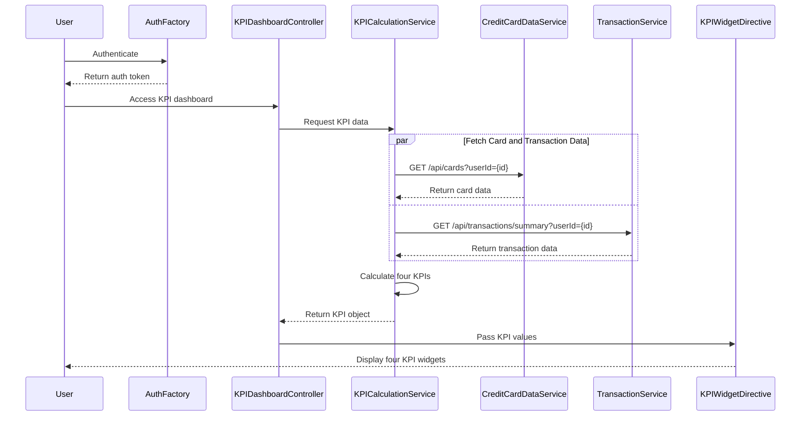

# Low-Level Design: QE-7714 - Dashboard and KPI Management

## a. Architecture Mapping

- **AngularJS Module**: `kpiDashboardModule` - Main module for KPI dashboard
- **Controller**: `KPIDashboardController` - Manages KPI dashboard view and interactions
- **Service**: `CreditCardDataService` - Fetches card details and limits via REST API
- **Service**: `TransactionService` - Fetches monthly spend and outstanding amounts
- **Service**: `KPICalculationService` - Calculates and aggregates four KPIs
- **Directive**: `kpiWidget` - Renders individual KPI widget with responsive design
- **Factory**: `AuthFactory` - Manages user authentication state

**Folder Structure:**
```
/app
  /modules
    /kpi-dashboard
      /controllers
        - kpi-dashboard.controller.js
      /services
        - credit-card-data.service.js
        - transaction.service.js
        - kpi-calculation.service.js
      /directives
        - kpi-widget.directive.js
      /factories
        - auth.factory.js
      /views
        - kpi-dashboard.html
      - kpi-dashboard.module.js
```

## b. Component Specifications

| Name | Artifact Type | Responsibility | Key Dependencies |
|------|---------------|----------------|------------------|
| kpiDashboardModule | Module | Registers KPI dashboard components and responsive layout config | angular, ui.router, ngAnimate |
| KPIDashboardController | Controller | Manages KPI dashboard state, handles data refresh, user interactions | KPICalculationService, AuthFactory, $scope |
| CreditCardDataService | Service | Fetches card details, credit limits from REST API | $http, $q |
| TransactionService | Service | Fetches monthly spend, outstanding amounts from REST API | $http, $q |
| KPICalculationService | Service | Calculates four KPIs by aggregating card and transaction data | CreditCardDataService, TransactionService |
| kpiWidget | Directive | Renders responsive KPI widget with icon, title, value, color coding | None |
| AuthFactory | Factory | Manages authentication token and user session state | $window, $http |

## c. Data Model

**KPI Object:**
```javascript
{
  monthlySpend: {
    value: Number,
    currency: String,
    trend: String // up, down, stable
  },
  totalCreditLimit: {
    value: Number,
    currency: String
  },
  availableCredit: {
    value: Number,
    currency: String,
    percentage: Number // of total limit
  },
  outstandingAmount: {
    value: Number,
    currency: String,
    dueDate: Date
  }
}
```

**CardData Object:**
```javascript
{
  cardId: String,
  creditLimit: Number,
  availableCredit: Number
}
```

**TransactionData Object:**
```javascript
{
  userId: String,
  currentMonthSpend: Number,
  totalOutstanding: Number
}
```

## d. Data Flow

User authenticates via AuthFactory → KPIDashboardController initializes and calls KPICalculationService → Service makes parallel REST API calls via CreditCardDataService (GET /api/cards) and TransactionService (GET /api/transactions/summary) → CreditCardDataService returns card list with limits and available credit → TransactionService returns monthly spend and outstanding amounts → KPICalculationService aggregates data to compute four KPIs (sums credit limits, available credit, retrieves monthly spend and outstanding) → Controller updates $scope with KPI object → kpiWidget directive renders four responsive widgets with values → Dashboard displays consolidated KPIs in responsive layout.

## e. Primary Sequence Diagram



## f. Implementation Notes

- Use AngularJS $q.all for parallel API calls to meet 2-second load time requirement
- KPICalculationService implements memoization to cache KPI calculations for repeated requests
- kpiWidget directive uses CSS media queries and Bootstrap responsive classes for cross-device compatibility
- AuthFactory stores JWT token in $window.sessionStorage and injects it in $http interceptor
- Implement real-time refresh using $interval with user-configurable refresh rate

## g. Error Handling

HTTP interceptor handles API failures; controller displays error notification with retry option; partial data display if one API call fails.

## h. Security Notes

Requires token-based auth via existing SSO; all API endpoints validate JWT token before returning data; HTTPS enforced for all communications.