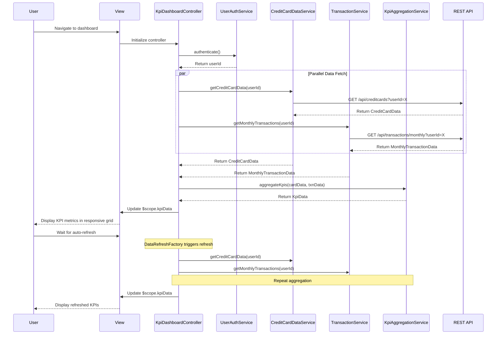

# Low-Level Design: QE-7714 - Dashboard and KPI Management

## a. Architecture Mapping

**AngularJS Artifacts:**
- **Module:** `kpiDashboardModule` - Root module for KPI dashboard feature
- **Controller:** `KpiDashboardController` - Manages KPI dashboard view state and data orchestration
- **Service:** `UserAuthService` - Handles user authentication and authorization
- **Service:** `CreditCardDataService` - Retrieves card details and credit limits
- **Service:** `TransactionService` - Fetches monthly spend and outstanding amounts
- **Service:** `KpiAggregationService` - Computes aggregated KPI metrics from card and transaction data
- **Directive:** `kpiMetricDirective` - Renders individual KPI metric tile with value and label
- **Directive:** `responsiveGridDirective` - Manages responsive grid layout for KPI tiles
- **Factory:** `DataRefreshFactory` - Provides configurable auto-refresh mechanism for KPI data

**Folder Structure:**
```
app/
├── modules/
│   └── kpi-dashboard/
│       ├── controllers/
│       │   └── kpi-dashboard.controller.js
│       ├── services/
│       │   ├── user-auth.service.js
│       │   ├── credit-card-data.service.js
│       │   ├── transaction.service.js
│       │   └── kpi-aggregation.service.js
│       ├── directives/
│       │   ├── kpi-metric.directive.js
│       │   └── responsive-grid.directive.js
│       ├── factories/
│       │   └── data-refresh.factory.js
│       ├── views/
│       │   └── kpi-dashboard.html
│       └── kpi-dashboard.module.js
```

## b. Component Specifications

| Component Name | Artifact Type | Responsibility | Key Dependencies |
|----------------|---------------|----------------|------------------|
| kpiDashboardModule | Module | Registers all KPI dashboard components and configures routing | angular, ngRoute |
| KpiDashboardController | Controller | Orchestrates KPI data retrieval, manages view state, handles real-time refresh | UserAuthService, CreditCardDataService, TransactionService, KpiAggregationService, DataRefreshFactory |
| UserAuthService | Service | Authenticates user and retrieves userId from session | $http, $q, $window |
| CreditCardDataService | Service | Fetches card details and credit limits from `/api/creditcards` | $http, $q |
| TransactionService | Service | Retrieves monthly spend and outstanding amounts from `/api/transactions/monthly` | $http, $q |
| KpiAggregationService | Service | Aggregates card and transaction data to compute Monthly Spend, Total Credit Limit, Available Credit, Outstanding Amount | None |
| kpiMetricDirective | Directive | Renders KPI metric tile with icon, label, value, and optional trend indicator | None |
| responsiveGridDirective | Directive | Applies responsive grid layout using Bootstrap classes based on viewport | None |
| DataRefreshFactory | Factory | Provides $interval-based auto-refresh with configurable interval (default 3 minutes) | $interval |

## c. Data Model

**KpiData Model:**
```javascript
{
  monthlySpend: Number,
  totalCreditLimit: Number,
  availableCredit: Number,
  outstandingAmount: Number,
  lastRefreshed: Date
}
```

**CreditCardData Model:**
```javascript
{
  userId: String,
  cards: Array<{
    cardId: String,
    cardType: String,
    creditLimit: Number,
    currentBalance: Number,
    availableCredit: Number
  }>
}
```

**MonthlyTransactionData Model:**
```javascript
{
  userId: String,
  billingCycle: String, // YYYY-MM
  totalSpend: Number,
  outstandingBalance: Number,
  transactionCount: Number
}
```

## d. Data Flow

User accesses KPI dashboard → UserAuthService validates session and retrieves userId → KpiDashboardController initializes and calls CreditCardDataService to fetch card details via GET `/api/creditcards?userId={userId}` → Simultaneously calls TransactionService to fetch monthly transaction summary via GET `/api/transactions/monthly?userId={userId}` → Both responses are passed to KpiAggregationService which computes KPI metrics: Monthly Spend (from totalSpend), Total Credit Limit (sum of all card limits), Available Credit (sum of all available credit), Outstanding Amount (from outstandingBalance) → Computed KpiData object is bound to $scope → kpiMetricDirective instances render each KPI in responsive grid → DataRefreshFactory triggers periodic refresh every 3 minutes, repeating data fetch and aggregation → User views consolidated financial metrics with real-time updates in responsive layout optimized for mobile, tablet, and desktop.

## e. Primary Sequence Diagram



## f. Implementation Notes

- Use AngularJS dependency injection for all services; register components in kpiDashboardModule with proper initialization order
- Implement parallel API calls using $q.all() to meet 2-second load time requirement
- Apply responsiveGridDirective with Bootstrap grid system (col-xs-12, col-sm-6, col-md-3) for cross-device compatibility
- Use DataRefreshFactory with $interval; ensure proper cleanup on $scope.$destroy to prevent memory leaks
- Leverage AngularJS filters (currency, number) in kpiMetricDirective template for formatted display

## g. Error Handling

HTTP interceptor handles API errors with user-friendly notifications via toastr; controller implements fallback to cached KPI data in sessionStorage when API calls fail.

## h. Security Notes

Requires token-based authentication via existing SSO; all API endpoints validate JWT tokens server-side; sensitive financial data is transmitted over HTTPS only.