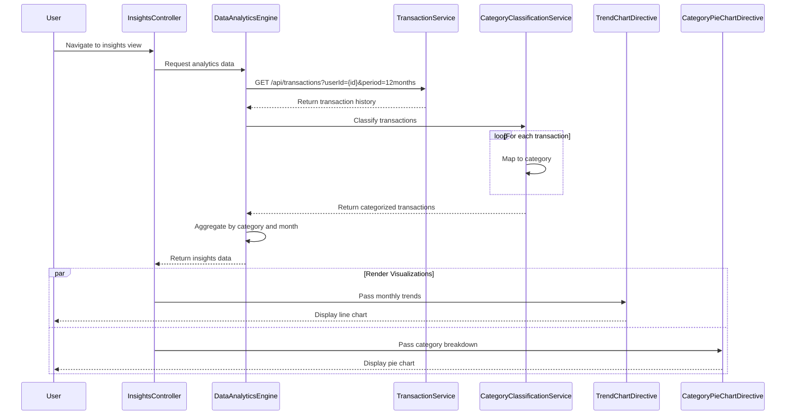

# Low-Level Design: QE-7715 - Analytics and Spending Insights

## a. Architecture Mapping

- **AngularJS Module**: `spendingInsightsModule` - Main module for analytics and insights
- **Controller**: `InsightsController` - Manages insights view and user interactions
- **Service**: `TransactionService` - Fetches historical transaction data via REST API
- **Service**: `CategoryClassificationService` - Maps transactions to 9 categories
- **Service**: `DataAnalyticsEngine` - Aggregates spending and calculates trends
- **Directive**: `trendChart` - Renders monthly trend line charts
- **Directive**: `categoryPieChart` - Renders category breakdown pie chart
- **Factory**: `VisualizationFactory` - Configures Chart.js visualization settings

**Folder Structure:**
```
/app
  /modules
    /spending-insights
      /controllers
        - insights.controller.js
      /services
        - transaction.service.js
        - category-classification.service.js
        - data-analytics-engine.service.js
      /directives
        - trend-chart.directive.js
        - category-pie-chart.directive.js
      /factories
        - visualization.factory.js
      /views
        - insights.html
      - spending-insights.module.js
```

## b. Component Specifications

| Name | Artifact Type | Responsibility | Key Dependencies |
|------|---------------|----------------|------------------|
| spendingInsightsModule | Module | Registers insights components and visualization libraries | angular, ui.router, chart.js |
| InsightsController | Controller | Manages insights view state, handles time period selection | DataAnalyticsEngine, $scope, $filter |
| TransactionService | Service | Fetches historical transactions from REST API | $http, $q |
| CategoryClassificationService | Service | Classifies transactions into 9 predefined categories | None |
| DataAnalyticsEngine | Service | Aggregates spending by category/month, calculates trends | TransactionService, CategoryClassificationService |
| trendChart | Directive | Renders interactive line chart for monthly spend trends | VisualizationFactory, Chart.js |
| categoryPieChart | Directive | Renders interactive pie chart for category breakdown | VisualizationFactory, Chart.js |
| VisualizationFactory | Factory | Provides Chart.js configuration and color schemes | chart.js |

## c. Data Model

**Transaction Object:**
```javascript
{
  id: String,
  userId: String,
  amount: Number,
  merchantName: String,
  merchantCode: String,
  category: String, // One of 9 categories
  transactionDate: Date
}
```

**CategoryInsight Object:**
```javascript
{
  category: String, // Food & Dining, Fuel, Shopping, Travel, Entertainment, Utilities, Healthcare, Education, Miscellaneous
  totalSpend: Number,
  transactionCount: Number,
  percentageOfTotal: Number
}
```

**MonthlyTrend Object:**
```javascript
{
  month: String, // YYYY-MM
  totalSpend: Number,
  categoryBreakdown: Array<CategoryInsight>
}
```

## d. Data Flow

User navigates to insights view → InsightsController calls DataAnalyticsEngine → Engine fetches historical transactions via TransactionService REST API (GET /api/transactions?userId={id}&startDate={date}&endDate={date}) → CategoryClassificationService classifies each transaction into one of 9 categories using merchant code and description → DataAnalyticsEngine aggregates spending by category and month, calculates percentage breakdown and trends → Controller updates $scope with category insights and monthly trends → trendChart directive renders line chart showing monthly spend over time → categoryPieChart directive renders pie chart showing category breakdown → User interacts with charts to explore insights.

## e. Primary Sequence Diagram



## f. Implementation Notes

- Use AngularJS $http with pagination support for fetching large transaction datasets (10,000+ transactions)
- CategoryClassificationService uses merchant code lookup table with fallback to keyword matching
- DataAnalyticsEngine uses ES6 Map and reduce for efficient aggregation of large datasets
- trendChart and categoryPieChart directives use Chart.js with responsive configuration
- Implement date range picker for user-selectable time periods using AngularJS datepicker

## g. Error Handling

HTTP interceptor handles API errors; controller displays error message with retry button; graceful degradation if classification fails for some transactions.

## h. Security Notes

Requires token-based auth via existing SSO; API validates user ownership of transaction data; sensitive transaction details masked in UI.