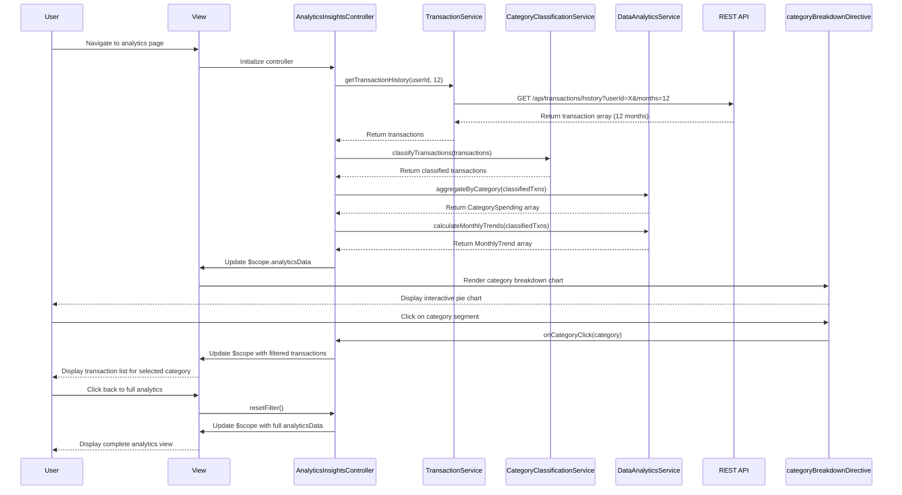

# Low-Level Design: QE-7715 - Analytics and Spending Insights

## a. Architecture Mapping

**AngularJS Artifacts:**
- **Module:** `analyticsInsightsModule` - Root module for analytics and insights feature
- **Controller:** `AnalyticsInsightsController` - Manages analytics view state and user interactions
- **Service:** `TransactionService` - Retrieves historical transaction data from backend
- **Service:** `CategoryClassificationService` - Maps transactions to 9 predefined spending categories
- **Service:** `DataAnalyticsService` - Aggregates spending data by category and time period
- **Directive:** `categoryBreakdownDirective` - Renders pie chart for category-wise spending breakdown
- **Directive:** `monthlyTrendDirective` - Renders line chart for monthly spend trends
- **Directive:** `drillDownDirective` - Provides interactive drill-down into specific categories
- **Factory:** `VisualizationConfigFactory` - Provides chart configuration and color schemes

**Folder Structure:**
```
app/
├── modules/
│   └── analytics-insights/
│       ├── controllers/
│       │   └── analytics-insights.controller.js
│       ├── services/
│       │   ├── transaction.service.js
│       │   ├── category-classification.service.js
│       │   └── data-analytics.service.js
│       ├── directives/
│       │   ├── category-breakdown.directive.js
│       │   ├── monthly-trend.directive.js
│       │   └── drill-down.directive.js
│       ├── factories/
│       │   └── visualization-config.factory.js
│       ├── views/
│       │   └── analytics-insights.html
│       └── analytics-insights.module.js
```

## b. Component Specifications

| Component Name | Artifact Type | Responsibility | Key Dependencies |
|----------------|---------------|----------------|------------------|
| analyticsInsightsModule | Module | Registers all analytics components and configures routing | angular, ngRoute, Chart.js |
| AnalyticsInsightsController | Controller | Manages analytics view state, coordinates data retrieval and visualization rendering | TransactionService, CategoryClassificationService, DataAnalyticsService, VisualizationConfigFactory |
| TransactionService | Service | Fetches historical transaction data from `/api/transactions/history` | $http, $q |
| CategoryClassificationService | Service | Classifies transactions into 9 categories: Food & Dining, Fuel, Shopping, Travel, Entertainment, Utilities, Healthcare, Education, Miscellaneous | None |
| DataAnalyticsService | Service | Aggregates spending by category and time period, calculates monthly trends | None |
| categoryBreakdownDirective | Directive | Renders interactive pie/donut chart showing category-wise spending percentages | VisualizationConfigFactory, Chart.js |
| monthlyTrendDirective | Directive | Renders line chart displaying monthly spend trends over 12 months | VisualizationConfigFactory, Chart.js |
| drillDownDirective | Directive | Handles click events on chart segments to display detailed transaction list for selected category | None |
| VisualizationConfigFactory | Factory | Provides reusable chart configurations, color palettes, and formatting options | None |

## c. Data Model

**Transaction Model:**
```javascript
{
  transactionId: String,
  userId: String,
  cardId: String,
  amount: Number,
  currency: String,
  merchant: String,
  category: String, // One of 9 predefined categories
  transactionDate: Date,
  description: String
}
```

**CategorySpending Model:**
```javascript
{
  category: String,
  totalAmount: Number,
  percentage: Number,
  transactionCount: Number,
  color: String // Chart color
}
```

**MonthlyTrend Model:**
```javascript
{
  month: String, // YYYY-MM
  totalSpend: Number,
  categoryBreakdown: Array<CategorySpending>
}
```

**AnalyticsData Model:**
```javascript
{
  categorySpending: Array<CategorySpending>,
  monthlyTrends: Array<MonthlyTrend>,
  totalSpend: Number,
  period: String // e.g., "Last 12 Months"
}
```

## d. Data Flow

User navigates to analytics insights page → AnalyticsInsightsController initializes and calls TransactionService to fetch historical transactions via GET `/api/transactions/history?userId={userId}&months=12` → Retrieved transactions are passed to CategoryClassificationService which assigns each transaction to one of 9 predefined categories → Classified transactions are sent to DataAnalyticsService which aggregates spending by category (computing totals and percentages) and calculates monthly trends → DataAnalyticsService returns AnalyticsData object containing categorySpending and monthlyTrends arrays → Controller binds AnalyticsData to $scope → categoryBreakdownDirective and monthlyTrendDirective watch scope data and render interactive charts using Chart.js with configurations from VisualizationConfigFactory → User clicks on chart segment → drillDownDirective captures event and filters transactions by selected category → Controller updates $scope with filtered data → View displays detailed transaction list for selected category with option to return to full analytics view.

## e. Primary Sequence Diagram



## f. Implementation Notes

- Use AngularJS dependency injection to inject services into controller; register all components in analyticsInsightsModule
- Implement Chart.js integration via directive link function; use $scope.$watch to trigger chart updates on data changes
- Leverage ES6 array methods (map, filter, reduce) in DataAnalyticsService for efficient aggregation
- Apply AngularJS filters (currency, date) in drill-down view for formatted transaction display
- Cache classified transactions in service to avoid re-classification on filter changes

## g. Error Handling

HTTP interceptor captures API errors and displays user notifications; controller falls back to cached analytics data when API calls fail; empty state message displayed when no transactions exist.

## h. Security Notes

Requires token-based authentication via existing SSO; userId is validated server-side; transaction data is filtered by userId to prevent unauthorized access.