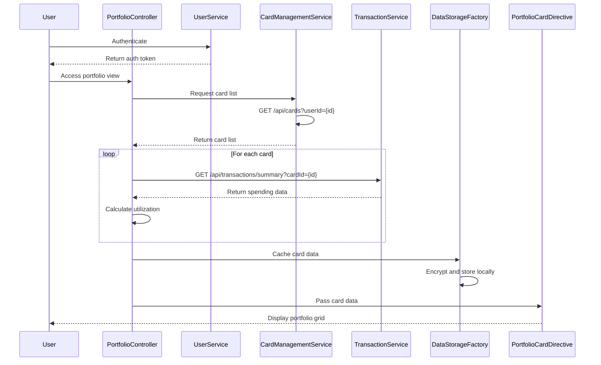

# Low-Level Design: QE-7716 - Credit Card Portfolio Management

## a. Architecture Mapping

- **AngularJS Module**: `portfolioManagementModule` - Main module for portfolio features
- **Controller**: `PortfolioController` - Manages portfolio view and card interactions
- **Service**: `CardManagementService` - Handles card CRUD operations via REST API
- **Service**: `TransactionService` - Fetches card-specific transaction data
- **Service**: `UserService` - Manages user authentication and card associations
- **Directive**: `portfolioCard` - Renders individual card in portfolio grid
- **Factory**: `DataStorageFactory` - Manages local data caching and encryption

**Folder Structure:**
```
/app
  /modules
    /portfolio-management
      /controllers
        - portfolio.controller.js
      /services
        - card-management.service.js
        - transaction.service.js
        - user.service.js
      /directives
        - portfolio-card.directive.js
      /factories
        - data-storage.factory.js
      /views
        - portfolio.html
      - portfolio-management.module.js
```

## b. Component Specifications

| Name | Artifact Type | Responsibility | Key Dependencies |
|------|---------------|----------------|------------------|
| portfolioManagementModule | Module | Registers portfolio components and security config | angular, ui.router, ngCrypto |
| PortfolioController | Controller | Manages portfolio view, handles card selection and filtering | CardManagementService, UserService, $scope |
| CardManagementService | Service | Performs card CRUD operations via REST API | $http, $q, DataStorageFactory |
| TransactionService | Service | Fetches card-specific transaction history | $http, $q |
| UserService | Service | Manages user authentication and card-user associations | $http, AuthFactory |
| portfolioCard | Directive | Renders card tile with details, spending, utilization | None |
| DataStorageFactory | Factory | Manages encrypted local storage for card data caching | $window, CryptoJS |

## c. Data Model

**CreditCard Object:**
```javascript
{
  cardId: String,
  userId: String,
  cardNumber: String, // Masked
  cardType: String,
  issuer: String,
  creditLimit: Number,
  availableCredit: Number,
  currentBalance: Number,
  utilizationPercentage: Number,
  status: String
}
```

**CardSpending Object:**
```javascript
{
  cardId: String,
  monthlySpend: Number,
  yearlySpend: Number,
  lastTransactionDate: Date
}
```

**PortfolioSummary Object:**
```javascript
{
  totalCards: Number,
  totalCreditLimit: Number,
  totalAvailableCredit: Number,
  totalOutstanding: Number,
  averageUtilization: Number
}
```

## d. Data Flow

User authenticates via UserService → PortfolioController initializes and calls CardManagementService → Service fetches user's card list via REST API (GET /api/cards?userId={id}) → For each card, TransactionService fetches spending data → CardManagementService calculates utilization percentage for each card → DataStorageFactory caches encrypted card data locally → Controller updates $scope with card list and portfolio summary → portfolioCard directive renders each card in responsive grid layout → User clicks card to view details or perform actions.

## e. Primary Sequence Diagram



## f. Implementation Notes

- Use AngularJS $http with retry logic for transient API failures to ensure data retrieval within 1-second NFR
- CardManagementService implements optimistic locking for concurrent card updates
- portfolioCard directive uses isolate scope and emits custom events for card actions
- DataStorageFactory uses CryptoJS for AES-256 encryption of cached card data
- Implement infinite scroll or pagination for users with 10+ cards to optimize initial load

## g. Error Handling

HTTP interceptor handles API errors; controller displays error modal with retry/cancel options; local cache used as fallback if API unavailable.

## h. Security Notes

Requires token-based auth via existing SSO; card data encrypted at rest using AES-256; sensitive fields masked before display; HTTPS enforced for all API calls.