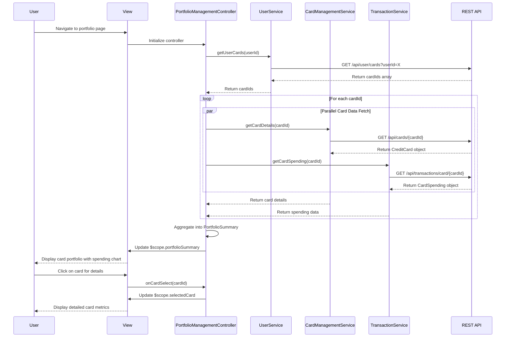

# Low-Level Design: QE-7716 - Credit Card Portfolio Management

## a. Architecture Mapping

**AngularJS Artifacts:**
- **Module:** `portfolioManagementModule` - Root module for credit card portfolio feature
- **Controller:** `PortfolioManagementController` - Manages portfolio view state and user interactions
- **Service:** `UserService` - Handles user authentication and card-user association
- **Service:** `CardManagementService` - Retrieves and manages card data (CRUD operations)
- **Service:** `TransactionService` - Fetches card-specific transaction and spending data
- **Directive:** `cardPortfolioDirective` - Renders list of credit cards with details
- **Directive:** `cardDetailDirective` - Displays detailed view of individual card metrics
- **Directive:** `cardSpendingChartDirective` - Renders card-wise spending comparison chart
- **Filter:** `cardNumberMaskFilter` - Masks card numbers for security (shows last 4 digits)

**Folder Structure:**
```
app/
├── modules/
│   └── portfolio-management/
│       ├── controllers/
│       │   └── portfolio-management.controller.js
│       ├── services/
│       │   ├── user.service.js
│       │   ├── card-management.service.js
│       │   └── transaction.service.js
│       ├── directives/
│       │   ├── card-portfolio.directive.js
│       │   ├── card-detail.directive.js
│       │   └── card-spending-chart.directive.js
│       ├── filters/
│       │   └── card-number-mask.filter.js
│       ├── views/
│       │   └── portfolio-management.html
│       └── portfolio-management.module.js
```

## b. Component Specifications

| Component Name | Artifact Type | Responsibility | Key Dependencies |
|----------------|---------------|----------------|------------------|
| portfolioManagementModule | Module | Registers all portfolio management components and configures routing | angular, ngRoute |
| PortfolioManagementController | Controller | Manages portfolio view state, coordinates card data retrieval and spending analysis | UserService, CardManagementService, TransactionService |
| UserService | Service | Authenticates user and retrieves associated card list from `/api/user/cards` | $http, $q |
| CardManagementService | Service | Performs CRUD operations on card data via `/api/cards` endpoints | $http, $q |
| TransactionService | Service | Fetches card-specific spending data from `/api/transactions/card/{cardId}` | $http, $q |
| cardPortfolioDirective | Directive | Renders scrollable list of cards with type, limit, balance, available credit | cardNumberMaskFilter |
| cardDetailDirective | Directive | Displays detailed metrics for selected card including utilization and recent transactions | None |
| cardSpendingChartDirective | Directive | Renders bar chart comparing spending across multiple cards | Chart.js |
| cardNumberMaskFilter | Filter | Masks card numbers to display only last 4 digits (e.g., **** 1234) | None |

## c. Data Model

**CreditCard Model:**
```javascript
{
  cardId: String,
  userId: String,
  cardType: String, // Visa, Mastercard, Amex, etc.
  cardNumber: String, // Encrypted, masked on client
  cardholderName: String,
  creditLimit: Number,
  currentBalance: Number,
  availableCredit: Number,
  outstandingBalance: Number,
  utilizationPercentage: Number,
  expiryDate: String, // MM/YY
  status: String // Active, Inactive, Blocked
}
```

**CardSpending Model:**
```javascript
{
  cardId: String,
  cardType: String,
  monthlySpend: Number,
  yearlySpend: Number,
  categoryBreakdown: Array<{
    category: String,
    amount: Number
  }>,
  lastTransactionDate: Date
}
```

**PortfolioSummary Model:**
```javascript
{
  userId: String,
  totalCards: Number,
  totalCreditLimit: Number,
  totalAvailableCredit: Number,
  totalUtilization: Number,
  cards: Array<CreditCard>,
  cardSpending: Array<CardSpending>
}
```

## d. Data Flow

User navigates to portfolio management page → PortfolioManagementController initializes and calls UserService to authenticate and retrieve associated card list via GET `/api/user/cards?userId={userId}` → UserService returns array of cardIds → Controller iterates through cardIds and calls CardManagementService for each card via GET `/api/cards/{cardId}` to fetch detailed card information (type, limit, balance, utilization) → Simultaneously calls TransactionService for each card via GET `/api/transactions/card/{cardId}` to fetch card-specific spending data → Retrieved card details and spending data are aggregated into PortfolioSummary model → Controller binds PortfolioSummary to $scope → cardPortfolioDirective renders list of cards with masked card numbers using cardNumberMaskFilter → cardSpendingChartDirective renders comparison chart → User clicks on card to view details → Controller updates $scope with selected card data → cardDetailDirective displays detailed metrics including utilization, outstanding balance, and recent transactions.

## e. Primary Sequence Diagram



## f. Implementation Notes

- Use AngularJS dependency injection for all services; register components in portfolioManagementModule
- Implement parallel API calls using $q.all() to fetch multiple card details simultaneously to meet 1-second retrieval requirement
- Apply cardNumberMaskFilter in templates using pipe syntax: {{card.cardNumber | cardNumberMask}}
- Use ng-repeat with track by cardId for efficient list rendering; implement virtual scrolling for users with 10+ cards
- Encrypt card data at rest using AES-256; ensure HTTPS for all API communications

## g. Error Handling

HTTP interceptor handles API errors with retry logic for transient failures; controller displays error notifications and falls back to cached portfolio data when available.

## h. Security Notes

Requires token-based auth via existing SSO; card numbers are encrypted server-side and masked client-side; all API endpoints validate JWT tokens and enforce userId-based access control.