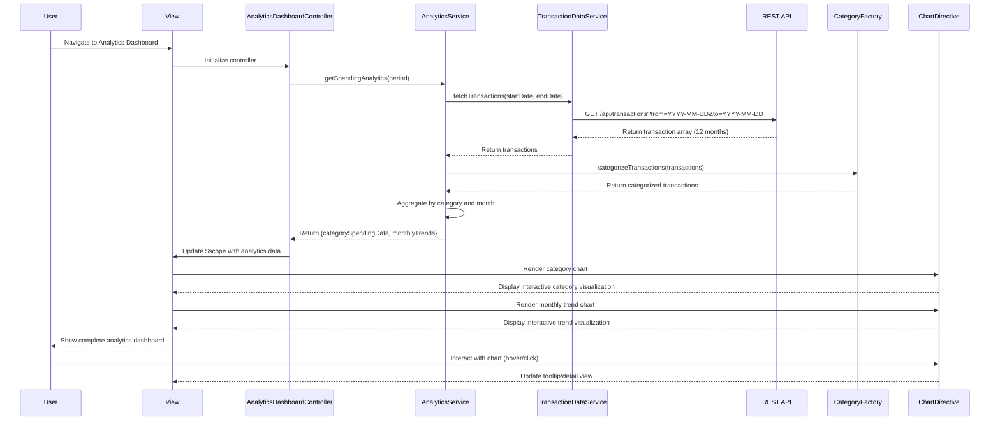

# Low-Level Design: QE-7717 - Spending Analytics and Visualization

## a. Architecture Mapping

- **Analytics Dashboard UI** → AngularJS Module (`analyticsModule`) + Controller (`AnalyticsDashboardController`)
- **Visualization Library** → Third-party Directive wrapper (`chartDirective`) using Chart.js or D3.js
- **Analytics Engine** → AngularJS Service (`AnalyticsService`) for data aggregation and computation
- **Categorization Engine** → AngularJS Factory (`CategoryFactory`) for transaction classification logic
- **Transaction Data Service** → AngularJS Service (`TransactionDataService`) for API communication
- **Historical Data Store** → Backend REST API endpoints

**Recommended Folder Structure:**
```
app/
├── modules/analytics/
│   ├── analytics.module.js
│   ├── controllers/analytics-dashboard.controller.js
│   ├── services/analytics.service.js
│   ├── services/transaction-data.service.js
│   ├── factories/category.factory.js
│   ├── directives/chart.directive.js
│   └── views/analytics-dashboard.html
├── shared/
│   └── constants/categories.constant.js
└── assets/css/analytics.css
```

## b. Component Specifications

| Component Name | Artifact Type | Responsibility | Key Dependencies |
|----------------|---------------|----------------|------------------|
| analyticsModule | Module | Root module for analytics feature, registers all analytics components | angular, ngRoute, chart.js |
| AnalyticsDashboardController | Controller | Manages analytics dashboard view state, user interactions, and data binding | AnalyticsService, CategoryFactory, $scope |
| AnalyticsService | Service | Aggregates transaction data, computes category-wise and monthly trends | TransactionDataService, CategoryFactory, $q |
| TransactionDataService | Service | Fetches historical transaction data from REST API (12 months minimum) | $http, $q, API_CONFIG |
| CategoryFactory | Factory | Classifies transactions into 9 predefined categories, provides category metadata | CATEGORIES_CONSTANT |
| chartDirective | Directive | Wraps Chart.js/D3.js for rendering interactive, responsive visualizations | Chart.js/D3.js library, $window |
| CATEGORIES_CONSTANT | Constant | Defines 9 spending categories: Food & Dining, Fuel, Shopping, Travel, Entertainment, Utilities, Healthcare, Education, Miscellaneous | None |

## c. Data Model

**Transaction Object:**
```javascript
{
  transactionId: String,
  cardId: String,
  amount: Number,
  category: String, // One of 9 predefined categories
  date: Date,
  description: String,
  merchantName: String
}
```

**CategorySpending Object:**
```javascript
{
  categoryName: String,
  totalAmount: Number,
  transactionCount: Number,
  percentage: Number
}
```

**MonthlyTrend Object:**
```javascript
{
  month: String, // YYYY-MM format
  totalSpend: Number,
  categoryBreakdown: Array<CategorySpending>
}
```

**AnalyticsViewModel (Controller scope):**
```javascript
{
  categorySpendingData: Array<CategorySpending>,
  monthlyTrends: Array<MonthlyTrend>,
  selectedPeriod: String, // e.g., 'last12months'
  isLoading: Boolean,
  errorMessage: String
}
```

## d. Data Flow

User navigates to Analytics Dashboard → AnalyticsDashboardController initializes and calls AnalyticsService.getSpendingAnalytics() → AnalyticsService invokes TransactionDataService to fetch 12 months of transaction history via REST API → CategoryFactory classifies each transaction into one of 9 categories → AnalyticsService aggregates data into category-wise totals and monthly trends → Controller updates scope with computed data → chartDirective renders interactive visualizations (category pie/bar chart and monthly trend line chart) → User interacts with charts (hover, click) triggering directive event handlers that update view details in real-time.

## e. Primary Sequence Diagram



## f. Implementation Notes

- Use AngularJS 1.x module pattern with dependency injection for all services, factories, and controllers
- Leverage ES6 classes for service definitions, transpiled via Babel for browser compatibility
- Implement Chart.js via custom directive with two-way data binding for responsive, interactive charts
- Use $http interceptor for API authentication token injection and global error handling
- Pre-aggregate monthly data on initial load and cache in AnalyticsService to meet 1.5s rendering NFR
- Apply Bootstrap grid system and CSS3 media queries for responsive layout across devices
- Use $q promises for asynchronous data flow and error propagation

## g. Error Handling

HTTP interceptor captures API errors; service layer wraps calls in try/catch; user notified via toast/alert directive on failure.

## h. Security Notes

Requires token-based authentication via existing SSO; all API calls include auth header; standard input validation applied.