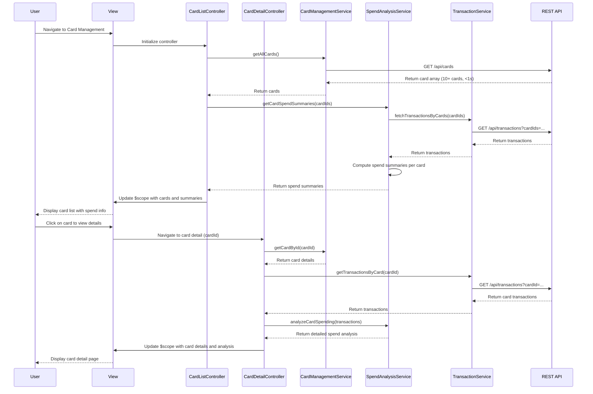

# Low-Level Design: QE-7718 - Credit Card Management and Tracking

## a. Architecture Mapping

- **User Interface** → AngularJS Module (`cardManagementModule`) + Controller (`CardListController`, `CardDetailController`)
- **Card Management Module** → AngularJS Service (`CardManagementService`) for business logic and state management
- **Card Data Repository** → Backend REST API endpoints for card CRUD operations
- **Transaction Service** → AngularJS Service (`TransactionService`) for fetching card-wise transaction data
- **Spend Analysis Engine** → AngularJS Service (`SpendAnalysisService`) for computing card-wise spending metrics

**Recommended Folder Structure:**
```
app/
├── modules/card-management/
│   ├── card-management.module.js
│   ├── controllers/card-list.controller.js
│   ├── controllers/card-detail.controller.js
│   ├── services/card-management.service.js
│   ├── services/transaction.service.js
│   ├── services/spend-analysis.service.js
│   └── views/
│       ├── card-list.html
│       └── card-detail.html
├── shared/
│   └── filters/card-filter.js
└── assets/css/card-management.css
```

## b. Component Specifications

| Component Name | Artifact Type | Responsibility | Key Dependencies |
|----------------|---------------|----------------|------------------|
| cardManagementModule | Module | Root module for card management feature, registers all card-related components | angular, ngRoute |
| CardListController | Controller | Manages card list view, handles card selection, filtering, and navigation to details | CardManagementService, SpendAnalysisService, $scope |
| CardDetailController | Controller | Manages individual card detail view, displays card-specific balances and spend analysis | CardManagementService, TransactionService, SpendAnalysisService, $routeParams, $scope |
| CardManagementService | Service | Fetches and caches card data from API, manages card state (supports min 10 cards/user) | $http, $q, API_CONFIG |
| TransactionService | Service | Retrieves card-wise transaction history from REST API | $http, $q, API_CONFIG |
| SpendAnalysisService | Service | Computes card-wise spending totals, trends, and comparisons | TransactionService, $q |
| cardFilter | Filter | Client-side filtering of cards by name, type, or status | None |

## c. Data Model

**CreditCard Object:**
```javascript
{
  cardId: String,
  cardNumber: String, // Masked, e.g., "****1234"
  cardHolderName: String,
  cardType: String, // e.g., "Visa", "MasterCard"
  creditLimit: Number,
  availableCredit: Number,
  outstandingAmount: Number,
  expiryDate: String, // MM/YY format
  status: String // "Active", "Blocked", "Expired"
}
```

**CardSpendSummary Object:**
```javascript
{
  cardId: String,
  monthlySpend: Number,
  totalTransactions: Number,
  lastTransactionDate: Date,
  categoryBreakdown: Array<{category: String, amount: Number}>
}
```

**CardListViewModel (Controller scope):**
```javascript
{
  cards: Array<CreditCard>,
  selectedCard: CreditCard,
  spendSummaries: Object, // Map of cardId to CardSpendSummary
  filterText: String,
  isLoading: Boolean,
  errorMessage: String
}
```

**CardDetailViewModel (Controller scope):**
```javascript
{
  card: CreditCard,
  spendSummary: CardSpendSummary,
  recentTransactions: Array<Transaction>,
  isLoading: Boolean,
  errorMessage: String
}
```

## d. Data Flow

User navigates to Card Management page → CardListController initializes and calls CardManagementService.getAllCards() → Service fetches card list via GET /api/cards REST endpoint (retrieves up to 10+ cards within 1 second per NFR) → Controller receives card array and updates scope → SpendAnalysisService.getCardSpendSummaries() is invoked to fetch spend data for all cards → View renders card list with filtering capability → User selects a card → CardDetailController loads, retrieves card details and transactions via CardManagementService and TransactionService → SpendAnalysisService computes card-specific metrics → View displays detailed card information, balances, and spend analysis.

## e. Primary Sequence Diagram



## f. Implementation Notes

- Use AngularJS 1.x with ES6 classes for service definitions, ensuring clean dependency injection
- Implement client-side card filtering using AngularJS filter for instant response without server round-trips
- Cache card data in CardManagementService using in-memory object to avoid redundant API calls
- Apply $http interceptor for token injection and global error handling across all API requests
- Use ngRoute for navigation between card list and card detail views with cardId as route parameter
- Ensure data encryption requirements (at rest/in transit) are met via HTTPS and backend encryption
- Bootstrap grid and CSS3 for responsive card layout across mobile, tablet, and desktop

## g. Error Handling

HTTP interceptor-based error capture; service-level try/catch with promise rejection; user notification via alert/toast component.

## h. Security Notes

Requires token-based auth via existing SSO; card numbers masked on client; data encrypted at rest and in transit per NFR.