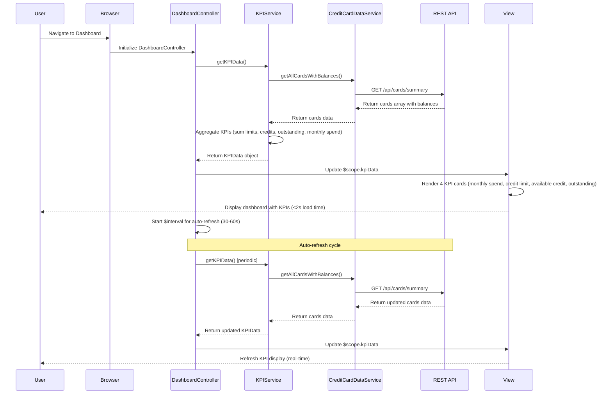

# Low-Level Design: QE-7719 - Credit Card Dashboard and KPI Management

## a. Architecture Mapping

- **User Browser** → AngularJS SPA entry point
- **Authentication Service** → Existing SSO integration (out of scope for this LLD, assumed available)
- **Dashboard UI Component** → AngularJS Module (`dashboardModule`) + Controller (`DashboardController`) + View (`dashboard.html`)
- **KPI Calculation Engine** → AngularJS Service (`KPIService`) for aggregating and computing KPIs
- **Credit Card Data Service** → AngularJS Service (`CreditCardDataService`) for REST API communication
- **Data Repository** → Backend REST API endpoints

**Recommended Folder Structure:**
```
app/
├── modules/dashboard/
│   ├── dashboard.module.js
│   ├── controllers/dashboard.controller.js
│   ├── services/kpi.service.js
│   ├── services/credit-card-data.service.js
│   └── views/dashboard.html
├── shared/
│   └── directives/kpi-card.directive.js
└── assets/css/dashboard.css
```

## b. Component Specifications

| Component Name | Artifact Type | Responsibility | Key Dependencies |
|----------------|---------------|----------------|------------------|
| dashboardModule | Module | Root module for dashboard feature, registers all dashboard components | angular, ngRoute |
| DashboardController | Controller | Manages dashboard view state, orchestrates KPI data loading and real-time refresh | KPIService, CreditCardDataService, $scope, $interval |
| KPIService | Service | Computes KPIs (monthly spend, total credit limit, available credit, outstanding amount) from card data | CreditCardDataService, $q |
| CreditCardDataService | Service | Fetches credit card details, balances, and transaction data from REST API | $http, $q, API_CONFIG |
| kpiCardDirective | Directive | Reusable UI component for displaying individual KPI with icon, label, and value | None |

## c. Data Model

**CreditCard Object:**
```javascript
{
  cardId: String,
  cardNumber: String, // Masked
  creditLimit: Number,
  availableCredit: Number,
  outstandingAmount: Number,
  currentMonthSpend: Number
}
```

**KPIData Object:**
```javascript
{
  monthlySpend: Number,
  totalCreditLimit: Number,
  totalAvailableCredit: Number,
  totalOutstandingAmount: Number
}
```

**DashboardViewModel (Controller scope):**
```javascript
{
  kpiData: KPIData,
  cards: Array<CreditCard>,
  lastRefreshTime: Date,
  isLoading: Boolean,
  errorMessage: String
}
```

## d. Data Flow

User accesses dashboard URL → AngularJS router loads DashboardController → Controller calls KPIService.getKPIData() → KPIService invokes CreditCardDataService.getAllCardsWithBalances() → Service makes GET request to /api/cards/summary REST endpoint → API returns array of card objects with balances and current month spend → CreditCardDataService returns data to KPIService → KPIService aggregates across all cards to compute total monthly spend, total credit limit, total available credit, and total outstanding amount → KPIService returns KPIData object to Controller → Controller updates $scope.kpiData → View renders four KPI cards via kpiCardDirective → $interval triggers refresh every 30-60 seconds, repeating the data fetch and update cycle for real-time visibility.

## e. Primary Sequence Diagram



## f. Implementation Notes

- Use AngularJS 1.x module pattern with strict dependency injection for testability and maintainability
- Implement ES6 service classes transpiled via Babel for modern JavaScript syntax
- Use $interval service for periodic data refresh (configurable 30-60 second interval) to meet real-time NFR
- Cache KPI data in KPIService with timestamp to avoid redundant calculations within refresh window
- Apply Bootstrap 4 grid system and CSS3 flexbox for responsive layout across mobile, tablet, desktop
- Use $http interceptor for authentication token injection and centralized error handling
- Implement kpiCardDirective as isolated scope directive for reusable KPI display components
- Optimize API payload by requesting summary endpoint that pre-aggregates data server-side to meet <2s load time NFR

## g. Error Handling

HTTP interceptor captures API failures; service layer uses promise rejection; controller displays error message to user via alert/toast.

## h. Security Notes

Requires token-based auth via existing SSO; all API calls secured with authentication headers; standard input validation applied.