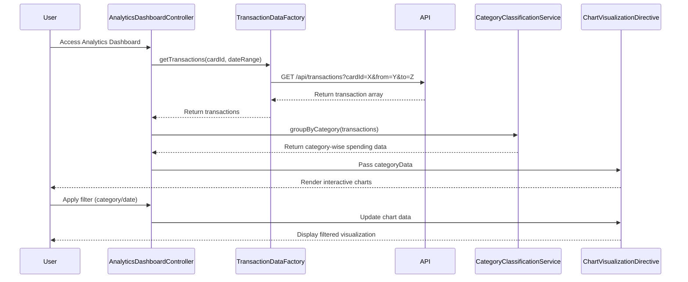

# Low-Level Design: Transaction Analytics and Category Insights
**Epic ID:** QE-7720

## a. Architecture Mapping

- **Analytics Dashboard UI** → AngularJS Module (`app.analytics`) with Controller (`AnalyticsDashboardController`) and View Template (`analytics-dashboard.html`)
- **Analytics Controller** → AngularJS Controller (`AnalyticsController`) managing view logic and user interactions
- **Category Classification Service** → AngularJS Service (`CategoryClassificationService`) for transaction categorization logic
- **Visualization Engine** → AngularJS Directive (`chartVisualization`) wrapping Chart.js for rendering interactive charts
- **Transaction Data Service** → AngularJS Factory (`TransactionDataFactory`) for REST API communication

**Folder Structure:**
```
/app
  /modules
    /analytics
      analytics.module.js
      analytics.controller.js
      analytics-dashboard.html
  /services
    category-classification.service.js
    transaction-data.factory.js
  /directives
    chart-visualization.directive.js
  /models
    transaction.model.js
```

## b. Component Specifications

| Name | Artifact Type | Responsibility | Key Dependencies |
|------|---------------|----------------|------------------|
| AnalyticsModule | Module | Defines analytics feature module and routes | ngRoute, chart.js |
| AnalyticsDashboardController | Controller | Manages dashboard state, filters, date ranges | TransactionDataFactory, CategoryClassificationService |
| CategoryClassificationService | Service | Classifies transactions into 9 categories | None |
| ChartVisualizationDirective | Directive | Renders interactive charts using Chart.js | Chart.js library |
| TransactionDataFactory | Factory | Fetches transaction data via REST API | $http, $q |
| TransactionModel | Model | Defines transaction object structure | None |

## c. Data Model

**Transaction Model:**
```javascript
{
  id: String,
  cardId: String,
  amount: Number,
  date: Date,
  merchant: String,
  category: String, // One of: Food & Dining, Fuel, Shopping, Travel, Entertainment, Utilities, Healthcare, Education, Miscellaneous
  description: String
}
```

**CategorySpending Model:**
```javascript
{
  category: String,
  totalAmount: Number,
  transactionCount: Number,
  percentage: Number
}
```

## d. Data Flow

User accesses analytics dashboard → `AnalyticsDashboardController` initializes and calls `TransactionDataFactory.getTransactions()` → Factory makes GET request to `/api/transactions` REST endpoint → Response returns transaction array → `CategoryClassificationService.groupByCategory()` processes and aggregates transactions into 9 categories → Aggregated data passed to `ChartVisualizationDirective` → Chart.js renders interactive pie/bar charts → User applies filters (date range, category) → Controller updates model → View re-renders with filtered data via two-way binding.

## e. Primary Sequence Diagram



## f. Implementation Notes

- Use AngularJS Dependency Injection for all services, factories, and controllers to ensure testability and modularity
- Implement ES6 classes for services and use arrow functions for cleaner syntax and lexical `this` binding
- Use `$http` service with promise-based API calls; handle responses with `.then()` and `.catch()` for error handling
- Integrate Chart.js via custom AngularJS directive with isolated scope for reusability across different chart types
- Apply Bootstrap grid system for responsive layout; use `ng-repeat` for dynamic transaction list rendering

## g. Error Handling

HTTP interceptor captures API errors; display user-friendly notifications using Bootstrap alerts or toast service; fallback to cached data if available.

## h. Security Notes

Standard input validation and secure API calls assumed; token-based authentication via existing SSO for API requests.