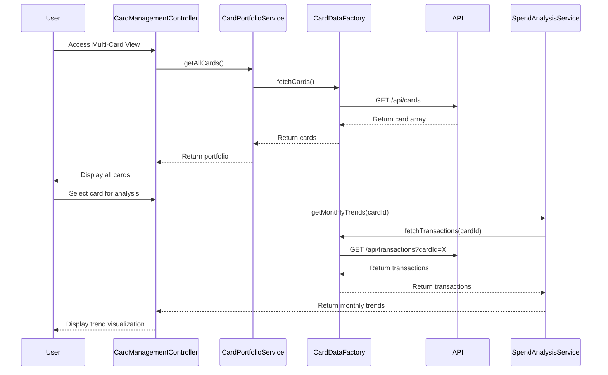

# Low-Level Design: Multi-Card Management and Monitoring
**Epic ID:** QE-7721

## a. Architecture Mapping

- **User Interface** → AngularJS Module (`app.cardManagement`) with Controller (`CardManagementController`) and View Template (`card-management.html`)
- **Card Management Controller** → AngularJS Controller (`CardManagementController`) handling card selection and display logic
- **Card Portfolio Service** → AngularJS Service (`CardPortfolioService`) for multi-card data aggregation
- **Spend Analysis Engine** → AngularJS Service (`SpendAnalysisService`) for card-wise spend calculations and trend analysis
- **Card Data Repository** → REST API integration via AngularJS Factory (`CardDataFactory`)

**Folder Structure:**
```
/app
  /modules
    /card-management
      card-management.module.js
      card-management.controller.js
      card-management.html
  /services
    card-portfolio.service.js
    spend-analysis.service.js
  /factories
    card-data.factory.js
  /models
    card.model.js
```

## b. Component Specifications

| Name | Artifact Type | Responsibility | Key Dependencies |
|------|---------------|----------------|------------------|
| CardManagementModule | Module | Defines card management feature module | ngRoute |
| CardManagementController | Controller | Manages card list, selection, and detail views | CardPortfolioService, SpendAnalysisService |
| CardPortfolioService | Service | Aggregates and manages multiple card data | CardDataFactory |
| SpendAnalysisService | Service | Calculates monthly trends and card-wise spending | None |
| CardDataFactory | Factory | Fetches card details and transaction history via REST | $http, $q |
| CardModel | Model | Defines credit card object structure | None |

## c. Data Model

**Card Model:**
```javascript
{
  cardId: String,
  cardNumber: String, // Masked
  cardType: String, // Visa, Mastercard, etc.
  creditLimit: Number,
  availableCredit: Number,
  outstandingAmount: Number,
  monthlySpend: Number
}
```

**MonthlyTrend Model:**
```javascript
{
  month: String, // YYYY-MM
  totalSpend: Number,
  transactionCount: Number
}
```

## d. Data Flow

User accesses multi-card view → `CardManagementController` calls `CardPortfolioService.getAllCards()` → Service invokes `CardDataFactory.fetchCards()` → Factory makes GET request to `/api/cards` → API returns array of card objects → Cards displayed in UI with summary info → User selects specific card → Controller calls `SpendAnalysisService.getMonthlyTrends(cardId)` → Service requests transaction history from `CardDataFactory` → Monthly aggregation performed → Trend chart rendered with card-specific spending patterns.

## e. Primary Sequence Diagram



## f. Implementation Notes

- Use AngularJS Dependency Injection for service/factory/controller wiring; apply singleton pattern for services
- Implement ES6 classes for service definitions; use `const` and `let` for block-scoped variables
- Use `$http` with promise chaining for sequential API calls; cache card portfolio data in service to reduce API calls
- Apply Bootstrap cards and grid for responsive multi-card layout; use `ng-repeat` with `track by cardId` for performance
- Implement card selection state management using controller scope variables with two-way binding

## g. Error Handling

HTTP interceptor-based error handling with user notifications via Bootstrap modals; retry logic for failed card data fetches.

## h. Security Notes

Requires token-based auth via existing SSO; card numbers masked on client side; secure HTTPS API calls enforced.