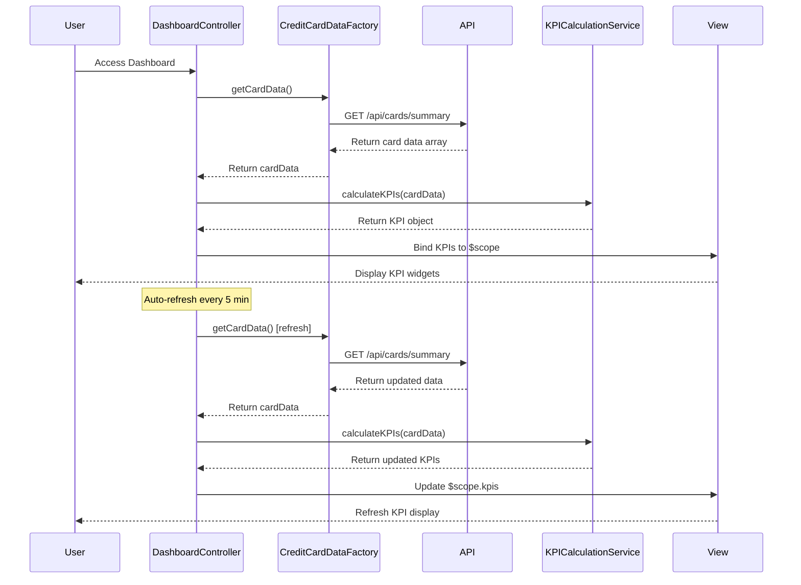

# Low-Level Design: Dashboard and KPI Management
**Epic ID:** QE-7722

## a. Architecture Mapping

- **User Interface Layer** → AngularJS Module (`app.dashboard`) with Controller (`DashboardController`) and View Template (`dashboard.html`)
- **Dashboard Controller** → AngularJS Controller (`DashboardController`) managing KPI display and refresh logic
- **KPI Calculation Engine** → AngularJS Service (`KPICalculationService`) for aggregating and computing KPIs
- **Credit Card Data Service** → AngularJS Factory (`CreditCardDataFactory`) for REST API integration
- **Data Repository** → Backend REST API endpoints

**Folder Structure:**
```
/app
  /modules
    /dashboard
      dashboard.module.js
      dashboard.controller.js
      dashboard.html
  /services
    kpi-calculation.service.js
  /factories
    credit-card-data.factory.js
  /models
    kpi.model.js
```

## b. Component Specifications

| Name | Artifact Type | Responsibility | Key Dependencies |
|------|---------------|----------------|------------------|
| DashboardModule | Module | Defines dashboard feature module and routing | ngRoute |
| DashboardController | Controller | Manages dashboard state, KPI display, auto-refresh | KPICalculationService, CreditCardDataFactory |
| KPICalculationService | Service | Calculates Monthly Spend, Total Credit Limit, Available Credit, Outstanding Amount | None |
| CreditCardDataFactory | Factory | Fetches card balances, limits, transactions via REST | $http, $q, $interval |
| KPIModel | Model | Defines KPI data structure | None |

## c. Data Model

**KPI Model:**
```javascript
{
  monthlySpend: Number,
  totalCreditLimit: Number,
  availableCredit: Number,
  outstandingAmount: Number,
  lastUpdated: Date
}
```

**CardData Model:**
```javascript
{
  cardId: String,
  balance: Number,
  creditLimit: Number,
  currentMonthSpend: Number
}
```

## d. Data Flow

User accesses dashboard → `DashboardController` initializes and calls `CreditCardDataFactory.getCardData()` → Factory makes GET request to `/api/cards/summary` → API returns aggregated card data → `KPICalculationService.calculateKPIs(cardData)` computes four KPIs (Monthly Spend = sum of currentMonthSpend, Total Credit Limit = sum of creditLimit, Available Credit = sum of (creditLimit - balance), Outstanding Amount = sum of balance) → Computed KPIs bound to view via `$scope.kpis` → Dashboard displays KPI widgets using Bootstrap panels → `$interval` triggers auto-refresh every 5 minutes → Updated KPIs re-rendered.

## e. Primary Sequence Diagram



## f. Implementation Notes

- Use AngularJS Dependency Injection for all components; apply service singleton pattern for KPI calculation logic
- Implement ES6 arrow functions in service methods for cleaner code and proper `this` context
- Use `$http` for REST API calls with promise-based error handling; implement `$interval` for periodic data refresh
- Apply Bootstrap grid and panel components for responsive KPI widget layout; use CSS3 media queries for mobile optimization
- Implement loading indicators using `ng-show` bound to controller loading state during API calls

## g. Error Handling

HTTP interceptor captures API failures; display error messages using Bootstrap alerts; gracefully degrade to last known KPI values on refresh failure.

## h. Security Notes

Requires token-based auth via existing SSO; all API calls secured with JWT tokens in headers; input validation on client side.