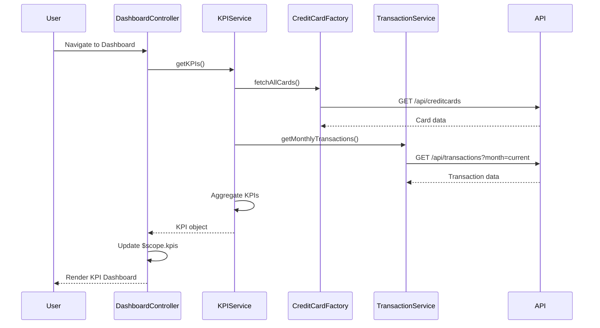

# Low-Level Design: Dashboard and KPI Management
**Epic ID:** QE-7729

## a. Architecture Mapping

- **Dashboard UI Component** → AngularJS Module (`app.dashboard`) with Controller (`DashboardController`)
- **KPI Service** → AngularJS Service (`KPIService`) for aggregating KPI data
- **Credit Card Data Service** → AngularJS Factory (`CreditCardFactory`) for REST API calls
- **Transaction Service** → AngularJS Service (`TransactionService`) for transaction data retrieval
- **Responsive Layout** → HTML5 templates with Bootstrap grid system and CSS3 media queries

**Recommended Folder Structure:**
```
app/
├── modules/
│   └── dashboard/
│       ├── dashboard.module.js
│       ├── dashboard.controller.js
│       ├── dashboard.html
│       └── dashboard.css
├── services/
│   ├── kpi.service.js
│   ├── transaction.service.js
│   └── creditcard.factory.js
└── assets/
    └── styles/
        └── responsive.css
```

## b. Component Specifications

| Component Name | Artifact Type | Responsibility | Key Dependencies |
|---|---|---|---|
| DashboardModule | Module | Root module for dashboard feature | angular, ui.router |
| DashboardController | Controller | Manages dashboard state, fetches and displays KPIs | KPIService, $scope |
| KPIService | Service | Aggregates monthly spend, credit limit, available credit, outstanding amount from backend | CreditCardFactory, TransactionService, $http, $q |
| CreditCardFactory | Factory | Fetches credit card balances and limits via REST API | $http |
| TransactionService | Service | Retrieves transaction data for monthly spend and outstanding calculations | $http |
| DashboardView | HTML Template | Renders KPI cards in responsive grid layout | Bootstrap grid, ng-repeat |

## c. Data Model

**KPI Model:**
```javascript
{
  monthlySpend: Number,
  totalCreditLimit: Number,
  availableCredit: Number,
  outstandingAmount: Number,
  lastUpdated: Date
}
```

**CreditCard Model:**
```javascript
{
  cardId: String,
  cardNumber: String,
  balance: Number,
  creditLimit: Number,
  availableCredit: Number
}
```

## d. Data Flow

User navigates to dashboard → DashboardController initializes and calls KPIService.getKPIs() → KPIService makes parallel REST API calls via CreditCardFactory (for card limits/balances) and TransactionService (for monthly spend/outstanding) → Services return JSON data → KPIService aggregates data into KPI model → Controller updates $scope with KPI data → View renders KPI cards using Bootstrap responsive grid → User sees monthly spend, total credit limit, available credit, and outstanding amount in real-time.

## e. Primary Sequence Diagram



## f. Implementation Notes

- Use AngularJS dependency injection to inject KPIService, CreditCardFactory, and TransactionService into DashboardController
- Leverage $q.all() for parallel API calls to CreditCard and Transaction endpoints to meet 2-second load requirement
- Implement Bootstrap responsive grid (col-xs, col-sm, col-md, col-lg) for mobile, tablet, desktop viewports
- Use $http interceptor for centralized API error handling and loading state management
- Apply ES6 arrow functions and const/let for cleaner service implementations

## g. Error Handling

$http interceptor captures API errors; user-friendly notifications displayed via toastr or Bootstrap alerts on KPI fetch failure.

## h. Security Notes

Standard input validation and secure API calls assumed; token-based authentication via existing SSO for API requests.