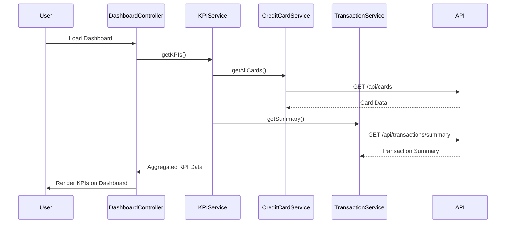

# Low-Level Design: Dashboard and KPI Management
**Epic ID:** QE-7729  
**Epic Title:** PERFTEST20261109161800-Dashboard and KPI Management

---

## a. Architecture Mapping

| HLD Component | AngularJS Artifact | Responsibility |
|---------------|-------------------|----------------|
| Responsive Dashboard UI | Module: `dashboardModule` | Root module for dashboard feature |
| Dashboard UI | Controller: `DashboardController` | Orchestrates KPI display and user interactions |
| KPI Service | Service: `KPIService` | Fetches and aggregates KPI data from backend APIs |
| Credit Card Data Service | Service: `CreditCardService` | Retrieves card balances and limits |
| Transaction Service | Service: `TransactionService` | Retrieves monthly spend and outstanding amounts |
| KPI Display Components | Directive: `kpiCard` | Reusable UI component for individual KPI display |

**Recommended Folder Structure:**
```
app/
├── modules/
│   └── dashboard/
│       ├── dashboard.module.js
│       ├── controllers/
│       │   └── dashboard.controller.js
│       ├── services/
│       │   ├── kpi.service.js
│       │   ├── credit-card.service.js
│       │   └── transaction.service.js
│       ├── directives/
│       │   └── kpi-card.directive.js
│       └── views/
│           └── dashboard.html
```

---

## b. Component Specifications

| Component Name | Artifact Type | Responsibility | Key Dependencies |
|----------------|---------------|----------------|------------------|
| `dashboardModule` | Module | Encapsulates all dashboard-related components | `ngRoute`, `ui.bootstrap` |
| `DashboardController` | Controller | Manages dashboard state, triggers KPI loading, handles refresh | `KPIService`, `$scope`, `$timeout` |
| `KPIService` | Service | Aggregates KPI data from CreditCardService and TransactionService | `CreditCardService`, `TransactionService`, `$http`, `$q` |
| `CreditCardService` | Service | Calls REST API to fetch card balances and limits | `$http`, `API_CONFIG` |
| `TransactionService` | Service | Calls REST API to fetch monthly spend and outstanding amounts | `$http`, `API_CONFIG` |
| `kpiCard` | Directive | Renders individual KPI with icon, label, and value | None |

---

## c. Data Model

**KPI Model (`KPIModel`):**
```javascript
{
  monthlySpend: Number,        // Total spend for current month
  totalCreditLimit: Number,    // Sum of all card limits
  availableCredit: Number,     // Total available credit across cards
  outstandingAmount: Number    // Total outstanding balance
}
```

**Credit Card Model (`CreditCard`):**
```javascript
{
  cardId: String,
  cardNumber: String,
  creditLimit: Number,
  currentBalance: Number,
  availableCredit: Number
}
```

**Transaction Summary Model (`TransactionSummary`):**
```javascript
{
  monthlySpend: Number,
  outstandingAmount: Number
}
```

---

## d. Data Flow

User loads the dashboard → `DashboardController` initializes and calls `KPIService.getKPIs()` → `KPIService` concurrently invokes `CreditCardService.getAllCards()` and `TransactionService.getSummary()` → Both services make REST API calls to backend endpoints → Services return promises resolved with card data and transaction summary → `KPIService` aggregates data into `KPIModel` → Controller updates `$scope.kpis` → `kpiCard` directives render each KPI in the view with responsive layout.

---

## e. Primary Sequence Diagram



---

## f. Implementation Notes

- Use AngularJS Dependency Injection to inject services into controller and services into each other
- Implement `$q.all()` in `KPIService` to parallelize API calls for faster load time
- Use Bootstrap grid system for responsive layout (col-xs, col-sm, col-md, col-lg)
- Cache KPI data in service with TTL-based invalidation to reduce redundant API calls
- Implement `$timeout` for periodic auto-refresh of KPIs (e.g., every 60 seconds)

---

## g. Error Handling

HTTP interceptor captures API errors; user-friendly error messages displayed via Bootstrap alert directive; retry logic on transient failures.

---

## h. Security Notes

Standard input validation and secure API calls assumed; token-based authentication via existing SSO required for API access.

---

**End of LLD for QE-7729**