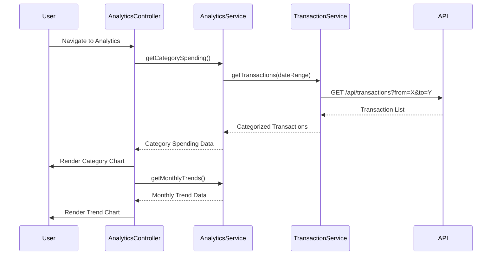

# Low-Level Design: Spending Analytics and Insights
**Epic ID:** QE-7730  
**Epic Title:** PERFTEST20261109161800-Spending Analytics and Insights

---

## a. Architecture Mapping

| HLD Component | AngularJS Artifact | Responsibility |
|---------------|-------------------|----------------|
| Analytics UI | Module: `analyticsModule` | Root module for analytics feature |
| Analytics Dashboard UI | Controller: `AnalyticsController` | Manages analytics state and chart rendering |
| Analytics Engine | Service: `AnalyticsService` | Aggregates and processes transaction data for visualization |
| Transaction Service | Service: `TransactionService` | Retrieves categorized transaction data |
| Dashboard Service | Service: `ChartService` | Provides chart configuration and rendering utilities |
| Interactive Charts | Directive: `categoryChart` | Renders category-wise spending charts |
| Trend Charts | Directive: `trendChart` | Renders monthly spend trend line chart |

**Recommended Folder Structure:**
```
app/
├── modules/
│   └── analytics/
│       ├── analytics.module.js
│       ├── controllers/
│       │   └── analytics.controller.js
│       ├── services/
│       │   ├── analytics.service.js
│       │   ├── transaction.service.js
│       │   └── chart.service.js
│       ├── directives/
│       │   ├── category-chart.directive.js
│       │   └── trend-chart.directive.js
│       └── views/
│           └── analytics.html
```

---

## b. Component Specifications

| Component Name | Artifact Type | Responsibility | Key Dependencies |
|----------------|---------------|----------------|------------------|
| `analyticsModule` | Module | Encapsulates analytics feature components | `ngRoute`, `chart.js` (via angular-chart.js) |
| `AnalyticsController` | Controller | Manages analytics view state, triggers data load, handles user interactions | `AnalyticsService`, `$scope` |
| `AnalyticsService` | Service | Aggregates transaction data by category and month | `TransactionService`, `$http`, `$q` |
| `TransactionService` | Service | Fetches categorized transaction data from REST API | `$http`, `API_CONFIG` |
| `ChartService` | Service | Provides chart.js configuration templates for responsive charts | None |
| `categoryChart` | Directive | Renders interactive pie/bar chart for category-wise spending | `ChartService` |
| `trendChart` | Directive | Renders line chart for monthly spend trends | `ChartService` |

---

## c. Data Model

**Category Spending Model (`CategorySpending`):**
```javascript
{
  category: String,            // e.g., "Food & Dining", "Fuel"
  amount: Number,              // Total spend in category
  percentage: Number           // Percentage of total spend
}
```

**Monthly Trend Model (`MonthlyTrend`):**
```javascript
{
  month: String,               // e.g., "Jan 2026"
  totalSpend: Number           // Total spend for the month
}
```

**Transaction Model (`Transaction`):**
```javascript
{
  transactionId: String,
  amount: Number,
  category: String,            // One of 9 predefined categories
  date: Date,
  description: String
}
```

---

## d. Data Flow

User navigates to analytics page → `AnalyticsController` calls `AnalyticsService.getCategorySpending()` and `AnalyticsService.getMonthlyTrends()` → `AnalyticsService` invokes `TransactionService.getTransactions()` with date range filter → `TransactionService` calls REST API `/api/transactions` → API returns categorized transaction list → `AnalyticsService` aggregates data by category and month → Controller updates `$scope.categoryData` and `$scope.trendData` → `categoryChart` and `trendChart` directives render interactive visualizations using chart.js.

---

## e. Primary Sequence Diagram



---

## f. Implementation Notes

- Use angular-chart.js wrapper for chart.js to integrate with AngularJS data binding
- Implement client-side aggregation in `AnalyticsService` using ES6 `Array.reduce()` for category totals
- Use `$filter('date')` for consistent date formatting in trend charts
- Enable chart interactivity (tooltips, click events) via chart.js configuration in `ChartService`
- Lazy-load chart.js library to optimize initial page load time

---

## g. Error Handling

HTTP interceptor handles API errors; display user-friendly message if transaction data unavailable; graceful degradation with empty state UI.

---

## h. Security Notes

Standard input validation and secure API calls assumed; requires token-based auth via existing SSO.

---

**End of LLD for QE-7730**