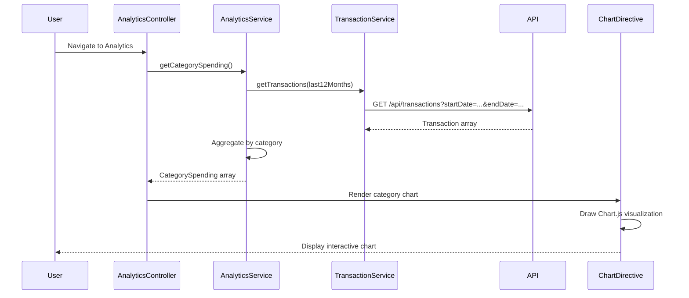

# Low-Level Design: Spending Analytics and Insights
**Epic ID:** QE-7730

## a. Architecture Mapping

- **Analytics UI** → AngularJS Module (`app.analytics`) with Controller (`AnalyticsController`)
- **Analytics Engine** → AngularJS Service (`AnalyticsService`) for data aggregation and trend calculation
- **Transaction Service** → AngularJS Service (`TransactionService`) for categorized transaction data
- **Dashboard Service** → AngularJS Service (`ChartService`) for visualization rendering using Chart.js or D3.js
- **Interactive Charts** → AngularJS Directive (`chartDirective`) wrapping visualization library

**Recommended Folder Structure:**
```
app/
├── modules/
│   └── analytics/
│       ├── analytics.module.js
│       ├── analytics.controller.js
│       ├── analytics.html
│       └── analytics.css
├── services/
│   ├── analytics.service.js
│   ├── transaction.service.js
│   └── chart.service.js
├── directives/
│   └── chart.directive.js
└── assets/
    └── libs/
        └── chart.min.js
```

## b. Component Specifications

| Component Name | Artifact Type | Responsibility | Key Dependencies |
|---|---|---|---|
| AnalyticsModule | Module | Root module for analytics feature | angular, ui.router, chart.js |
| AnalyticsController | Controller | Manages analytics state, fetches spending data, triggers chart rendering | AnalyticsService, ChartService, $scope |
| AnalyticsService | Service | Aggregates transaction data by category, calculates monthly trends | TransactionService, $http, $q |
| TransactionService | Service | Retrieves categorized transaction data for past 12 months | $http |
| ChartService | Service | Prepares chart data structures and configurations for Chart.js | None |
| ChartDirective | Directive | Renders interactive charts (bar, pie, line) in DOM using Chart.js | ChartService |
| AnalyticsView | HTML Template | Displays category filters, monthly trend charts, and spending breakdown | Bootstrap, ng-repeat, chart-directive |

## c. Data Model

**CategorySpending Model:**
```javascript
{
  category: String,
  amount: Number,
  percentage: Number,
  transactionCount: Number
}
```

**MonthlyTrend Model:**
```javascript
{
  month: String,
  totalSpend: Number,
  categoryBreakdown: Array<CategorySpending>
}
```

**Transaction Model:**
```javascript
{
  transactionId: String,
  amount: Number,
  category: String,
  date: Date,
  description: String
}
```

**Categories:** ['Food & Dining', 'Fuel', 'Shopping', 'Travel', 'Entertainment', 'Utilities', 'Healthcare', 'Education', 'Miscellaneous']

## d. Data Flow

User navigates to analytics page → AnalyticsController calls AnalyticsService.getCategorySpending() and getMonthlyTrends() → AnalyticsService calls TransactionService.getTransactions(startDate, endDate) for past 12 months → TransactionService fetches categorized transactions via REST API → AnalyticsService aggregates data by category and month → ChartService formats data for Chart.js → AnalyticsController updates $scope with category spending and monthly trends → ChartDirective renders interactive bar/pie/line charts → User interacts with charts to explore spending patterns.

## e. Primary Sequence Diagram



## f. Implementation Notes

- Use AngularJS DI to inject AnalyticsService, TransactionService, and ChartService into AnalyticsController
- Integrate Chart.js via custom AngularJS directive for reusable, interactive charts (bar for categories, line for trends)
- Implement client-side caching of transaction data using $cacheFactory to improve performance on repeated views
- Use Array.reduce() and ES6 methods for efficient category aggregation and trend calculation
- Apply responsive chart sizing using Chart.js responsive configuration and Bootstrap container classes

## g. Error Handling

Try/catch blocks in AnalyticsService with fallback to empty data arrays; user notified via alert if transaction data fetch fails.

## h. Security Notes

Standard input validation and secure API calls assumed; token-based auth for transaction API access.