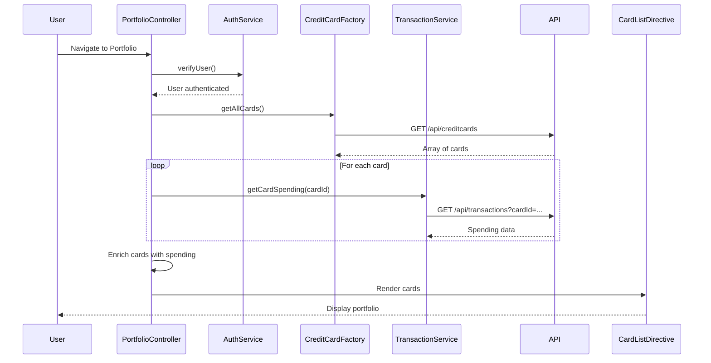

# Low-Level Design: Credit Card Portfolio Management
**Epic ID:** QE-7731

## a. Architecture Mapping

- **Portfolio Management UI** → AngularJS Module (`app.portfolio`) with Controller (`PortfolioController`)
- **Authentication Service** → AngularJS Service (`AuthService`) for user authentication and card ownership verification
- **Credit Card Data Service** → AngularJS Factory (`CreditCardFactory`) for card information retrieval
- **Transaction Service** → AngularJS Service (`TransactionService`) for card-specific spending data
- **Comparison Engine** → AngularJS Service (`ComparisonService`) for client-side card comparison logic
- **Card List View** → AngularJS Directive (`cardListDirective`) for rendering multiple cards

**Recommended Folder Structure:**
```
app/
├── modules/
│   └── portfolio/
│       ├── portfolio.module.js
│       ├── portfolio.controller.js
│       ├── portfolio.html
│       └── portfolio.css
├── services/
│   ├── auth.service.js
│   ├── creditcard.factory.js
│   ├── transaction.service.js
│   └── comparison.service.js
├── directives/
│   └── card-list.directive.js
└── components/
    └── card-detail/
        ├── card-detail.component.js
        └── card-detail.html
```

## b. Component Specifications

| Component Name | Artifact Type | Responsibility | Key Dependencies |
|---|---|---|---|
| PortfolioModule | Module | Root module for portfolio management | angular, ui.router |
| PortfolioController | Controller | Manages portfolio state, fetches all user cards, handles card selection | CreditCardFactory, TransactionService, ComparisonService, AuthService, $scope |
| AuthService | Service | Validates user authentication and card ownership | $http, $window |
| CreditCardFactory | Factory | Retrieves all credit cards for authenticated user via REST API | $http, AuthService |
| TransactionService | Service | Fetches card-specific spending data for each card | $http |
| ComparisonService | Service | Compares cards by utilization, spend, available credit | None |
| CardListDirective | Directive | Renders list of credit cards with individual card details | ng-repeat |
| CardDetailComponent | Component | Displays detailed view of selected card (limit, balance, available credit, spending) | None |

## c. Data Model

**CreditCard Model:**
```javascript
{
  cardId: String,
  cardNumber: String,
  cardHolderName: String,
  issuer: String,
  creditLimit: Number,
  currentBalance: Number,
  availableCredit: Number,
  utilizationPercentage: Number,
  monthlySpend: Number
}
```

**CardComparison Model:**
```javascript
{
  cardId: String,
  utilizationRank: Number,
  spendRank: Number,
  availableCreditRank: Number
}
```

## d. Data Flow

User navigates to portfolio page → PortfolioController calls AuthService.verifyUser() → AuthService validates token → PortfolioController calls CreditCardFactory.getAllCards() → CreditCardFactory fetches all cards via GET /api/creditcards → For each card, PortfolioController calls TransactionService.getCardSpending(cardId) → TransactionService returns monthly spend per card → ComparisonService.compareCards() ranks cards by utilization and spend → Controller updates $scope.cards with enriched card data → CardListDirective renders all cards in responsive grid → User selects card → CardDetailComponent displays detailed card view.

## e. Primary Sequence Diagram



## f. Implementation Notes

- Use AngularJS DI to inject AuthService, CreditCardFactory, TransactionService, and ComparisonService into PortfolioController
- Implement $q.all() for parallel fetching of card-specific spending data to meet 1-second retrieval NFR
- Use ng-repeat with track by cardId for efficient rendering of up to 10+ cards
- Apply Bootstrap card components (card, card-body) for consistent card UI layout
- Implement client-side sorting and filtering using AngularJS filters for card comparison

## g. Error Handling

$http interceptor handles API errors; authentication failures redirect to login; card fetch errors display user-friendly message.

## h. Security Notes

Requires token-based auth via existing SSO; card ownership verified by AuthService before displaying portfolio.