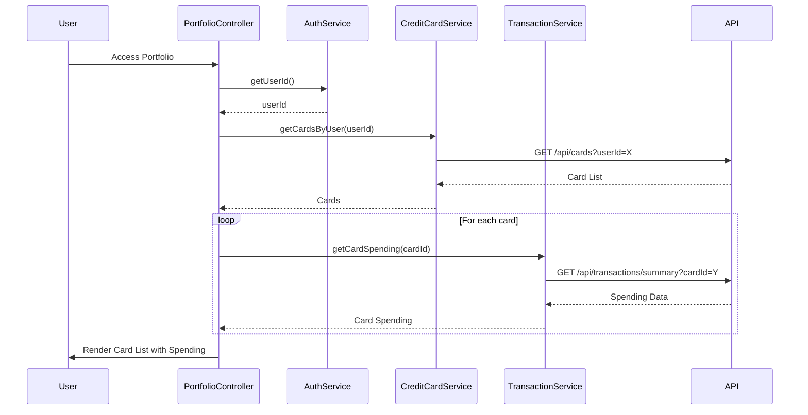

# Low-Level Design: Credit Card Portfolio Management
**Epic ID:** QE-7731  
**Epic Title:** PERFTEST20261109161800-Credit Card Portfolio Management

---

## a. Architecture Mapping

| HLD Component | AngularJS Artifact | Responsibility |
|---------------|-------------------|----------------|
| Portfolio Management UI | Module: `portfolioModule` | Root module for portfolio feature |
| Portfolio UI | Controller: `PortfolioController` | Manages card list display and comparison logic |
| Authentication Service | Service: `AuthService` | Validates user identity and card ownership |
| Credit Card Data Service | Service: `CreditCardService` | Retrieves card details for authenticated user |
| Transaction Service | Service: `TransactionService` | Retrieves card-specific spending data |
| Comparison Engine | Service: `ComparisonService` | Computes comparison metrics across cards |
| Card List Display | Directive: `cardList` | Renders list of user's credit cards |
| Card Details View | Directive: `cardDetails` | Displays detailed view of selected card |

**Recommended Folder Structure:**
```
app/
├── modules/
│   └── portfolio/
│       ├── portfolio.module.js
│       ├── controllers/
│       │   └── portfolio.controller.js
│       ├── services/
│       │   ├── auth.service.js
│       │   ├── credit-card.service.js
│       │   ├── transaction.service.js
│       │   └── comparison.service.js
│       ├── directives/
│       │   ├── card-list.directive.js
│       │   └── card-details.directive.js
│       └── views/
│           └── portfolio.html
```

---

## b. Component Specifications

| Component Name | Artifact Type | Responsibility | Key Dependencies |
|----------------|---------------|----------------|------------------|
| `portfolioModule` | Module | Encapsulates portfolio management components | `ngRoute`, `ui.bootstrap` |
| `PortfolioController` | Controller | Manages card selection, triggers data load, handles comparison | `CreditCardService`, `TransactionService`, `ComparisonService`, `$scope` |
| `AuthService` | Service | Validates user authentication and retrieves user ID | `$http`, `$window` (for token storage) |
| `CreditCardService` | Service | Fetches all cards for authenticated user | `$http`, `API_CONFIG`, `AuthService` |
| `TransactionService` | Service | Fetches card-specific transaction summary | `$http`, `API_CONFIG` |
| `ComparisonService` | Service | Computes comparison metrics (utilization rate, spend ranking) | None |
| `cardList` | Directive | Renders scrollable list of cards with summary info | None |
| `cardDetails` | Directive | Displays detailed card info including limit, balance, spend | None |

---

## c. Data Model

**Credit Card Model (`CreditCard`):**
```javascript
{
  cardId: String,
  cardNumber: String,          // Masked, e.g., "**** 1234"
  cardType: String,            // e.g., "Visa", "Mastercard"
  creditLimit: Number,
  currentBalance: Number,
  availableCredit: Number,
  issuer: String
}
```

**Card Spending Model (`CardSpending`):**
```javascript
{
  cardId: String,
  monthlySpend: Number,
  outstandingAmount: Number
}
```

**Comparison Metrics Model (`ComparisonMetrics`):**
```javascript
{
  cardId: String,
  utilizationRate: Number,     // (currentBalance / creditLimit) * 100
  spendRank: Number            // Rank by monthly spend
}
```

---

## d. Data Flow

User accesses portfolio page → `PortfolioController` calls `AuthService.getUserId()` to validate session → Controller invokes `CreditCardService.getCardsByUser(userId)` → Service calls REST API `/api/cards?userId=X` → API returns list of cards → Controller iterates over cards and calls `TransactionService.getCardSpending(cardId)` for each → Services return card and spending data → `ComparisonService.computeMetrics(cards, spending)` calculates comparison metrics → Controller updates `$scope.cards` and `$scope.metrics` → `cardList` directive renders card list → User selects card → `cardDetails` directive displays detailed view.

---

## e. Primary Sequence Diagram



---

## f. Implementation Notes

- Use AngularJS `$q.all()` to parallelize card spending API calls for faster load
- Implement client-side sorting and filtering in controller using `$filter('orderBy')`
- Store selected card in controller scope; use two-way binding to sync with `cardDetails` directive
- Use Bootstrap responsive grid for card list layout (col-md-4 for card tiles)
- Cache card data in `CreditCardService` with session-level TTL to avoid redundant API calls

---

## g. Error Handling

HTTP interceptor captures API errors; display error message if card data unavailable; retry logic for transient failures.

---

## h. Security Notes

Requires token-based auth via existing SSO; validate card ownership server-side before returning data.

---

**End of LLD for QE-7731**