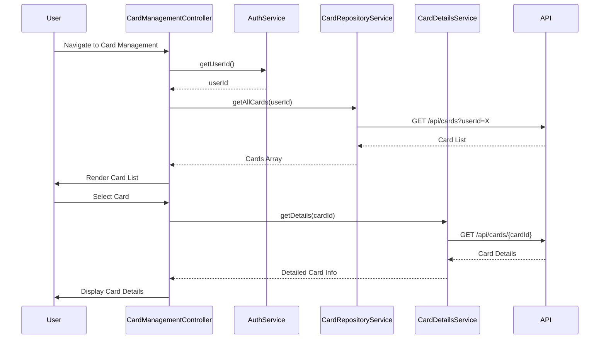

# Low-Level Design: Multiple Credit Card Management and Monitoring
**Epic ID:** QE-7732  
**Epic Title:** PERFTEST20261109161800-Multiple Credit Card Management and Monitoring

---

## a. Architecture Mapping

| HLD Component | AngularJS Artifact | Responsibility |
|---------------|-------------------|----------------|
| Card Management Module | Module: `cardManagementModule` | Root module for card management feature |
| Card Management UI | Controller: `CardManagementController` | Orchestrates card display and selection |
| User Authentication Service | Service: `AuthService` | Validates user and retrieves user context |
| Credit Card Data Repository | Service: `CardRepositoryService` | Fetches multiple card information from backend |
| Card Details Service | Service: `CardDetailsService` | Retrieves detailed info for individual card |
| Card List Component | Directive: `multiCardList` | Renders list of all user cards |
| Card Selector | Directive: `cardSelector` | Provides UI for switching between cards |

**Recommended Folder Structure:**
```
app/
├── modules/
│   └── card-management/
│       ├── card-management.module.js
│       ├── controllers/
│       │   └── card-management.controller.js
│       ├── services/
│       │   ├── auth.service.js
│       │   ├── card-repository.service.js
│       │   └── card-details.service.js
│       ├── directives/
│       │   ├── multi-card-list.directive.js
│       │   └── card-selector.directive.js
│       └── views/
│           └── card-management.html
```

---

## b. Component Specifications

| Component Name | Artifact Type | Responsibility | Key Dependencies |
|----------------|---------------|----------------|------------------|
| `cardManagementModule` | Module | Encapsulates card management components | `ngRoute`, `ui.bootstrap` |
| `CardManagementController` | Controller | Manages card list state, handles card selection and switching | `CardRepositoryService`, `CardDetailsService`, `$scope` |
| `AuthService` | Service | Validates user session and retrieves user ID | `$http`, `$window` |
| `CardRepositoryService` | Service | Fetches all cards for authenticated user from REST API | `$http`, `API_CONFIG`, `AuthService` |
| `CardDetailsService` | Service | Fetches detailed information for a specific card | `$http`, `API_CONFIG` |
| `multiCardList` | Directive | Renders grid/list view of all user cards with summary | None |
| `cardSelector` | Directive | Provides dropdown or tab UI for card selection | None |

---

## c. Data Model

**Credit Card Model (`CreditCard`):**
```javascript
{
  cardId: String,
  cardNumber: String,          // Masked
  cardType: String,            // Visa, Mastercard, etc.
  issuer: String,
  creditLimit: Number,
  currentBalance: Number,
  availableCredit: Number,
  status: String               // Active, Blocked, etc.
}
```

**Card Details Model (`CardDetails`):**
```javascript
{
  cardId: String,
  cardNumber: String,
  expiryDate: String,
  cvv: String,                 // Not displayed, for reference
  billingAddress: Object,
  recentTransactions: Array    // Array of Transaction objects
}
```

---

## d. Data Flow

User navigates to card management page → `CardManagementController` calls `AuthService.getUserId()` → Controller invokes `CardRepositoryService.getAllCards(userId)` → Service makes REST API call to `/api/cards?userId=X` → API returns array of cards → Controller updates `$scope.cards` → `multiCardList` directive renders card grid → User selects a card → Controller calls `CardDetailsService.getDetails(cardId)` → Service fetches detailed card info from `/api/cards/{cardId}` → Controller updates `$scope.selectedCard` → UI displays card details and recent transactions.

---

## e. Primary Sequence Diagram



---

## f. Implementation Notes

- Use AngularJS `ng-repeat` with `track by cardId` for efficient card list rendering
- Implement lazy loading for card details (fetch only when user selects a card)
- Use Bootstrap cards or panels for responsive card display layout
- Cache card list in service with session-level persistence to minimize API calls
- Implement `$scope.$watch` on selected card to trigger detail fetch

---

## g. Error Handling

HTTP interceptor handles API errors; display user-friendly message if card data fetch fails; retry mechanism for transient errors.

---

## h. Security Notes

Requires token-based auth via existing SSO; server-side validation of card ownership before returning data.

---

**End of LLD for QE-7732**