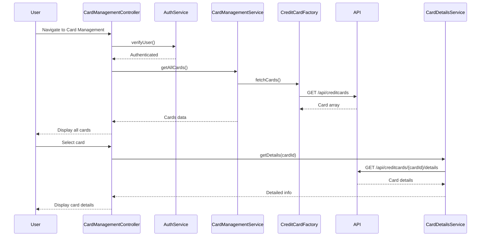

# Low-Level Design: Multiple Credit Card Management and Monitoring
**Epic ID:** QE-7732

## a. Architecture Mapping

- **User Interface** → AngularJS Module (`app.cardManagement`) with Controller (`CardManagementController`)
- **Card Management Module** → AngularJS Service (`CardManagementService`) for card operations and state management
- **User Authentication Service** → AngularJS Service (`AuthService`) for card ownership validation
- **Credit Card Data Repository** → AngularJS Factory (`CreditCardFactory`) for REST API calls
- **Card Details Service** → AngularJS Service (`CardDetailsService`) for fetching detailed card information
- **Card Switcher** → AngularJS Directive (`cardSwitcherDirective`) for seamless card navigation

**Recommended Folder Structure:**
```
app/
├── modules/
│   └── card-management/
│       ├── card-management.module.js
│       ├── card-management.controller.js
│       ├── card-management.html
│       └── card-management.css
├── services/
│   ├── card-management.service.js
│   ├── auth.service.js
│   ├── creditcard.factory.js
│   └── card-details.service.js
├── directives/
│   └── card-switcher.directive.js
└── components/
    └── card-item/
        ├── card-item.component.js
        └── card-item.html
```

## b. Component Specifications

| Component Name | Artifact Type | Responsibility | Key Dependencies |
|---|---|---|---|
| CardManagementModule | Module | Root module for card management feature | angular, ui.router |
| CardManagementController | Controller | Manages card list state, handles card selection and switching | CardManagementService, AuthService, $scope |
| CardManagementService | Service | Orchestrates card operations, maintains selected card state | CreditCardFactory, CardDetailsService |
| AuthService | Service | Validates user authentication and card ownership | $http, $window |
| CreditCardFactory | Factory | Fetches all user credit cards via REST API | $http |
| CardDetailsService | Service | Retrieves detailed information for specific card | $http |
| CardSwitcherDirective | Directive | Provides UI for seamless card navigation and selection | ng-click |
| CardItemComponent | Component | Renders individual card with status, limits, and usage | None |

## c. Data Model

**CreditCard Model:**
```javascript
{
  cardId: String,
  cardNumber: String,
  cardHolderName: String,
  issuer: String,
  cardType: String,
  creditLimit: Number,
  currentBalance: Number,
  availableCredit: Number,
  status: String,
  expiryDate: Date
}
```

**CardDetails Model:**
```javascript
{
  cardId: String,
  recentTransactions: Array,
  monthlySpend: Number,
  utilizationPercentage: Number,
  paymentDueDate: Date,
  minimumPayment: Number
}
```

## d. Data Flow

User navigates to card management page → CardManagementController calls AuthService.verifyUser() → AuthService validates authentication → CardManagementController calls CardManagementService.getAllCards() → CardManagementService calls CreditCardFactory.fetchCards() → CreditCardFactory makes GET /api/creditcards API call → API returns array of cards → Controller updates $scope.cards → CardItemComponent renders each card in unified interface → User clicks card → CardManagementController calls CardDetailsService.getDetails(cardId) → CardDetailsService fetches detailed card info → Controller updates $scope.selectedCard → View displays detailed card information.

## e. Primary Sequence Diagram



## f. Implementation Notes

- Use AngularJS DI to inject CardManagementService, AuthService, and CardDetailsService into CardManagementController
- Implement lazy loading for card details to optimize initial page load performance
- Use ng-repeat with track by cardId for efficient rendering of multiple cards without performance degradation
- Apply Bootstrap grid and card components for scalable, responsive card layout
- Implement $scope.$watch on selectedCard for seamless card switching and detail updates

## g. Error Handling

$http interceptor captures API errors; authentication failures redirect to login; card fetch failures display user notification.

## h. Security Notes

Requires token-based auth via existing SSO; card ownership validated by AuthService before displaying card data.