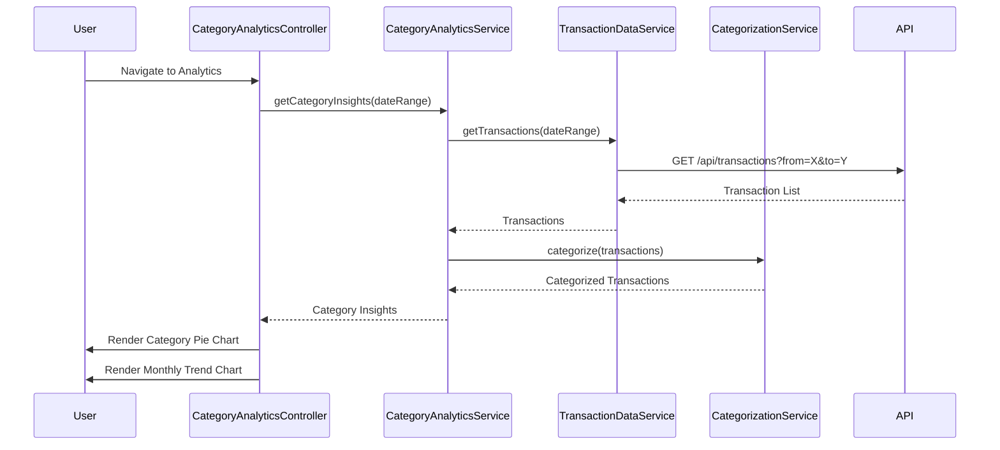

# Low-Level Design: Spending Analytics and Category Insights
**Epic ID:** QE-7733  
**Epic Title:** PERFTEST20261109161800-Spending Analytics and Category Insights

---

## a. Architecture Mapping

| HLD Component | AngularJS Artifact | Responsibility |
|---------------|-------------------|----------------|
| Analytics Dashboard UI | Module: `categoryAnalyticsModule` | Root module for category analytics |
| Analytics Dashboard Component | Controller: `CategoryAnalyticsController` | Manages analytics view and user interactions |
| Analytics Engine | Service: `CategoryAnalyticsService` | Aggregates spending by category and month |
| Transaction Data Service | Service: `TransactionDataService` | Fetches historical transaction data |
| Categorization Service | Service: `CategorizationService` | Assigns categories to transactions |
| Visualization Renderer | Directive: `categoryPieChart` | Renders pie chart for category distribution |
| Trend Visualization | Directive: `monthlyTrendChart` | Renders line chart for monthly trends |

**Recommended Folder Structure:**
```
app/
├── modules/
│   └── category-analytics/
│       ├── category-analytics.module.js
│       ├── controllers/
│       │   └── category-analytics.controller.js
│       ├── services/
│       │   ├── category-analytics.service.js
│       │   ├── transaction-data.service.js
│       │   └── categorization.service.js
│       ├── directives/
│       │   ├── category-pie-chart.directive.js
│       │   └── monthly-trend-chart.directive.js
│       └── views/
│           └── category-analytics.html
```

---

## b. Component Specifications

| Component Name | Artifact Type | Responsibility | Key Dependencies |
|----------------|---------------|----------------|------------------|
| `categoryAnalyticsModule` | Module | Encapsulates category analytics components | `ngRoute`, `chart.js` |
| `CategoryAnalyticsController` | Controller | Manages analytics state, triggers data load, handles filters | `CategoryAnalyticsService`, `$scope`, `$filter` |
| `CategoryAnalyticsService` | Service | Aggregates transaction data by category and computes insights | `TransactionDataService`, `CategorizationService`, `$q` |
| `TransactionDataService` | Service | Fetches historical transaction data from REST API | `$http`, `API_CONFIG` |
| `CategorizationService` | Service | Maps transactions to predefined categories | None (uses static category mapping) |
| `categoryPieChart` | Directive | Renders interactive pie chart showing category-wise spending | `chart.js` |
| `monthlyTrendChart` | Directive | Renders line chart showing monthly spend trends | `chart.js` |

---

## c. Data Model

**Transaction Model (`Transaction`):**
```javascript
{
  transactionId: String,
  cardId: String,
  amount: Number,
  category: String,            // One of 9 predefined categories
  date: Date,
  merchantName: String,
  description: String
}
```

**Category Spending Model (`CategorySpending`):**
```javascript
{
  category: String,            // e.g., "Food & Dining"
  totalAmount: Number,
  transactionCount: Number,
  percentage: Number           // % of total spend
}
```

**Monthly Trend Model (`MonthlyTrend`):**
```javascript
{
  month: String,               // e.g., "2026-01"
  totalSpend: Number,
  categoryBreakdown: Array     // Array of {category, amount}
}
```

**Predefined Categories:**
```javascript
[
  "Food & Dining",
  "Fuel",
  "Shopping",
  "Travel",
  "Entertainment",
  "Utilities",
  "Healthcare",
  "Education",
  "Miscellaneous"
]
```

---

## d. Data Flow

User navigates to category analytics page → `CategoryAnalyticsController` calls `CategoryAnalyticsService.getCategoryInsights(dateRange)` → Service invokes `TransactionDataService.getTransactions(dateRange)` → Service makes REST API call to `/api/transactions?from=X&to=Y` → API returns transaction list → `CategorizationService.categorize(transactions)` assigns categories if not pre-categorized → `CategoryAnalyticsService` aggregates data by category using ES6 `reduce()` → Service computes monthly trends and category percentages → Controller updates `$scope.categoryData` and `$scope.trendData` → `categoryPieChart` and `monthlyTrendChart` directives render interactive visualizations.

---

## e. Primary Sequence Diagram



---

## f. Implementation Notes

- Use angular-chart.js for seamless integration of chart.js with AngularJS data binding
- Implement client-side aggregation in `CategoryAnalyticsService` using ES6 `Map` for efficient category grouping
- Use AngularJS `$filter('date')` for consistent date formatting in trend charts
- Enable chart interactivity (click on category to drill down) via chart.js event handlers
- Implement date range picker using ui-bootstrap datepicker for user-defined analysis periods

---

## g. Error Handling

HTTP interceptor captures API errors; display user-friendly message if transaction data unavailable; graceful degradation with empty state.

---

## h. Security Notes

Standard input validation and secure API calls assumed; requires token-based auth via existing SSO.

---

**End of LLD for QE-7733**