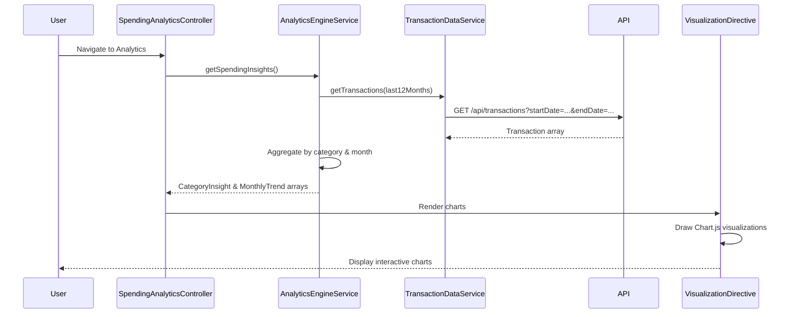

# Low-Level Design: Spending Analytics and Category Insights
**Epic ID:** QE-7733

## a. Architecture Mapping

- **Analytics Dashboard UI** → AngularJS Module (`app.spendingAnalytics`) with Controller (`SpendingAnalyticsController`)
- **Analytics Engine** → AngularJS Service (`AnalyticsEngineService`) for data aggregation and trend calculation
- **Transaction Data Service** → AngularJS Service (`TransactionDataService`) for retrieving historical spending data
- **Categorization Service** → AngularJS Service (`CategorizationService`) for transaction category assignment
- **Visualization Renderer** → AngularJS Directive (`visualizationDirective`) wrapping Chart.js for interactive charts
- **Category Filter** → AngularJS Component (`categoryFilterComponent`) for user-driven category selection

**Recommended Folder Structure:**
```
app/
├── modules/
│   └── spending-analytics/
│       ├── spending-analytics.module.js
│       ├── spending-analytics.controller.js
│       ├── spending-analytics.html
│       └── spending-analytics.css
├── services/
│   ├── analytics-engine.service.js
│   ├── transaction-data.service.js
│   └── categorization.service.js
├── directives/
│   └── visualization.directive.js
└── components/
    └── category-filter/
        ├── category-filter.component.js
        └── category-filter.html
```

## b. Component Specifications

| Component Name | Artifact Type | Responsibility | Key Dependencies |
|---|---|---|---|
| SpendingAnalyticsModule | Module | Root module for spending analytics | angular, ui.router, chart.js |
| SpendingAnalyticsController | Controller | Manages analytics state, fetches spending data, triggers visualizations | AnalyticsEngineService, TransactionDataService, $scope |
| AnalyticsEngineService | Service | Aggregates transaction data by category, calculates monthly trends | TransactionDataService, CategorizationService, $q |
| TransactionDataService | Service | Retrieves historical transaction data for past 12 months | $http |
| CategorizationService | Service | Assigns or validates transaction categories | None |
| VisualizationDirective | Directive | Renders interactive bar/pie/line charts using Chart.js | Chart.js |
| CategoryFilterComponent | Component | Provides UI for filtering spending by category | ng-model |

## c. Data Model

**Transaction Model:**
```javascript
{
  transactionId: String,
  amount: Number,
  category: String,
  date: Date,
  description: String,
  cardId: String
}
```

**CategoryInsight Model:**
```javascript
{
  category: String,
  totalSpend: Number,
  transactionCount: Number,
  percentageOfTotal: Number,
  trend: String
}
```

**MonthlyTrend Model:**
```javascript
{
  month: String,
  totalSpend: Number,
  categoryBreakdown: Array<CategoryInsight>
}
```

**Categories:** ['Food & Dining', 'Fuel', 'Shopping', 'Travel', 'Entertainment', 'Utilities', 'Healthcare', 'Education', 'Miscellaneous']

## d. Data Flow

User navigates to spending analytics page → SpendingAnalyticsController calls AnalyticsEngineService.getSpendingInsights() → AnalyticsEngineService calls TransactionDataService.getTransactions(startDate, endDate) for past 12 months → TransactionDataService fetches transactions via GET /api/transactions → CategorizationService validates/assigns categories → AnalyticsEngineService aggregates data by category and month → Controller updates $scope.categoryInsights and $scope.monthlyTrends → VisualizationDirective renders interactive charts (bar for categories, line for trends) → User filters by category via CategoryFilterComponent → Controller updates visualizations based on filter.

## e. Primary Sequence Diagram



## f. Implementation Notes

- Use AngularJS DI to inject AnalyticsEngineService, TransactionDataService, and CategorizationService into SpendingAnalyticsController
- Integrate Chart.js via custom directive for reusable, interactive visualizations (bar chart for category spending, line chart for monthly trends)
- Implement client-side caching using $cacheFactory to store transaction data and reduce API calls on filter changes
- Use Array.reduce() and ES6 methods for efficient category aggregation and trend calculation
- Apply responsive chart configuration in Chart.js to ensure charts adapt to mobile, tablet, and desktop viewports

## g. Error Handling

Try/catch in AnalyticsEngineService with fallback to empty arrays; API errors caught by $http interceptor and user notified via alert.

## h. Security Notes

Standard input validation and secure API calls assumed; token-based auth for transaction data access.