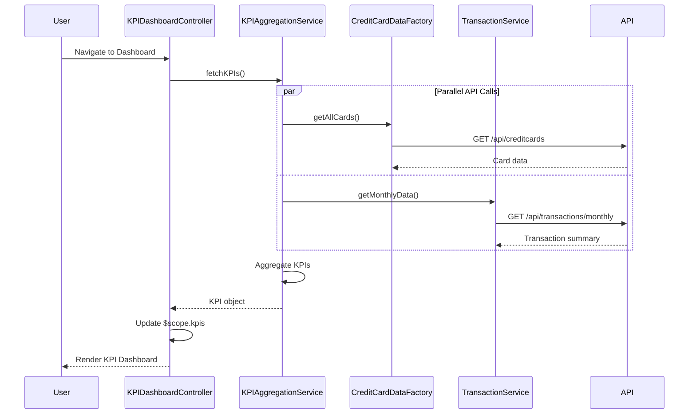

# Low-Level Design: Credit Card Dashboard and KPI Management
**Epic ID:** QE-7734

## a. Architecture Mapping

- **Dashboard UI Component** → AngularJS Module (`app.kpiDashboard`) with Controller (`KPIDashboardController`)
- **KPI Aggregation Service** → AngularJS Service (`KPIAggregationService`) for calculating and aggregating KPIs
- **Credit Card Data Service** → AngularJS Factory (`CreditCardDataFactory`) for retrieving card balances and limits
- **Transaction Service** → AngularJS Service (`TransactionService`) for monthly spend and outstanding amounts
- **Responsive Layout** → HTML5 templates with Bootstrap grid system and CSS3 media queries

**Recommended Folder Structure:**
```
app/
├── modules/
│   └── kpi-dashboard/
│       ├── kpi-dashboard.module.js
│       ├── kpi-dashboard.controller.js
│       ├── kpi-dashboard.html
│       └── kpi-dashboard.css
├── services/
│   ├── kpi-aggregation.service.js
│   ├── transaction.service.js
│   └── creditcard-data.factory.js
└── assets/
    └── styles/
        └── responsive-dashboard.css
```

## b. Component Specifications

| Component Name | Artifact Type | Responsibility | Key Dependencies |
|---|---|---|---|
| KPIDashboardModule | Module | Root module for KPI dashboard feature | angular, ui.router |
| KPIDashboardController | Controller | Manages dashboard state, fetches KPIs, handles data refresh | KPIAggregationService, $scope, $interval |
| KPIAggregationService | Service | Aggregates monthly spend, total credit limit, available credit, outstanding amount | CreditCardDataFactory, TransactionService, $http, $q |
| CreditCardDataFactory | Factory | Fetches credit card balances and limits via REST API | $http |
| TransactionService | Service | Retrieves transaction data for monthly spend and outstanding calculations | $http |
| KPIDashboardView | HTML Template | Renders KPI cards in responsive Bootstrap grid layout | Bootstrap, ng-repeat |

## c. Data Model

**KPI Model:**
```javascript
{
  monthlySpend: Number,
  totalCreditLimit: Number,
  availableCredit: Number,
  outstandingAmount: Number,
  lastRefreshed: Date
}
```

**CreditCardSummary Model:**
```javascript
{
  cardId: String,
  creditLimit: Number,
  currentBalance: Number,
  availableCredit: Number
}
```

**TransactionSummary Model:**
```javascript
{
  monthlySpend: Number,
  outstandingAmount: Number,
  transactionCount: Number
}
```

## d. Data Flow

User navigates to KPI dashboard → KPIDashboardController initializes and calls KPIAggregationService.fetchKPIs() → KPIAggregationService makes parallel REST API calls via CreditCardDataFactory.getAllCards() (for card limits/balances) and TransactionService.getMonthlyData() (for monthly spend/outstanding) → Both services return JSON data → KPIAggregationService aggregates data into KPI model (sum credit limits, calculate available credit, sum monthly spend, sum outstanding) → Service returns KPI object to Controller → Controller updates $scope.kpis → KPIDashboardView renders KPI cards using Bootstrap responsive grid (col-md-3 for desktop, col-sm-6 for tablet, col-xs-12 for mobile) → User sees real-time financial health metrics.

## e. Primary Sequence Diagram



## f. Implementation Notes

- Use AngularJS DI to inject KPIAggregationService, CreditCardDataFactory, and TransactionService into KPIDashboardController
- Leverage $q.all() for parallel API calls to meet 2-second load time NFR
- Implement Bootstrap responsive grid (col-xs-12, col-sm-6, col-md-3) for mobile, tablet, desktop viewports
- Use $interval for periodic KPI refresh (e.g., every 60 seconds) to maintain real-time data
- Apply ES6 const/let and arrow functions for cleaner service code

## g. Error Handling

$http interceptor captures API errors; user-friendly error messages displayed via Bootstrap alerts on KPI fetch failure.

## h. Security Notes

Requires token-based auth via existing SSO for secure API access; standard input validation applied.