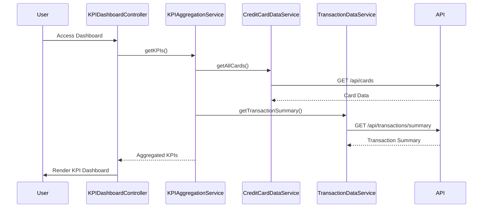

# Low-Level Design: Credit Card Dashboard and KPI Management
**Epic ID:** QE-7734  
**Epic Title:** PERFTEST20261109161800-Credit Card Dashboard and KPI Management

---

## a. Architecture Mapping

| HLD Component | AngularJS Artifact | Responsibility |
|---------------|-------------------|----------------|
| Dashboard UI Component | Module: `kpiDashboardModule` | Root module for KPI dashboard |
| Dashboard UI | Controller: `KPIDashboardController` | Orchestrates KPI display and refresh |
| KPI Aggregation Service | Service: `KPIAggregationService` | Aggregates KPI data from multiple sources |
| Credit Card Data Service | Service: `CreditCardDataService` | Retrieves card balances and limits |
| Transaction Service | Service: `TransactionDataService` | Retrieves monthly spend and outstanding amounts |
| KPI Display Widget | Directive: `kpiWidget` | Reusable component for individual KPI display |

**Recommended Folder Structure:**
```
app/
├── modules/
│   └── kpi-dashboard/
│       ├── kpi-dashboard.module.js
│       ├── controllers/
│       │   └── kpi-dashboard.controller.js
│       ├── services/
│       │   ├── kpi-aggregation.service.js
│       │   ├── credit-card-data.service.js
│       │   └── transaction-data.service.js
│       ├── directives/
│       │   └── kpi-widget.directive.js
│       └── views/
│           └── kpi-dashboard.html
```

---

## b. Component Specifications

| Component Name | Artifact Type | Responsibility | Key Dependencies |
|----------------|---------------|----------------|------------------|
| `kpiDashboardModule` | Module | Encapsulates KPI dashboard components | `ngRoute`, `ui.bootstrap` |
| `KPIDashboardController` | Controller | Manages dashboard state, triggers KPI load, handles user refresh | `KPIAggregationService`, `$scope`, `$interval` |
| `KPIAggregationService` | Service | Aggregates KPI metrics from card and transaction services | `CreditCardDataService`, `TransactionDataService`, `$q` |
| `CreditCardDataService` | Service | Fetches card balances and credit limits from REST API | `$http`, `API_CONFIG` |
| `TransactionDataService` | Service | Fetches monthly spend and outstanding amounts from REST API | `$http`, `API_CONFIG` |
| `kpiWidget` | Directive | Renders individual KPI with icon, label, value, and trend indicator | None |

---

## c. Data Model

**KPI Dashboard Model (`KPIDashboard`):**
```javascript
{
  monthlySpend: Number,        // Total spend for current month
  totalCreditLimit: Number,    // Sum of credit limits across all cards
  availableCredit: Number,     // Total available credit
  outstandingAmount: Number    // Total outstanding balance
}
```

**Credit Card Data Model (`CreditCardData`):**
```javascript
{
  cardId: String,
  creditLimit: Number,
  currentBalance: Number,
  availableCredit: Number
}
```

**Transaction Summary Model (`TransactionSummary`):**
```javascript
{
  currentMonthSpend: Number,
  outstandingAmount: Number
}
```

---

## d. Data Flow

User accesses dashboard → `KPIDashboardController` initializes and calls `KPIAggregationService.getKPIs()` → Service concurrently invokes `CreditCardDataService.getAllCards()` and `TransactionDataService.getTransactionSummary()` → Both services make REST API calls to `/api/cards` and `/api/transactions/summary` → API returns card data and transaction summary → `KPIAggregationService` aggregates data (sums credit limits, calculates available credit, retrieves monthly spend and outstanding amount) → Service returns `KPIDashboard` object → Controller updates `$scope.kpis` → `kpiWidget` directives render each KPI in responsive grid layout.

---

## e. Primary Sequence Diagram



---

## f. Implementation Notes

- Use AngularJS Dependency Injection to inject services into controller
- Implement `$q.all()` in `KPIAggregationService` to parallelize API calls for faster dashboard load
- Use Bootstrap grid (col-xs-12, col-sm-6, col-md-3) for responsive KPI widget layout
- Cache KPI data in service with 5-minute TTL to reduce API load
- Use `$interval` for auto-refresh every 60 seconds to keep KPIs current

---

## g. Error Handling

HTTP interceptor captures API errors; display user-friendly error notification using Bootstrap alerts; implement retry logic for transient failures.

---

## h. Security Notes

Requires token-based auth via existing SSO; all API calls include authorization header with JWT token.

---

**End of LLD for QE-7734**