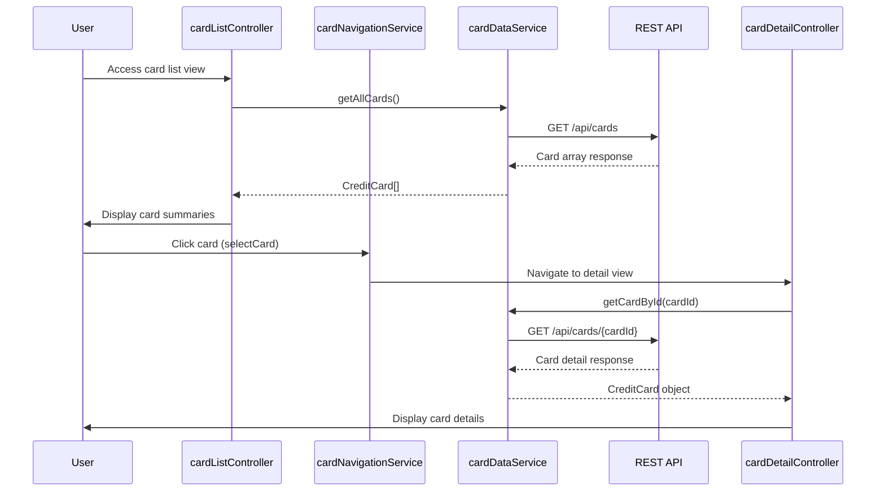

# Low-Level Design: Credit Card Management and Visualization
**Epic ID:** QE-7735

## a. Architecture Mapping

- **cardManagementModule** (AngularJS Module) - Root module for card management features
- **cardListController** (Controller) - Manages display of multiple credit cards
- **cardDetailController** (Controller) - Handles individual card detail view
- **cardNavigationService** (Service) - Manages card switching and selection logic
- **cardDataService** (Factory) - Fetches card data from REST API
- **cardSummaryDirective** (Directive) - Renders card summary tiles

**Folder Structure:**
```
/app
  /modules
    /card-management
      /controllers (cardListController.js, cardDetailController.js)
      /services (cardNavigationService.js, cardDataService.js)
      /directives (cardSummaryDirective.js)
      /views (card-list.html, card-detail.html)
```

## b. Component Specifications

| Component Name | Artifact Type | Responsibility | Key Dependencies |
|----------------|---------------|----------------|------------------|
| cardManagementModule | Module | Bootstraps card management feature | angular, ngRoute |
| cardListController | Controller | Displays list of user's credit cards | cardDataService, cardNavigationService |
| cardDetailController | Controller | Shows detailed view of selected card | cardDataService, $routeParams |
| cardNavigationService | Service | Manages card selection state and navigation | $rootScope |
| cardDataService | Factory | Fetches card data via REST API | $http, $q |
| cardSummaryDirective | Directive | Renders individual card summary tile | None |

## c. Data Model

**CreditCard Object:**
```javascript
{
  cardId: String,
  cardNumber: String (masked),
  cardType: String,
  cardHolderName: String,
  creditLimit: Number,
  availableCredit: Number,
  outstandingAmount: Number,
  monthlySpend: Number,
  expiryDate: String,
  isActive: Boolean
}
```

## d. Data Flow

User accesses card management view → cardListController initializes and calls cardDataService.getAllCards() → Service makes GET /api/cards REST call → Response parsed into CreditCard model array → Cards rendered via cardSummaryDirective → User clicks card → cardNavigationService.selectCard(cardId) updates state → $routeParams triggers cardDetailController → Controller fetches detailed card data via cardDataService.getCardById(cardId) → Detailed view rendered with spending, limits, and balances.

## e. Primary Sequence Diagram



## f. Implementation Notes

- Use AngularJS $http service with promise-based pattern for all REST API calls
- Implement cardNavigationService as singleton with $rootScope event broadcasting for card selection changes
- Apply AngularJS DI via function parameter annotation for minification safety
- Cache card list data in cardDataService for sub-500ms card switching performance
- Use ng-repeat with track by cardId for efficient list rendering

## g. Error Handling

HTTP interceptor captures API errors; cardDataService wraps calls in $q promises with rejection handlers; user notified via toastr or modal dialog.

## h. Security Notes

Requires token-based auth via existing SSO; card numbers masked on client; all API calls over HTTPS.