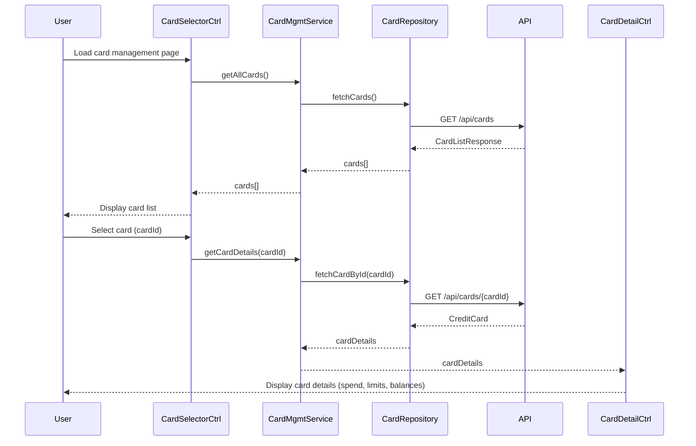

# Low-Level Design: Credit Card Management and Visualization
**Epic ID:** QE-7735

---

## a. Architecture Mapping

- **Card Management Module** → AngularJS Module (`creditCardManagement`)
- **Card Selector Component** → AngularJS Controller (`CardSelectorController`) + Directive (`cardSelector`)
- **Card Detail Viewer** → AngularJS Controller (`CardDetailController`) + View Template
- **Card Management Service** → AngularJS Service (`CardManagementService`) for business logic and API calls
- **Card Repository Access** → AngularJS Factory (`CardRepository`) for data access layer
- **Dashboard KPI Integration** → AngularJS Service (`DashboardKPIService`) for aggregated metrics

**Recommended Folder Structure:**
```
app/
├── modules/
│   └── creditCardManagement/
│       ├── controllers/
│       │   ├── cardSelectorController.js
│       │   └── cardDetailController.js
│       ├── services/
│       │   ├── cardManagementService.js
│       │   └── dashboardKPIService.js
│       ├── factories/
│       │   └── cardRepository.js
│       ├── directives/
│       │   └── cardSelector.js
│       ├── views/
│       │   ├── card-list.html
│       │   └── card-detail.html
│       └── creditCardManagement.module.js
```

---

## b. Component Specifications

| Component Name | Artifact Type | Responsibility | Key Dependencies |
|----------------|---------------|----------------|------------------|
| `creditCardManagement` | Module | Root module for credit card management features | `ngRoute`, `ui.bootstrap` |
| `CardSelectorController` | Controller | Manages card selection, switching, and list display | `CardManagementService`, `$scope` |
| `CardDetailController` | Controller | Displays detailed card information (spend, limits, balances) | `CardManagementService`, `DashboardKPIService`, `$routeParams` |
| `CardManagementService` | Service | Fetches card data, handles card switching logic, ensures data consistency | `CardRepository`, `$q`, `$http` |
| `CardRepository` | Factory | Data access layer for credit card CRUD operations | `$http`, `API_CONFIG` |
| `DashboardKPIService` | Service | Provides aggregated KPI metrics for card comparison | `$http`, `API_CONFIG` |
| `cardSelector` | Directive | Reusable UI component for card selection dropdown/list | `CardManagementService` |

---

## c. Data Model

**CreditCard Object:**
```javascript
{
  cardId: String,              // Unique card identifier
  cardNumber: String,          // Masked card number (e.g., "**** **** **** 1234")
  cardHolderName: String,      // Cardholder name
  cardType: String,            // e.g., "Visa", "MasterCard", "Amex"
  creditLimit: Number,         // Total credit limit
  availableCredit: Number,     // Available credit
  outstandingBalance: Number,  // Current outstanding amount
  monthlySpend: Number,        // Current month's spend
  expiryDate: String,          // MM/YY format
  status: String               // "Active", "Blocked", "Expired"
}
```

**CardListResponse Object:**
```javascript
{
  cards: Array<CreditCard>,    // Array of credit card objects
  totalCards: Number           // Total number of cards
}
```

---

## d. Data Flow

User loads the card management interface → `CardSelectorController` initializes and calls `CardManagementService.getAllCards()` → Service invokes `CardRepository.fetchCards()` which makes REST API call to `/api/cards` → Card list retrieved and cached → User selects a specific card from the selector → `CardSelectorController` broadcasts card selection event → `CardDetailController` listens to event and calls `CardManagementService.getCardDetails(cardId)` → Service retrieves detailed card data (sub-500ms via cache or optimized API) → `DashboardKPIService` fetches aggregated metrics for comparison → View updates with card-specific spending, limits, and balances → User can switch between up to 20 cards with instant navigation.

---

## e. Primary Sequence Diagram



---

## f. Implementation Notes

- Use AngularJS DI to inject `CardManagementService` and `CardRepository` into controllers for testability
- Implement client-side caching in `CardManagementService` using `$cacheFactory` to achieve sub-500ms card switching
- Use `$http` interceptors for consistent error handling and authentication token injection
- Leverage `ng-repeat` with `track by cardId` for optimized card list rendering
- Use `$routeParams` or `$stateParams` (if using UI-Router) for card detail navigation

---

## g. Error Handling

HTTP interceptor-based error handling with user-friendly notifications via `toastr` or Bootstrap modals for API failures.

---

## h. Security Notes

Requires token-based authentication via existing SSO; card data transmission over HTTPS with masked card numbers in UI.