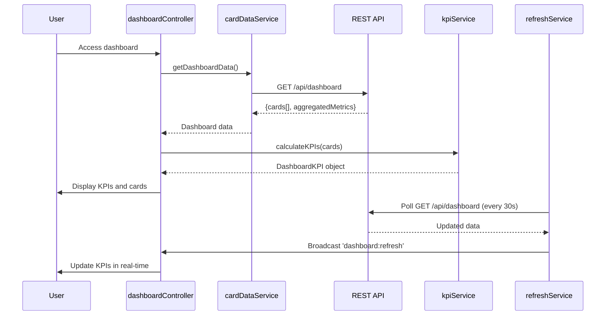

# Low-Level Design: Credit Card Dashboard and KPI Management
**Epic ID:** QE-7736

## a. Architecture Mapping

- **dashboardModule** (AngularJS Module) - Root module for dashboard feature
- **dashboardController** (Controller) - Manages dashboard view and KPI display
- **kpiService** (Service) - Calculates and manages KPI metrics
- **cardDataService** (Factory) - Fetches card data from REST API
- **refreshService** (Service) - Handles real-time data refresh logic
- **kpiCardDirective** (Directive) - Renders individual KPI metric cards

**Folder Structure:**
```
/app
  /modules
    /dashboard
      /controllers (dashboardController.js)
      /services (kpiService.js, cardDataService.js, refreshService.js)
      /directives (kpiCardDirective.js)
      /views (dashboard.html)
```

## b. Component Specifications

| Component Name | Artifact Type | Responsibility | Key Dependencies |
|----------------|---------------|----------------|------------------|
| dashboardModule | Module | Bootstraps dashboard feature | angular, ngRoute |
| dashboardController | Controller | Orchestrates dashboard view and KPI updates | kpiService, cardDataService, refreshService |
| kpiService | Service | Calculates monthly spend, credit limit, available credit, outstanding amounts | None |
| cardDataService | Factory | Fetches aggregated card data via REST API | $http, $q |
| refreshService | Service | Polls or listens for data updates and triggers refresh | $interval, $rootScope |
| kpiCardDirective | Directive | Renders individual KPI metric with label and value | None |

## c. Data Model

**DashboardKPI Object:**
```javascript
{
  totalCreditLimit: Number,
  totalAvailableCredit: Number,
  totalOutstandingAmount: Number,
  monthlySpend: Number,
  cardCount: Number,
  lastUpdated: Date
}
```

**CreditCard Object (summary):**
```javascript
{
  cardId: String,
  cardType: String,
  creditLimit: Number,
  availableCredit: Number,
  outstandingAmount: Number,
  monthlySpend: Number
}
```

## d. Data Flow

User authenticates and accesses dashboard → dashboardController initializes and calls cardDataService.getDashboardData() → Service makes GET /api/dashboard REST call → Response contains card array and aggregated metrics → kpiService.calculateKPIs(cards) computes total credit limit, available credit, outstanding amount, and monthly spend → KPIs and card list rendered via kpiCardDirective → refreshService polls API every 30 seconds → On data change, $rootScope broadcasts 'dashboard:refresh' event → dashboardController re-fetches data and updates view.

## e. Primary Sequence Diagram



## f. Implementation Notes

- Use AngularJS $interval service for 30-second polling in refreshService
- Apply AngularJS two-way data binding for automatic KPI updates on model change
- Implement responsive grid layout using Bootstrap 3 col-* classes for mobile/tablet/desktop
- Use AngularJS $http caching for sub-2-second initial load performance
- Inject dependencies via explicit array notation for minification compatibility

## g. Error Handling

HTTP interceptor with $q rejection; refreshService handles polling failures silently with exponential backoff; user notified on critical errors via modal.

## h. Security Notes

Requires token-based auth via existing SSO; all API calls authenticated with JWT in Authorization header.