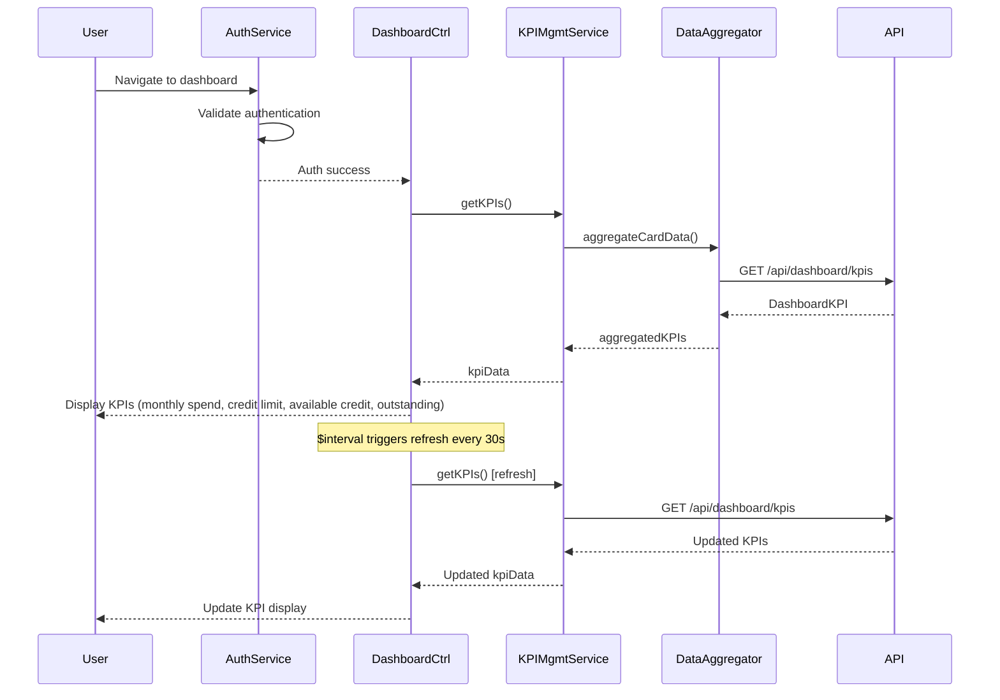

# Low-Level Design: Credit Card Dashboard and KPI Management
**Epic ID:** QE-7736

---

## a. Architecture Mapping

- **Dashboard Module** → AngularJS Module (`creditCardDashboard`)
- **Dashboard Interface** → AngularJS Controller (`DashboardController`) + View Template
- **KPI Management Service** → AngularJS Service (`KPIManagementService`) for KPI calculations and data aggregation
- **Data Aggregator** → AngularJS Factory (`DataAggregatorFactory`) for server-side data processing
- **Credit Card Data Source** → REST API integration via `$http`
- **Authentication Service** → AngularJS Service (`AuthService`) for user authentication

**Recommended Folder Structure:**
```
app/
├── modules/
│   └── creditCardDashboard/
│       ├── controllers/
│       │   └── dashboardController.js
│       ├── services/
│       │   ├── kpiManagementService.js
│       │   └── authService.js
│       ├── factories/
│       │   └── dataAggregatorFactory.js
│       ├── views/
│       │   └── dashboard.html
│       └── creditCardDashboard.module.js
```

---

## b. Component Specifications

| Component Name | Artifact Type | Responsibility | Key Dependencies |
|----------------|---------------|----------------|------------------|
| `creditCardDashboard` | Module | Root module for dashboard and KPI features | `ngRoute`, `ui.bootstrap` |
| `DashboardController` | Controller | Manages dashboard UI, displays KPIs, handles real-time refresh | `KPIManagementService`, `AuthService`, `$scope`, `$interval` |
| `KPIManagementService` | Service | Fetches and calculates KPIs (monthly spend, credit limit, available credit, outstanding) | `DataAggregatorFactory`, `$http`, `$q` |
| `DataAggregatorFactory` | Factory | Aggregates data from credit card data source, performs server-side calculations | `$http`, `API_CONFIG` |
| `AuthService` | Service | Handles user authentication and session management | `$http`, `$window`, `API_CONFIG` |

---

## c. Data Model

**DashboardKPI Object:**
```javascript
{
  monthlySpend: Number,         // Total spend for current month across all cards
  totalCreditLimit: Number,     // Sum of credit limits across all cards
  availableCredit: Number,      // Total available credit
  outstandingAmount: Number,    // Total outstanding balance
  cardCount: Number,            // Number of active cards
  lastUpdated: Date             // Timestamp of last data refresh
}
```

**CreditCardSummary Object:**
```javascript
{
  cardId: String,
  cardNumber: String,           // Masked
  cardType: String,
  monthlySpend: Number,
  creditLimit: Number,
  availableCredit: Number,
  outstandingBalance: Number
}
```

---

## d. Data Flow

User navigates to dashboard → `AuthService` validates authentication → `DashboardController` initializes and calls `KPIManagementService.getKPIs()` → Service invokes `DataAggregatorFactory.aggregateCardData()` which makes REST API call to `/api/dashboard/kpis` → Server-side aggregation returns calculated KPIs → KPIs displayed in responsive dashboard UI (WCAG 2.1 compliant) → `$interval` triggers periodic refresh (every 30 seconds) for real-time/near real-time updates → `KPIManagementService` fetches updated data → Dashboard UI updates KPI values → User views consolidated financial position across all credit cards within 2-second load time.

---

## e. Primary Sequence Diagram



---

## f. Implementation Notes

- Use AngularJS `$interval` service for periodic KPI refresh (30-second intervals) to achieve real-time/near real-time updates
- Implement responsive design using Bootstrap grid system and media queries for desktop/tablet/mobile support
- Use `ng-cloak` to prevent FOUC (Flash of Unstyled Content) during initial load
- Leverage `$q` promises for asynchronous KPI data fetching and error handling
- Ensure WCAG 2.1 compliance through semantic HTML, ARIA labels, and keyboard navigation support

---

## g. Error Handling

HTTP interceptor captures API errors; user notified via Bootstrap alert components with retry option.

---

## h. Security Notes

Requires token-based authentication via existing SSO; all API calls include JWT in Authorization header.