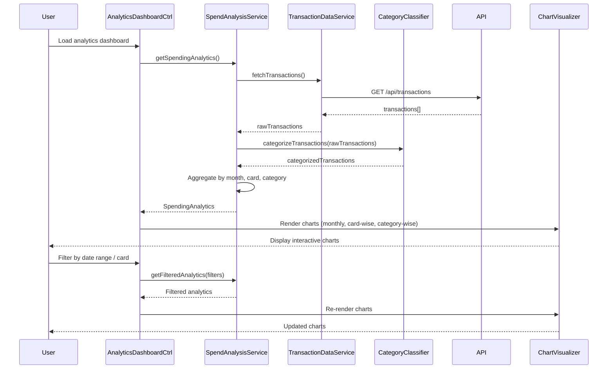

# Low-Level Design: Spending Analytics and Insights
**Epic ID:** QE-7737

---

## a. Architecture Mapping

- **Analytics Module** → AngularJS Module (`spendingAnalytics`)
- **Analytics Dashboard** → AngularJS Controller (`AnalyticsDashboardController`) + View Template
- **Spend Analysis Service** → AngularJS Service (`SpendAnalysisService`) for analytics logic
- **Category Classification Engine** → AngularJS Factory (`CategoryClassifierFactory`) for transaction categorization
- **Transaction Data Service** → AngularJS Service (`TransactionDataService`) for transaction data access
- **Visualization Engine** → AngularJS Directive (`chartVisualizer`) using Chart.js or D3.js

**Recommended Folder Structure:**
```
app/
├── modules/
│   └── spendingAnalytics/
│       ├── controllers/
│       │   └── analyticsDashboardController.js
│       ├── services/
│       │   ├── spendAnalysisService.js
│       │   └── transactionDataService.js
│       ├── factories/
│       │   └── categoryClassifierFactory.js
│       ├── directives/
│       │   └── chartVisualizer.js
│       ├── views/
│       │   └── analytics-dashboard.html
│       └── spendingAnalytics.module.js
```

---

## b. Component Specifications

| Component Name | Artifact Type | Responsibility | Key Dependencies |
|----------------|---------------|----------------|------------------|
| `spendingAnalytics` | Module | Root module for spending analytics features | `ngRoute`, `chart.js`, `ui.bootstrap` |
| `AnalyticsDashboardController` | Controller | Manages analytics dashboard, handles user interactions (filtering, drill-down) | `SpendAnalysisService`, `$scope`, `$filter` |
| `SpendAnalysisService` | Service | Aggregates spending data, calculates monthly trends, card-wise breakdowns | `TransactionDataService`, `CategoryClassifierFactory`, `$q` |
| `TransactionDataService` | Service | Fetches transaction data from API | `$http`, `API_CONFIG` |
| `CategoryClassifierFactory` | Factory | Classifies transactions into nine categories (Food & Dining, Fuel, Shopping, Travel, Entertainment, Utilities, Healthcare, Education, Miscellaneous) | None (rule-based logic) |
| `chartVisualizer` | Directive | Renders interactive charts (monthly trends, card-wise, category-wise) using Chart.js | `Chart.js library` |

---

## c. Data Model

**SpendingAnalytics Object:**
```javascript
{
  monthlyTrends: Array<MonthlySpend>,    // Monthly spend data
  cardWiseSpend: Array<CardSpend>,       // Spend breakdown by card
  categoryWiseSpend: Array<CategorySpend>, // Spend breakdown by category
  totalSpend: Number,                    // Total spend across all cards
  period: String                         // Analysis period (e.g., "Last 6 months")
}
```

**MonthlySpend Object:**
```javascript
{
  month: String,      // e.g., "Jan 2026"
  amount: Number      // Total spend for the month
}
```

**CardSpend Object:**
```javascript
{
  cardId: String,
  cardNumber: String,  // Masked
  amount: Number       // Total spend on this card
}
```

**CategorySpend Object:**
```javascript
{
  category: String,    // One of nine categories
  amount: Number,      // Total spend in this category
  percentage: Number   // Percentage of total spend
}
```

---

## d. Data Flow

User accesses analytics dashboard → `AnalyticsDashboardController` initializes and calls `SpendAnalysisService.getSpendingAnalytics()` → Service invokes `TransactionDataService.fetchTransactions()` which makes REST API call to `/api/transactions` → Raw transaction data retrieved → `CategoryClassifierFactory` categorizes each transaction into one of nine categories using rule-based logic → `SpendAnalysisService` aggregates data by month, card, and category → Aggregated data passed to `chartVisualizer` directive → Chart.js renders interactive charts (monthly trends, card-wise breakdown, category-wise spending) within 1 second → User interacts with charts through filtering (date range, card selection) and drill-down (click category to view transactions) → Controller updates data model → Charts re-render with filtered data.

---

## e. Primary Sequence Diagram



---

## f. Implementation Notes

- Use Chart.js library integrated via `angular-chart.js` wrapper for AngularJS compatibility and 1-second render time
- Implement `CategoryClassifierFactory` with rule-based logic (merchant name/MCC code mapping to categories)
- Cache aggregated analytics data in `SpendAnalysisService` using `$cacheFactory` to optimize performance
- Use `ng-click` on chart elements for drill-down functionality (navigate to transaction list filtered by category)
- Leverage `$filter` service for date range filtering and data manipulation

---

## g. Error Handling

Try/catch blocks in service methods with fallback to cached data; user notified via toastr on API failures.

---

## h. Security Notes

Standard input validation and secure API calls assumed; transaction data transmitted over HTTPS.