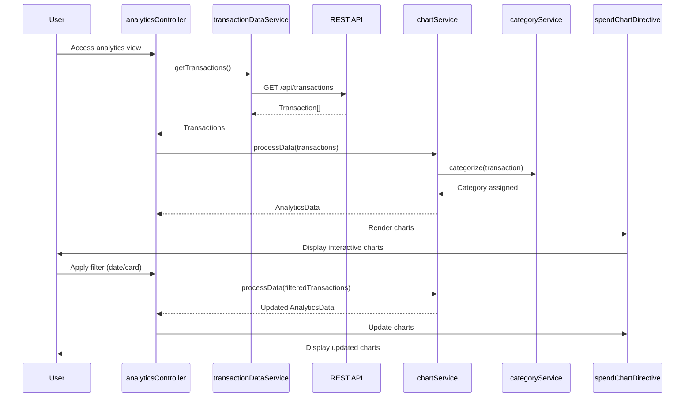

# Low-Level Design: Spending Analytics and Insights
**Epic ID:** QE-7737

## a. Architecture Mapping

- **analyticsModule** (AngularJS Module) - Root module for analytics feature
- **analyticsController** (Controller) - Manages analytics view and chart interactions
- **transactionDataService** (Factory) - Fetches transaction data from REST API
- **categoryService** (Service) - Handles category classification logic
- **chartService** (Service) - Prepares data for chart rendering
- **spendChartDirective** (Directive) - Renders interactive charts using Chart.js

**Folder Structure:**
```
/app
  /modules
    /analytics
      /controllers (analyticsController.js)
      /services (transactionDataService.js, categoryService.js, chartService.js)
      /directives (spendChartDirective.js)
      /views (analytics.html)
```

## b. Component Specifications

| Component Name | Artifact Type | Responsibility | Key Dependencies |
|----------------|---------------|----------------|------------------|
| analyticsModule | Module | Bootstraps analytics feature | angular, ngRoute, chart.js |
| analyticsController | Controller | Manages analytics view, filters, and drill-down | transactionDataService, chartService |
| transactionDataService | Factory | Fetches transaction data via REST API | $http, $q |
| categoryService | Service | Maps transactions to nine predefined categories | None |
| chartService | Service | Aggregates data for monthly trends and category breakdowns | categoryService |
| spendChartDirective | Directive | Renders Chart.js line/bar/pie charts with interactivity | chart.js |

## c. Data Model

**Transaction Object:**
```javascript
{
  transactionId: String,
  cardId: String,
  amount: Number,
  merchant: String,
  category: String, // One of 9 categories
  transactionDate: Date,
  description: String
}
```

**AnalyticsData Object:**
```javascript
{
  monthlyTrends: [{month: String, totalSpend: Number}],
  cardWiseSpend: [{cardId: String, totalSpend: Number}],
  categoryWiseSpend: [{category: String, totalSpend: Number}]
}
```

## d. Data Flow

User accesses analytics view → analyticsController calls transactionDataService.getTransactions() → Service makes GET /api/transactions REST call → Transactions retrieved and passed to chartService.processData() → categoryService categorizes each transaction into one of nine categories → chartService aggregates spending by month, card, and category → Processed data returned as AnalyticsData object → spendChartDirective renders monthly trend line chart, card-wise bar chart, and category-wise pie chart → User applies filter (date range, card) → analyticsController re-processes data and updates charts.

## e. Primary Sequence Diagram



## f. Implementation Notes

- Integrate Chart.js library via bower or CDN; wrap in AngularJS directive for two-way binding
- Use AngularJS $filter service for date range and card filtering on client-side
- Implement categoryService with static mapping of transaction categories to nine predefined categories
- Apply AngularJS $scope.$watch for reactive chart updates on filter changes
- Use Web Workers (if supported) for data aggregation to meet 1-second rendering NFR

## g. Error Handling

HTTP interceptor handles API errors; chartService validates data integrity; user notified via toastr on rendering failures.

## h. Security Notes

Standard input validation and secure API calls assumed; token-based auth via existing SSO.