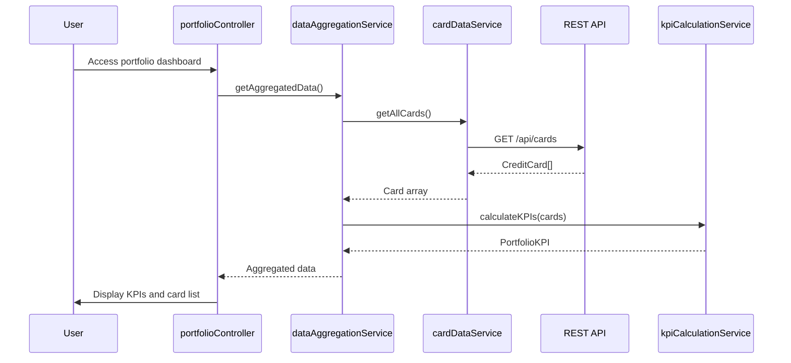

# Low-Level Design: Credit Card Portfolio Management and Dashboard KPIs
**Epic ID:** QE-7738

## a. Architecture Mapping

- **portfolioModule** (AngularJS Module) - Root module for portfolio management
- **portfolioController** (Controller) - Manages portfolio dashboard view
- **kpiCalculationService** (Service) - Computes aggregated KPI metrics
- **cardDataService** (Factory) - Fetches card data from REST API
- **dataAggregationService** (Service) - Consolidates multi-card data
- **kpiDisplayDirective** (Directive) - Renders KPI metric tiles

**Folder Structure:**
```
/app
  /modules
    /portfolio
      /controllers (portfolioController.js)
      /services (kpiCalculationService.js, cardDataService.js, dataAggregationService.js)
      /directives (kpiDisplayDirective.js)
      /views (portfolio.html)
```

## b. Component Specifications

| Component Name | Artifact Type | Responsibility | Key Dependencies |
|----------------|---------------|----------------|------------------|
| portfolioModule | Module | Bootstraps portfolio management feature | angular, ngRoute |
| portfolioController | Controller | Orchestrates portfolio view and KPI display | kpiCalculationService, dataAggregationService |
| kpiCalculationService | Service | Calculates monthly spend, total credit limit, available credit, outstanding amounts | None |
| cardDataService | Factory | Fetches card data via REST API | $http, $q |
| dataAggregationService | Service | Consolidates data from multiple credit cards | cardDataService |
| kpiDisplayDirective | Directive | Renders individual KPI tile with icon and value | None |

## c. Data Model

**PortfolioKPI Object:**
```javascript
{
  totalCreditLimit: Number,
  totalAvailableCredit: Number,
  totalOutstandingAmount: Number,
  monthlySpend: Number,
  creditUtilization: Number, // Percentage
  cardCount: Number
}
```

**CreditCard Object:**
```javascript
{
  cardId: String,
  cardNumber: String (masked),
  cardType: String,
  creditLimit: Number,
  availableCredit: Number,
  outstandingAmount: Number,
  monthlySpend: Number
}
```

## d. Data Flow

User authenticates and accesses portfolio dashboard → portfolioController calls dataAggregationService.getAggregatedData() → Service calls cardDataService.getAllCards() which makes GET /api/cards REST call → Card array retrieved → dataAggregationService consolidates data from all cards → kpiCalculationService.calculateKPIs(cards) computes total credit limit, available credit, outstanding amount, monthly spend, and credit utilization percentage → PortfolioKPI object returned → portfolioController binds KPIs to view → kpiDisplayDirective renders each KPI metric in responsive tile layout → Real-time refresh updates KPIs automatically.

## e. Primary Sequence Diagram



## f. Implementation Notes

- Use AngularJS $http service with caching for sub-2-second page load
- Implement kpiCalculationService with pure functions for testability
- Apply Bootstrap grid system for responsive layout across desktop/tablet/mobile
- Use AngularJS $interval for real-time data refresh every 30 seconds
- Inject dependencies via explicit array notation for minification safety

## g. Error Handling

HTTP interceptor with $q rejection; dataAggregationService handles partial failures gracefully; user notified via modal on critical errors.

## h. Security Notes

Requires token-based auth via existing SSO; card numbers masked; all API calls over HTTPS with JWT authentication.