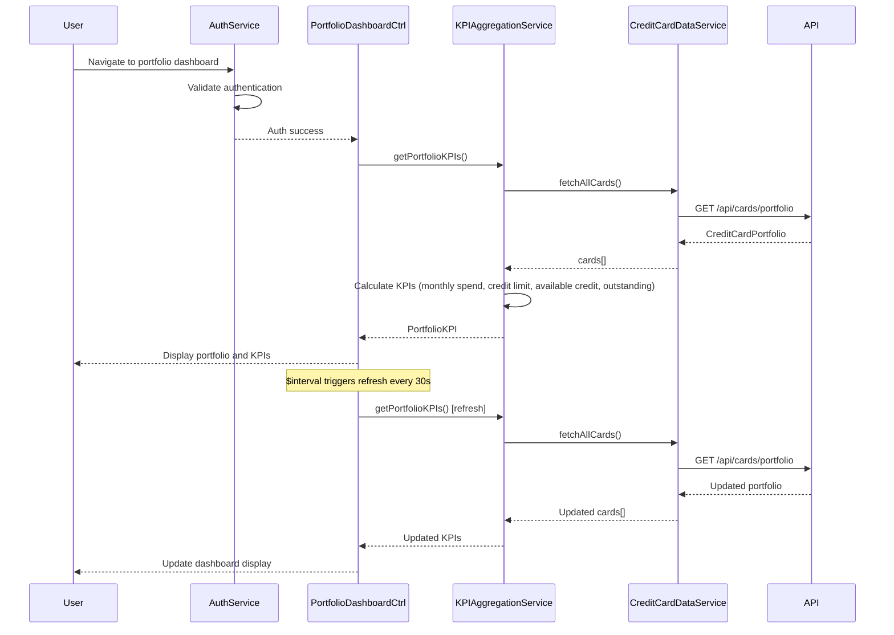

# Low-Level Design: Credit Card Portfolio Management and Dashboard KPIs
**Epic ID:** QE-7738

---

## a. Architecture Mapping

- **Portfolio Management Module** → AngularJS Module (`creditCardPortfolio`)
- **Dashboard UI** → AngularJS Controller (`PortfolioDashboardController`) + View Template
- **KPI Aggregation Service** → AngularJS Service (`KPIAggregationService`) for KPI calculations
- **Credit Card Data Service** → AngularJS Service (`CreditCardDataService`) for card data access
- **Authentication Service** → AngularJS Service (`AuthService`) for user authentication
- **Data Repository** → REST API integration via `$http`

**Recommended Folder Structure:**
```
app/
├── modules/
│   └── creditCardPortfolio/
│       ├── controllers/
│       │   └── portfolioDashboardController.js
│       ├── services/
│       │   ├── kpiAggregationService.js
│       │   ├── creditCardDataService.js
│       │   └── authService.js
│       ├── views/
│       │   └── portfolio-dashboard.html
│       └── creditCardPortfolio.module.js
```

---

## b. Component Specifications

| Component Name | Artifact Type | Responsibility | Key Dependencies |
|----------------|---------------|----------------|------------------|
| `creditCardPortfolio` | Module | Root module for portfolio management and KPI tracking | `ngRoute`, `ui.bootstrap` |
| `PortfolioDashboardController` | Controller | Manages portfolio dashboard UI, displays KPIs, handles real-time refresh | `KPIAggregationService`, `CreditCardDataService`, `AuthService`, `$scope`, `$interval` |
| `KPIAggregationService` | Service | Aggregates and calculates KPIs (monthly spend, total credit limit, available credit, outstanding amounts) | `CreditCardDataService`, `$q` |
| `CreditCardDataService` | Service | Fetches credit card data from repository | `$http`, `API_CONFIG`, `$cacheFactory` |
| `AuthService` | Service | Handles user authentication and session management | `$http`, `$window`, `API_CONFIG` |

---

## c. Data Model

**PortfolioKPI Object:**
```javascript
{
  monthlySpend: Number,         // Total monthly spend across all cards
  totalCreditLimit: Number,     // Sum of credit limits
  availableCredit: Number,      // Total available credit
  outstandingAmount: Number,    // Total outstanding balance
  creditUtilization: Number,    // Percentage of credit used
  cardCount: Number,            // Number of cards in portfolio
  lastRefreshed: Date           // Last data refresh timestamp
}
```

**CreditCardPortfolio Object:**
```javascript
{
  cards: Array<CreditCard>,     // Array of credit card objects
  kpis: PortfolioKPI            // Aggregated KPIs
}
```

**CreditCard Object:**
```javascript
{
  cardId: String,
  cardNumber: String,           // Masked
  cardType: String,
  creditLimit: Number,
  availableCredit: Number,
  outstandingBalance: Number,
  monthlySpend: Number
}
```

---

## d. Data Flow

User navigates to portfolio dashboard → `AuthService` validates authentication → `PortfolioDashboardController` initializes and calls `KPIAggregationService.getPortfolioKPIs()` → Service invokes `CreditCardDataService.fetchAllCards()` which makes REST API call to `/api/cards/portfolio` → Card data retrieved from data repository → `KPIAggregationService` calculates aggregated KPIs (monthly spend, total credit limit, available credit, outstanding amounts) in real-time → KPIs and card portfolio displayed in responsive dashboard UI → `$interval` triggers periodic refresh (every 30 seconds) for real-time/near real-time updates → `CreditCardDataService` fetches updated data → Dashboard UI updates KPI values → User views consolidated financial position across all credit cards with sub-2-second page load.

---

## e. Primary Sequence Diagram



---

## f. Implementation Notes

- Use AngularJS `$interval` service for periodic KPI refresh (30-second intervals) to achieve real-time/near real-time updates
- Implement responsive design using Bootstrap grid system for desktop/tablet/mobile support
- Cache card data in `CreditCardDataService` using `$cacheFactory` to optimize sub-2-second page load
- Use `$q.all()` for parallel data fetching if multiple API calls are required
- Leverage AngularJS two-way data binding for automatic UI updates when KPI data changes

---

## g. Error Handling

HTTP interceptor-based error handling with user notification via Bootstrap modals; retry mechanism for failed API calls.

---

## h. Security Notes

Requires token-based authentication via existing SSO; all API calls include JWT in Authorization header; card data transmitted over HTTPS.