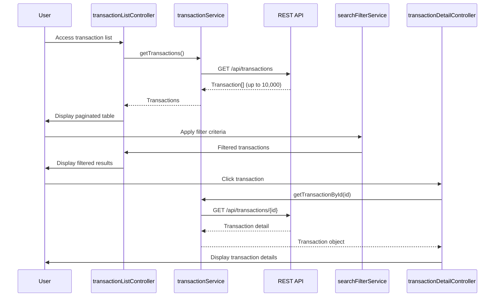

# Low-Level Design: Transaction Management and Monitoring
**Epic ID:** QE-7739

## a. Architecture Mapping

- **transactionModule** (AngularJS Module) - Root module for transaction management
- **transactionListController** (Controller) - Manages transaction list view
- **transactionDetailController** (Controller) - Handles transaction detail view
- **transactionService** (Factory) - Fetches transaction data via REST API
- **searchFilterService** (Service) - Handles search and filter logic
- **transactionTableDirective** (Directive) - Renders paginated transaction table

**Folder Structure:**
```
/app
  /modules
    /transactions
      /controllers (transactionListController.js, transactionDetailController.js)
      /services (transactionService.js, searchFilterService.js)
      /directives (transactionTableDirective.js)
      /views (transaction-list.html, transaction-detail.html)
```

## b. Component Specifications

| Component Name | Artifact Type | Responsibility | Key Dependencies |
|----------------|---------------|----------------|------------------|
| transactionModule | Module | Bootstraps transaction management feature | angular, ngRoute |
| transactionListController | Controller | Displays paginated transaction list with search/filter | transactionService, searchFilterService |
| transactionDetailController | Controller | Shows detailed view of selected transaction | transactionService, $routeParams |
| transactionService | Factory | Fetches transactions via REST API | $http, $q |
| searchFilterService | Service | Applies search and filter criteria to transaction list | $filter |
| transactionTableDirective | Directive | Renders transaction table with sorting and pagination | None |

## c. Data Model

**Transaction Object:**
```javascript
{
  transactionId: String,
  cardId: String,
  cardNumber: String (masked),
  amount: Number,
  merchant: String,
  category: String,
  transactionDate: Date,
  status: String,
  description: String
}
```

**SearchFilter Object:**
```javascript
{
  dateFrom: Date,
  dateTo: Date,
  cardId: String,
  minAmount: Number,
  maxAmount: Number,
  merchant: String,
  category: String
}
```

## d. Data Flow

User authenticates and accesses transaction list → transactionListController calls transactionService.getTransactions() → Service makes GET /api/transactions REST call → Up to 10,000 transactions retrieved within 500ms → Transactions displayed in paginated table via transactionTableDirective → User applies search/filter criteria → searchFilterService.applyFilter(transactions, filter) filters transactions client-side → Filtered results displayed → User clicks transaction → transactionDetailController fetches detailed data via transactionService.getTransactionById(id) → Detailed view rendered with all transaction attributes.

## e. Primary Sequence Diagram



## f. Implementation Notes

- Use AngularJS $http service with response caching for 500ms retrieval performance
- Implement client-side pagination using AngularJS $filter with page size of 50 transactions
- Apply searchFilterService with debounced search input (300ms delay) for performance
- Use ng-repeat with track by transactionId for efficient table rendering
- Inject dependencies via explicit array notation for minification compatibility

## g. Error Handling

HTTP interceptor captures API errors; transactionService wraps calls in $q promises with rejection handlers; user notified via toastr.

## h. Security Notes

Requires token-based auth via existing SSO; secure data transmission over HTTPS; card numbers masked in transaction list.