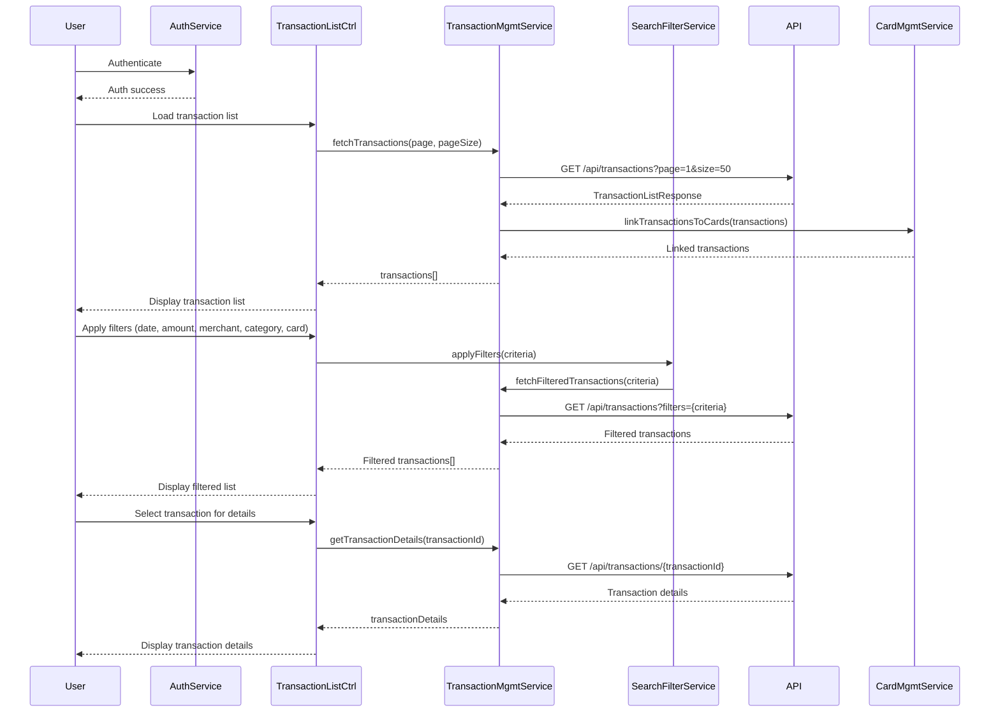

# Low-Level Design: Transaction Management and Monitoring
**Epic ID:** QE-7739

---

## a. Architecture Mapping

- **Transaction Management Module** → AngularJS Module (`transactionManagement`)
- **User Interface** → AngularJS Controller (`TransactionListController`) + View Template
- **Transaction Management Service** → AngularJS Service (`TransactionManagementService`) for business logic
- **Search and Filter Engine** → AngularJS Filter (`transactionFilter`) + Service (`SearchFilterService`)
- **Transaction Data Repository** → REST API integration via `$http`
- **Card Management System** → AngularJS Service (`CardManagementService`) for card-transaction linking
- **Authentication Service** → AngularJS Service (`AuthService`) for user authentication

**Recommended Folder Structure:**
```
app/
├── modules/
│   └── transactionManagement/
│       ├── controllers/
│       │   └── transactionListController.js
│       ├── services/
│       │   ├── transactionManagementService.js
│       │   ├── searchFilterService.js
│       │   ├── cardManagementService.js
│       │   └── authService.js
│       ├── filters/
│       │   └── transactionFilter.js
│       ├── views/
│       │   ├── transaction-list.html
│       │   └── transaction-detail.html
│       └── transactionManagement.module.js
```

---

## b. Component Specifications

| Component Name | Artifact Type | Responsibility | Key Dependencies |
|----------------|---------------|----------------|------------------|
| `transactionManagement` | Module | Root module for transaction tracking and monitoring | `ngRoute`, `ui.bootstrap`, `ngTable` |
| `TransactionListController` | Controller | Manages transaction list display, search, filter, and pagination | `TransactionManagementService`, `SearchFilterService`, `$scope` |
| `TransactionManagementService` | Service | Fetches transaction data, handles transaction details retrieval | `$http`, `CardManagementService`, `$q`, `API_CONFIG` |
| `SearchFilterService` | Service | Implements search and filter logic (date range, amount, merchant, category, card) | `$filter` |
| `transactionFilter` | Filter | Custom AngularJS filter for client-side transaction filtering | None |
| `CardManagementService` | Service | Links transactions to specific credit cards | `$http`, `API_CONFIG` |
| `AuthService` | Service | Handles user authentication and authorization | `$http`, `$window`, `API_CONFIG` |

---

## c. Data Model

**Transaction Object:**
```javascript
{
  transactionId: String,        // Unique transaction identifier
  cardId: String,               // Associated credit card ID
  cardNumber: String,           // Masked card number
  amount: Number,               // Transaction amount
  merchant: String,             // Merchant name
  category: String,             // Transaction category (e.g., "Food & Dining")
  transactionDate: Date,        // Transaction date and time
  description: String,          // Transaction description
  status: String,               // "Posted", "Pending", "Declined"
  location: String              // Transaction location (optional)
}
```

**TransactionListResponse Object:**
```javascript
{
  transactions: Array<Transaction>, // Array of transaction objects
  totalCount: Number,               // Total number of transactions
  page: Number,                     // Current page number
  pageSize: Number                  // Number of transactions per page
}
```

**SearchFilterCriteria Object:**
```javascript
{
  dateFrom: Date,
  dateTo: Date,
  minAmount: Number,
  maxAmount: Number,
  merchant: String,
  category: String,
  cardId: String
}
```

---

## d. Data Flow

User authenticates via `AuthService` → User navigates to transaction management interface → `TransactionListController` initializes and calls `TransactionManagementService.fetchTransactions()` → Service makes REST API call to `/api/transactions` with pagination parameters → Transaction data retrieved from repository (linked to cards via `CardManagementService`) → Transactions displayed in paginated list (using ng-table) → User applies search/filter criteria (date range, amount, merchant, category, card) → `SearchFilterService` processes criteria and calls API with filter parameters → Filtered transaction list retrieved within 500ms (optimized with indexed queries) → User clicks on a transaction to view details → `TransactionManagementService.getTransactionDetails(transactionId)` fetches detailed information → Transaction details displayed including amount, merchant, date, category, and associated card → System handles up to 10,000 transactions per user efficiently with pagination and lazy loading.

---

## e. Primary Sequence Diagram



---

## f. Implementation Notes

- Use `ng-table` directive for efficient pagination and sorting of up to 10,000 transactions
- Implement server-side pagination and filtering to meet 500ms retrieval requirement
- Use AngularJS `$filter` service for client-side filtering when working with cached data
- Leverage `$http` interceptors for authentication token injection and secure data transmission
- Implement lazy loading for transaction details to optimize initial page load

---

## g. Error Handling

HTTP interceptor-based error handling with user notification via toastr; retry mechanism for transient API failures.

---

## h. Security Notes

Requires token-based authentication via existing SSO; secure data transmission over HTTPS; sensitive transaction data encrypted at rest.