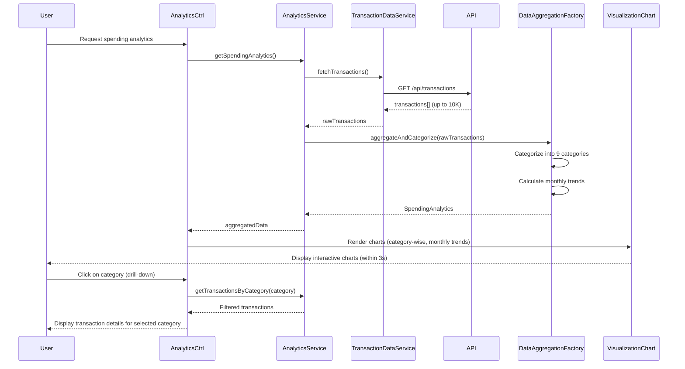

# Low-Level Design: Spending Analytics and Transaction Insights
**Epic ID:** QE-7740

---

## a. Architecture Mapping

- **Analytics Module** → AngularJS Module (`spendingAnalytics`)
- **User Interface** → AngularJS Controller (`AnalyticsController`) + View Template
- **Analytics Service** → AngularJS Service (`AnalyticsService`) for analytics logic and API orchestration
- **Transaction Data Service** → AngularJS Service (`TransactionDataService`) for transaction data access
- **Data Aggregation Engine** → AngularJS Factory (`DataAggregationFactory`) for data processing and categorization
- **Visualization Renderer** → AngularJS Directive (`visualizationChart`) using Chart.js or D3.js
- **Transaction Database** → REST API integration via `$http`

**Recommended Folder Structure:**
```
app/
├── modules/
│   └── spendingAnalytics/
│       ├── controllers/
│       │   └── analyticsController.js
│       ├── services/
│       │   ├── analyticsService.js
│       │   └── transactionDataService.js
│       ├── factories/
│       │   └── dataAggregationFactory.js
│       ├── directives/
│       │   └── visualizationChart.js
│       ├── views/
│       │   ├── analytics-dashboard.html
│       │   └── transaction-details.html
│       └── spendingAnalytics.module.js
```

---

## b. Component Specifications

| Component Name | Artifact Type | Responsibility | Key Dependencies |
|----------------|---------------|----------------|------------------|
| `spendingAnalytics` | Module | Root module for spending analytics and transaction insights | `ngRoute`, `chart.js`, `ui.bootstrap` |
| `AnalyticsController` | Controller | Manages analytics dashboard, handles user interactions (drill-down, filtering) | `AnalyticsService`, `$scope`, `$filter` |
| `AnalyticsService` | Service | Orchestrates analytics workflow, coordinates data fetching and aggregation | `TransactionDataService`, `DataAggregationFactory`, `$q` |
| `TransactionDataService` | Service | Fetches raw transaction data from API | `$http`, `API_CONFIG`, `$cacheFactory` |
| `DataAggregationFactory` | Factory | Processes and categorizes transactions into nine spending categories, calculates monthly trends | None (client-side logic) |
| `visualizationChart` | Directive | Renders interactive charts and graphs (category-wise, monthly trends) using Chart.js | `Chart.js library` |

---

## c. Data Model

**SpendingAnalytics Object:**
```javascript
{
  categoryWiseSpend: Array<CategorySpend>,  // Spend breakdown by nine categories
  monthlyTrends: Array<MonthlyTrend>,       // Monthly spend trends
  totalSpend: Number,                       // Total spend across all transactions
  transactionCount: Number,                 // Total number of transactions
  period: String                            // Analysis period (e.g., "Last 12 months")
}
```

**CategorySpend Object:**
```javascript
{
  category: String,    // One of: Food & Dining, Fuel, Shopping, Travel, Entertainment, Utilities, Healthcare, Education, Miscellaneous
  amount: Number,      // Total spend in this category
  percentage: Number,  // Percentage of total spend
  transactionCount: Number  // Number of transactions in this category
}
```

**MonthlyTrend Object:**
```javascript
{
  month: String,       // e.g., "Jan 2026"
  amount: Number,      // Total spend for the month
  categoryBreakdown: Array<CategorySpend>  // Category-wise spend for the month
}
```

**Transaction Object:**
```javascript
{
  transactionId: String,
  amount: Number,
  merchant: String,
  category: String,    // One of nine categories
  transactionDate: Date,
  cardId: String,
  description: String
}
```

---

## d. Data Flow

User requests spending analytics → `AnalyticsController` initializes and calls `AnalyticsService.getSpendingAnalytics()` → Service invokes `TransactionDataService.fetchTransactions()` which makes REST API call to `/api/transactions` → Raw transaction data retrieved from transaction database (up to 10,000 transactions) → `DataAggregationFactory` processes transactions and categorizes them into nine spending categories (Food & Dining, Fuel, Shopping, Travel, Entertainment, Utilities, Healthcare, Education, Miscellaneous) using merchant/MCC code mapping → Factory calculates monthly spend trends by aggregating transactions by month → Aggregated data passed to `visualizationChart` directive → Chart.js renders interactive charts and graphs (category-wise pie chart, monthly trend line chart) within 3 seconds → User Interface displays responsive visualizations → User can drill down into specific transactions by clicking on chart elements (e.g., click "Food & Dining" category to view all transactions in that category) → `AnalyticsController` navigates to transaction details view with category filter applied → Data aggregation completes within 5 seconds for optimal performance.

---

## e. Primary Sequence Diagram



---

## f. Implementation Notes

- Use Chart.js library integrated via `angular-chart.js` for 3-second visualization render time and responsive charts
- Implement `DataAggregationFactory` with rule-based categorization logic (merchant name/MCC code to category mapping)
- Cache aggregated analytics data in `AnalyticsService` using `$cacheFactory` to optimize 5-second aggregation requirement
- Use `ng-click` on chart elements for drill-down functionality (navigate to filtered transaction list)
- Leverage Web Workers (if supported) for heavy data aggregation to avoid blocking UI thread when handling 10K transactions

---

## g. Error Handling

Try/catch blocks in aggregation logic with fallback to partial data display; HTTP interceptor for API errors with user notification.

---

## h. Security Notes

Standard input validation and secure API calls assumed; transaction data transmitted over HTTPS with authentication tokens.