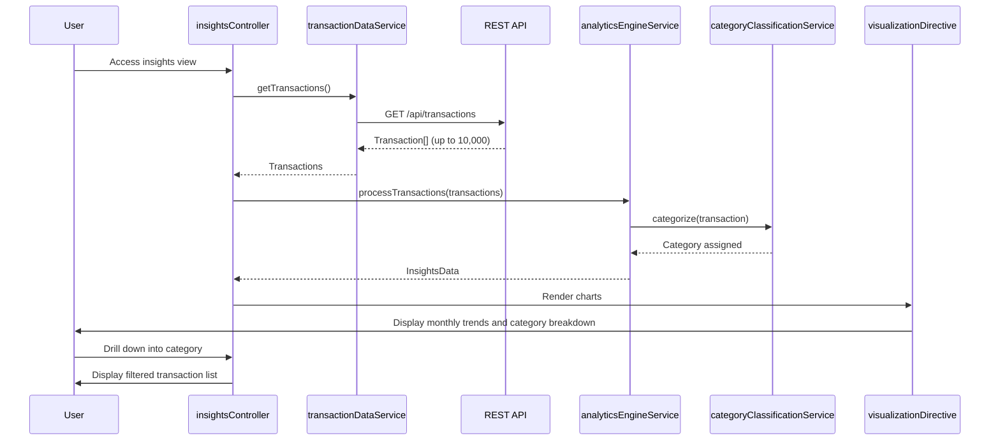

# Low-Level Design: Spending Analytics and Transaction Insights
**Epic ID:** QE-7740

## a. Architecture Mapping

- **insightsModule** (AngularJS Module) - Root module for spending insights
- **insightsController** (Controller) - Manages insights view and visualizations
- **analyticsEngineService** (Service) - Processes and aggregates transaction data
- **transactionDataService** (Factory) - Fetches transaction data via REST API
- **categoryClassificationService** (Service) - Categorizes transactions into nine categories
- **visualizationDirective** (Directive) - Renders interactive charts using D3.js or Chart.js

**Folder Structure:**
```
/app
  /modules
    /insights
      /controllers (insightsController.js)
      /services (analyticsEngineService.js, transactionDataService.js, categoryClassificationService.js)
      /directives (visualizationDirective.js)
      /views (insights.html)
```

## b. Component Specifications

| Component Name | Artifact Type | Responsibility | Key Dependencies |
|----------------|---------------|----------------|------------------|
| insightsModule | Module | Bootstraps spending insights feature | angular, ngRoute, chart.js |
| insightsController | Controller | Orchestrates insights view and drill-down interactions | analyticsEngineService, transactionDataService |
| analyticsEngineService | Service | Aggregates transaction data for monthly trends and category breakdowns | categoryClassificationService |
| transactionDataService | Factory | Fetches transaction data via REST API | $http, $q |
| categoryClassificationService | Service | Maps transactions to nine predefined spending categories | None |
| visualizationDirective | Directive | Renders monthly trend line chart and category pie chart | chart.js |

## c. Data Model

**Transaction Object:**
```javascript
{
  transactionId: String,
  cardId: String,
  amount: Number,
  merchant: String,
  category: String, // One of 9: Food & Dining, Fuel, Shopping, Travel, Entertainment, Utilities, Healthcare, Education, Miscellaneous
  transactionDate: Date,
  description: String
}
```

**InsightsData Object:**
```javascript
{
  monthlyTrends: [{month: String, totalSpend: Number}],
  categoryBreakdown: [{category: String, totalSpend: Number, percentage: Number}],
  topSpendingCategories: [String],
  spendingPatterns: String
}
```

## d. Data Flow

User accesses insights view → insightsController calls transactionDataService.getTransactions() → Service makes GET /api/transactions REST call → Up to 10,000 transactions retrieved → analyticsEngineService.processTransactions(transactions) invoked → categoryClassificationService categorizes each transaction into one of nine categories → analyticsEngineService aggregates spending by month and category → Monthly trend data and category breakdown calculated → InsightsData object returned → visualizationDirective renders monthly trend line chart and category-wise pie chart → User drills down into specific category → insightsController filters transactions by category and displays detailed list.

## e. Primary Sequence Diagram



## f. Implementation Notes

- Integrate Chart.js via bower; wrap in AngularJS directive for reactive updates
- Use AngularJS $filter for client-side date range filtering
- Implement categoryClassificationService with static category mapping logic
- Apply Web Workers for data aggregation to meet 3-second rendering NFR
- Use AngularJS $scope.$watch for reactive chart updates on data changes

## g. Error Handling

HTTP interceptor handles API errors; analyticsEngineService validates data completeness; user notified via toastr on processing failures.

## h. Security Notes

Standard input validation and secure API calls assumed; token-based auth via existing SSO.