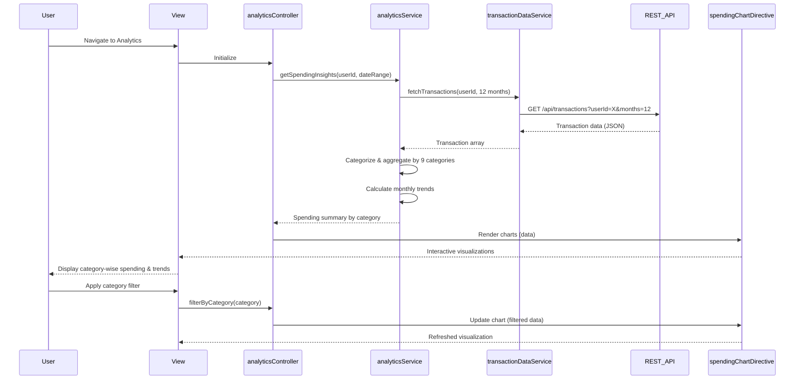

# Low-Level Design: QE-7741 - Spending Analytics and Insights

## a. Architecture Mapping

- **Analytics Engine** → AngularJS Service (`analyticsService`)
- **Transaction Categorization Service** → AngularJS Factory (`transactionCategorizationFactory`)
- **Visualization Rendering Service** → AngularJS Directive (`spendingChartDirective`)
- **Transaction Data Store** → AngularJS Service with REST API integration (`transactionDataService`)
- **User Interface** → AngularJS Controller (`analyticsController`) + HTML5 View

**Folder Structure:**
```
app/
├── modules/analytics/
│   ├── controllers/analyticsController.js
│   ├── services/analyticsService.js
│   ├── services/transactionDataService.js
│   ├── factories/transactionCategorizationFactory.js
│   ├── directives/spendingChartDirective.js
│   └── views/analytics.html
├── shared/
│   └── constants/categoryConstants.js
└── assets/css/analytics.css
```

## b. Component Specifications

| Component Name | Artifact Type | Responsibility | Key Dependencies |
|----------------|---------------|----------------|------------------|
| analyticsController | Controller | Orchestrates analytics view, handles user interactions, manages chart filters | analyticsService, $scope |
| analyticsService | Service | Performs spending aggregations, trend calculations, coordinates data flow | transactionDataService, transactionCategorizationFactory |
| transactionDataService | Service | Fetches 12-month transaction history via REST API, caches results | $http, $q |
| transactionCategorizationFactory | Factory | Maps transactions to 9 predefined categories, provides category metadata | categoryConstants |
| spendingChartDirective | Directive | Renders interactive charts using D3.js/Chart.js, handles drill-down events | analyticsService |
| categoryConstants | Constant | Defines 9 spending categories (Food & Dining, Fuel, Shopping, Travel, Entertainment, Utilities, Healthcare, Education, Miscellaneous) | None |

## c. Data Model

**Transaction Model:**
```javascript
{
  id: String,
  cardId: String,
  amount: Number,
  date: Date,
  category: String, // One of 9 predefined categories
  merchant: String,
  description: String
}
```

**Spending Summary Model:**
```javascript
{
  categoryName: String,
  totalAmount: Number,
  transactionCount: Number,
  percentage: Number,
  monthlyTrend: Array<{month: String, amount: Number}>
}
```

**Analytics Request Model:**
```javascript
{
  userId: String,
  cardIds: Array<String>,
  startDate: Date,
  endDate: Date,
  categories: Array<String> // Optional filter
}
```

## d. Data Flow

User navigates to analytics view → analyticsController initializes and calls analyticsService.getSpendingInsights() → analyticsService requests 12-month transaction data from transactionDataService via REST API → transactionCategorizationFactory maps each transaction to one of 9 categories → analyticsService aggregates spending by category and calculates monthly trends → spendingChartDirective receives aggregated data and renders interactive visualizations using Chart.js → User applies category filters or drills down into specific categories → Controller updates service parameters and refreshes charts with filtered data.

## e. Primary Sequence Diagram



## f. Implementation Notes

- Use AngularJS dependency injection to inject analyticsService and transactionDataService into analyticsController
- Implement Chart.js or D3.js via custom directive for responsive, interactive visualizations with drill-down capability
- Cache transaction data in transactionDataService using $cacheFactory to meet 1.5-second rendering requirement
- Use ES6 arrow functions and const/let in services for cleaner code; transpile with Babel if needed
- REST API integration via $http with promise-based error handling; aggregate data client-side for performance

## g. Error Handling

HTTP interceptor captures API failures; analyticsService wraps calls in try/catch; user notified via Bootstrap modal on data fetch errors.

## h. Security Notes

Requires token-based auth via existing SSO; transaction data API calls include JWT in Authorization header.