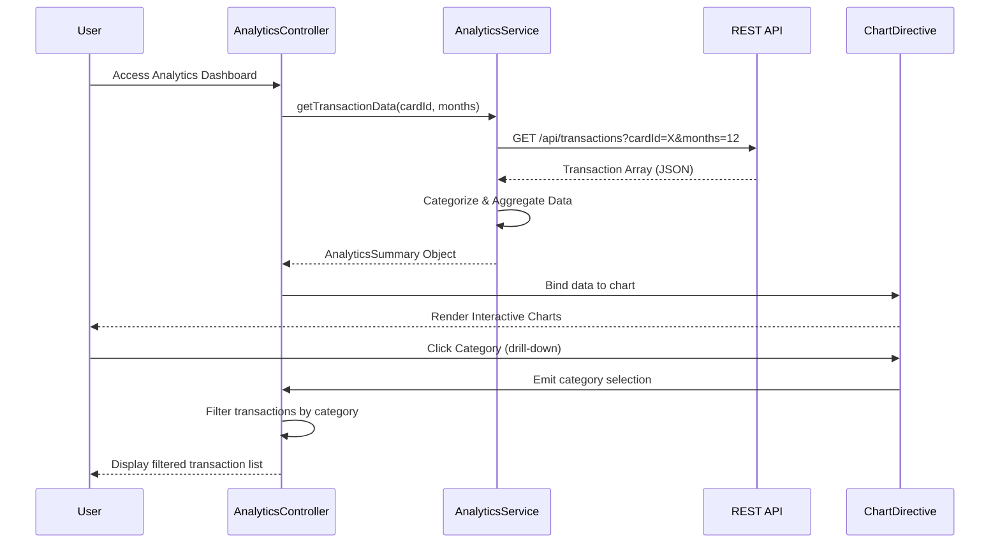

# Low-Level Design: QE-7741 - Spending Analytics and Insights

## a. Architecture Mapping

- **Analytics Dashboard UI** → AngularJS Module (`app.analytics`) + Controller (`AnalyticsDashboardController`)
- **Visualization Engine** → AngularJS Directive (`chartVisualizer`) wrapping Chart.js/D3.js
- **Analytics Service** → AngularJS Service (`AnalyticsService`) handling data aggregation and API calls
- **Transaction Categorization** → AngularJS Factory (`TransactionCategorizerFactory`) for client-side category logic
- **Analytics Data Store** → REST API backend endpoints consumed by AngularJS services

**Recommended Folder Structure:**
```
/app
  /analytics
    analytics.module.js
    analytics.controller.js
    analytics.service.js
    analytics.html
  /shared
    /directives
      chart-visualizer.directive.js
    /factories
      transaction-categorizer.factory.js
```

## b. Component Specifications

| Name | Artifact Type | Responsibility | Key Dependencies |
|------|---------------|----------------|------------------|
| AnalyticsDashboardController | Controller | Manages analytics view state, handles user interactions (filtering, drill-down) | AnalyticsService, $scope, $filter |
| AnalyticsService | Service | Fetches transaction data from REST API, aggregates by category and time period | $http, $q, TransactionCategorizerFactory |
| chartVisualizer | Directive | Renders interactive charts using Chart.js/D3.js with drill-down capability | Chart.js/D3.js library, $timeout |
| TransactionCategorizerFactory | Factory | Maps transactions to 9 predefined categories based on merchant/MCC codes | None (pure logic) |
| CategoryFilterComponent | Component | Provides multi-category filter UI for user selection | AnalyticsService |

## c. Data Model

**Transaction Object:**
```javascript
{
  id: String,
  cardId: String,
  amount: Number,
  date: Date,
  merchant: String,
  category: String, // One of: Food & Dining, Fuel, Shopping, Travel, Entertainment, Utilities, Healthcare, Education, Miscellaneous
  mccCode: String
}
```

**AnalyticsSummary Object:**
```javascript
{
  categoryBreakdown: Array<{category: String, totalSpend: Number, transactionCount: Number}>,
  monthlyTrends: Array<{month: String, totalSpend: Number}>,
  dateRange: {start: Date, end: Date}
}
```

## d. Data Flow

User accesses analytics dashboard → AnalyticsDashboardController initializes and calls AnalyticsService.getTransactionData() → Service makes REST API call to /api/transactions?cardId=X&months=12 → Backend returns transaction array → TransactionCategorizerFactory categorizes any uncategorized transactions → AnalyticsService aggregates data into category breakdown and monthly trends → Controller updates $scope with AnalyticsSummary → chartVisualizer directive renders interactive charts within 1.5s → User clicks chart segment to drill down → Controller filters transactions and updates view with detailed transaction list.

## e. Primary Sequence Diagram



## f. Implementation Notes

- Use AngularJS 1.x Dependency Injection for all services, factories, and controllers
- Leverage ES6 classes for service definitions with proper constructor injection
- Implement Chart.js for responsive, interactive visualizations with custom click handlers for drill-down
- Use $http interceptors for centralized API error handling and loading states
- Apply Bootstrap grid system for responsive layout across devices

## g. Error Handling

HTTP interceptor captures API errors; user notified via Bootstrap alert component; retry logic for transient failures.

## h. Security Notes

Standard input validation and secure API calls assumed; token-based authentication via existing SSO.