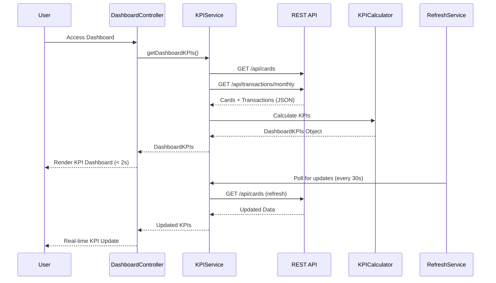

# Low-Level Design: QE-7742 - Credit Card Dashboard and KPI Management

## a. Architecture Mapping

- **Responsive Dashboard UI** → AngularJS Module (`app.dashboard`) + Controller (`DashboardController`)
- **KPI Aggregation Service** → AngularJS Service (`KPIService`) for API communication
- **KPI Calculation Module** → AngularJS Factory (`KPICalculatorFactory`) for client-side calculations
- **Real-time Data Refresh Engine** → AngularJS Service (`DataRefreshService`) using $interval for polling
- **Credit Card Data Sources** → REST API endpoints consumed by KPIService

**Recommended Folder Structure:**
```
/app
  /dashboard
    dashboard.module.js
    dashboard.controller.js
    dashboard.service.js
    dashboard.html
  /shared
    /services
      data-refresh.service.js
    /factories
      kpi-calculator.factory.js
```

## b. Component Specifications

| Name | Artifact Type | Responsibility | Key Dependencies |
|------|---------------|----------------|------------------|
| DashboardController | Controller | Manages dashboard state, displays KPIs, handles refresh triggers | KPIService, DataRefreshService, $scope |
| KPIService | Service | Fetches card balances, limits, transactions from REST API | $http, $q, KPICalculatorFactory |
| KPICalculatorFactory | Factory | Computes monthly spend, available credit, outstanding amounts from raw data | None (pure logic) |
| DataRefreshService | Service | Polls API at intervals for real-time KPI updates | $interval, KPIService |
| KPICardComponent | Component | Displays individual KPI metric (e.g., Monthly Spend) with responsive styling | None |

## c. Data Model

**CreditCard Object:**
```javascript
{
  cardId: String,
  cardNumber: String,
  creditLimit: Number,
  currentBalance: Number,
  availableCredit: Number
}
```

**DashboardKPIs Object:**
```javascript
{
  monthlySpend: Number,
  totalCreditLimit: Number,
  totalAvailableCredit: Number,
  totalOutstanding: Number,
  lastUpdated: Date
}
```

## d. Data Flow

User accesses dashboard → DashboardController calls KPIService.getDashboardKPIs() → Service makes parallel REST API calls to /api/cards and /api/transactions/monthly → Backend returns card array and transaction summary → KPICalculatorFactory aggregates total credit limit, available credit, outstanding amounts, and monthly spend → KPIService returns DashboardKPIs object → Controller updates $scope and renders KPI cards via Bootstrap grid within 2 seconds → DataRefreshService polls API every 30 seconds → On new data, Controller updates KPIs in real-time without page reload.

## e. Primary Sequence Diagram



## f. Implementation Notes

- Use AngularJS $q.all() for parallel API calls to meet 2-second load requirement
- Implement Bootstrap responsive utilities (col-xs, col-sm, col-md) for mobile/tablet/desktop layouts
- Use $interval in DataRefreshService with configurable polling frequency (default 30s)
- Apply AngularJS one-time binding (::) for static labels to optimize digest cycles
- Leverage ES6 arrow functions and template literals for cleaner service code

## g. Error Handling

$http interceptor handles API failures; user sees error notification via Bootstrap alert; failed refresh attempts logged silently.

## h. Security Notes

Requires token-based auth via existing SSO; API endpoints secured with JWT validation.