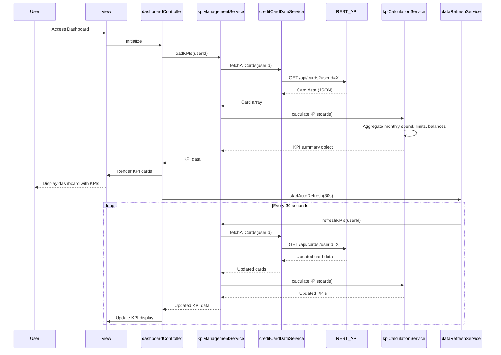

# Low-Level Design: QE-7742 - Credit Card Dashboard and KPI Management

## a. Architecture Mapping

- **Responsive Dashboard UI** → AngularJS Controller (`dashboardController`) + HTML5 View with Bootstrap grid
- **KPI Management Service** → AngularJS Service (`kpiManagementService`)
- **KPI Calculation Service** → AngularJS Service (`kpiCalculationService`)
- **Real-time Data Refresh Engine** → AngularJS Service with $interval (`dataRefreshService`)
- **Credit Card Data Sources** → REST API integration via AngularJS Service (`creditCardDataService`)

**Folder Structure:**
```
app/
├── modules/dashboard/
│   ├── controllers/dashboardController.js
│   ├── services/kpiManagementService.js
│   ├── services/kpiCalculationService.js
│   ├── services/dataRefreshService.js
│   ├── services/creditCardDataService.js
│   └── views/dashboard.html
├── shared/
│   └── directives/kpiCardDirective.js
└── assets/css/dashboard.css
```

## b. Component Specifications

| Component Name | Artifact Type | Responsibility | Key Dependencies |
|----------------|---------------|----------------|------------------|
| dashboardController | Controller | Manages dashboard view state, coordinates KPI display, handles user interactions | kpiManagementService, dataRefreshService, $scope |
| kpiManagementService | Service | Orchestrates KPI retrieval and refresh, manages data flow between calculation and UI | kpiCalculationService, creditCardDataService |
| kpiCalculationService | Service | Performs aggregations for monthly spend, total credit limit, available credit, outstanding amounts | None |
| dataRefreshService | Service | Implements periodic polling for real-time KPI updates using $interval | kpiManagementService |
| creditCardDataService | Service | Fetches card balances, limits, transaction data via REST API, implements caching | $http, $q, $cacheFactory |
| kpiCardDirective | Directive | Renders individual KPI cards with Bootstrap styling, displays metric values | None |

## c. Data Model

**Credit Card Model:**
```javascript
{
  cardId: String,
  cardNumber: String,
  cardType: String,
  creditLimit: Number,
  currentBalance: Number,
  availableCredit: Number,
  outstandingAmount: Number
}
```

**KPI Summary Model:**
```javascript
{
  monthlySpend: Number,
  totalCreditLimit: Number,
  totalAvailableCredit: Number,
  totalOutstanding: Number,
  cardCount: Number,
  lastUpdated: Date
}
```

**Dashboard Config Model:**
```javascript
{
  userId: String,
  refreshInterval: Number, // milliseconds
  enableAutoRefresh: Boolean
}
```

## d. Data Flow

User accesses dashboard → dashboardController initializes and calls kpiManagementService.loadKPIs() → kpiManagementService requests card data from creditCardDataService via REST API → creditCardDataService fetches all user cards with balances and limits → kpiCalculationService aggregates data to compute monthly spend, total credit limit, available credit, and outstanding amounts → dataRefreshService starts periodic polling (every 30 seconds) → Aggregated KPIs passed to dashboardController → kpiCardDirective renders each KPI in responsive Bootstrap cards → Real-time updates automatically refresh KPIs without page reload.

## e. Primary Sequence Diagram



## f. Implementation Notes

- Use AngularJS $interval in dataRefreshService for periodic polling; cancel interval on $scope.$destroy to prevent memory leaks
- Implement responsive Bootstrap grid (col-xs-12 col-md-6 col-lg-3) for KPI cards to support mobile, tablet, desktop
- Cache card data in creditCardDataService using $cacheFactory with 2-minute TTL to meet 2-second load requirement
- Use ES6 template literals and arrow functions in services; ensure dependency injection annotation for minification safety
- REST API calls via $http return promises; chain with .then() for sequential operations

## g. Error Handling

HTTP interceptor logs API errors; kpiManagementService catches failures and displays Bootstrap alert; retry logic in dataRefreshService on refresh failures.

## h. Security Notes

Requires token-based auth via existing SSO; all API calls include JWT in Authorization header; sensitive card data masked in UI.