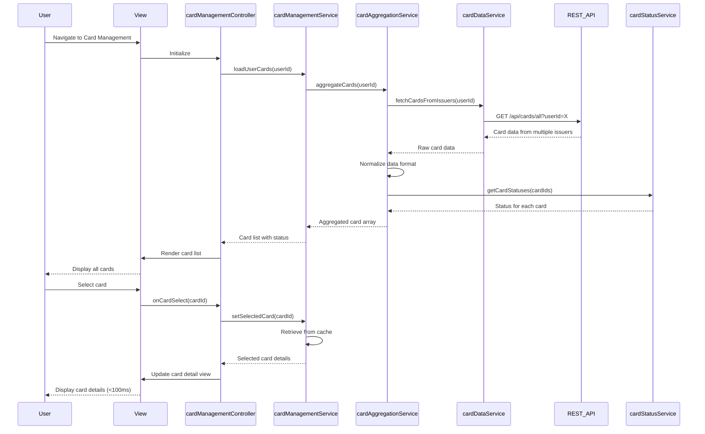

# Low-Level Design: QE-7743 - Multi-Card Management and Viewing

## a. Architecture Mapping

- **User Interface** → AngularJS Controller (`cardManagementController`) + HTML5 View
- **Card Management Service** → AngularJS Service (`cardManagementService`)
- **Card Data Aggregation Service** → AngularJS Service (`cardAggregationService`)
- **Card Status Monitoring Service** → AngularJS Service (`cardStatusService`)
- **Card Issuer Data Feeds** → REST API integration via AngularJS Service (`cardDataService`)

**Folder Structure:**
```
app/
├── modules/cards/
│   ├── controllers/cardManagementController.js
│   ├── services/cardManagementService.js
│   ├── services/cardAggregationService.js
│   ├── services/cardStatusService.js
│   ├── services/cardDataService.js
│   ├── directives/cardListDirective.js
│   ├── directives/cardDetailDirective.js
│   └── views/card-management.html
└── assets/css/cards.css
```

## b. Component Specifications

| Component Name | Artifact Type | Responsibility | Key Dependencies |
|----------------|---------------|----------------|------------------|
| cardManagementController | Controller | Manages card list view, handles card selection, coordinates card navigation | cardManagementService, $scope |
| cardManagementService | Service | Orchestrates card retrieval, manages selected card state, provides card operations | cardAggregationService, cardStatusService |
| cardAggregationService | Service | Aggregates card data from multiple issuer feeds, normalizes data format | cardDataService |
| cardStatusService | Service | Monitors card status (active/blocked/expired), provides real-time status updates | $interval |
| cardDataService | Service | Fetches card data from issuer APIs, implements client-side caching for sub-100ms switching | $http, $q, $cacheFactory |
| cardListDirective | Directive | Renders card list with Bootstrap cards, handles card selection events | None |
| cardDetailDirective | Directive | Displays individual card details, spend analysis, transaction summary | None |

## c. Data Model

**Card Model:**
```javascript
{
  cardId: String,
  cardNumber: String,
  cardType: String,
  issuer: String,
  creditLimit: Number,
  currentBalance: Number,
  availableCredit: Number,
  status: String, // active, blocked, expired
  expiryDate: Date,
  cardHolderName: String
}
```

**Card Spend Summary Model:**
```javascript
{
  cardId: String,
  currentMonthSpend: Number,
  lastMonthSpend: Number,
  yearToDateSpend: Number,
  transactionCount: Number
}
```

**Card List Model:**
```javascript
{
  userId: String,
  cards: Array<Card>,
  selectedCardId: String
}
```

## d. Data Flow

User navigates to card management view → cardManagementController calls cardManagementService.loadUserCards() → cardManagementService requests data from cardAggregationService → cardAggregationService fetches card data from multiple issuer feeds via cardDataService REST API → cardStatusService provides real-time status for each card → Aggregated card list with normalized format returned to controller → cardListDirective renders cards in Bootstrap grid → User selects a card → Controller updates selectedCardId in cardManagementService → cardDetailDirective displays selected card details and spend analysis from cached data (sub-100ms response) → cardStatusService polls for status updates every 60 seconds.

## e. Primary Sequence Diagram



## f. Implementation Notes

- Implement client-side caching in cardDataService using $cacheFactory with card data stored for 5 minutes to achieve sub-100ms card switching
- Use AngularJS $broadcast/$on for card selection events to decouple components
- Bootstrap card components (card, card-body, card-title) for responsive card list display supporting 10+ cards
- ES6 Map data structure in cardManagementService for O(1) card lookup by cardId
- REST API integration via $http with promise chaining; parallel requests using $q.all for multiple issuer feeds

## g. Error Handling

HTTP interceptor handles API failures; cardAggregationService implements fallback to cached data on issuer feed errors; user notified via Bootstrap toast.

## h. Security Notes

Requires token-based auth via existing SSO; card numbers masked in UI (show last 4 digits); API calls include JWT in Authorization header.