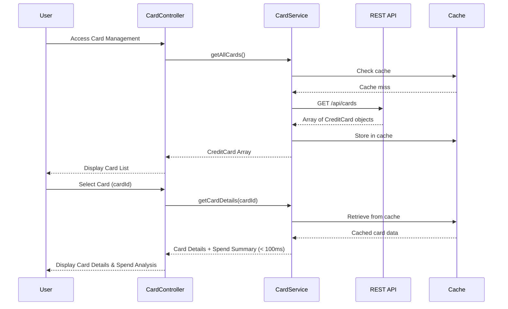

# Low-Level Design: QE-7743 - Multi-Card Management and Viewing

## a. Architecture Mapping

- **User Interface** → AngularJS Module (`app.cardManagement`) + Controller (`CardManagementController`)
- **Card Management Service** → AngularJS Service (`CardManagementService`) for API interactions
- **Data Aggregation Layer** → Backend REST API endpoints consumed by CardManagementService
- **Card Details Repository** → REST API backend storage accessed via CardManagementService
- **Card Issuer Data Feeds** → External API integration handled by backend, consumed via CardManagementService

**Recommended Folder Structure:**
```
/app
  /card-management
    card-management.module.js
    card-management.controller.js
    card-management.service.js
    card-list.html
    card-details.html
  /shared
    /components
      card-selector.component.js
```

## b. Component Specifications

| Name | Artifact Type | Responsibility | Key Dependencies |
|------|---------------|----------------|------------------|
| CardManagementController | Controller | Manages card list, handles card selection, displays card details and spend analysis | CardManagementService, $scope, $state |
| CardManagementService | Service | Fetches card list, retrieves individual card details, performs card-wise spend queries | $http, $q, $cacheFactory |
| CardSelectorComponent | Component | Provides UI for card selection with instant switching (< 100ms) | CardManagementService |
| CardDetailsView | Component | Displays detailed information for selected card including status, limits, usage | None |
| SpendAnalysisComponent | Component | Shows card-wise spending breakdown and trends | AnalyticsService (from QE-7741) |

## c. Data Model

**CreditCard Object:**
```javascript
{
  cardId: String,
  cardNumber: String,
  cardType: String, // Visa, Mastercard, etc.
  issuer: String,
  creditLimit: Number,
  availableCredit: Number,
  currentBalance: Number,
  status: String, // Active, Inactive, Blocked
  expiryDate: Date
}
```

**CardSpendSummary Object:**
```javascript
{
  cardId: String,
  monthlySpend: Number,
  categoryBreakdown: Array<{category: String, amount: Number}>,
  lastTransactionDate: Date
}
```

## d. Data Flow

User accesses card management interface → CardManagementController calls CardManagementService.getAllCards() → Service makes REST API call to /api/cards with caching enabled → Backend aggregates data from Card Issuer Data Feeds and Card Details Repository → Service returns array of CreditCard objects → Controller displays card list via CardSelectorComponent → User selects a card → Controller calls CardManagementService.getCardDetails(cardId) using cached data for sub-100ms response → Service returns detailed card info and spend summary → CardDetailsView and SpendAnalysisComponent render card-specific information instantly.

## e. Primary Sequence Diagram



## f. Implementation Notes

- Use AngularJS $cacheFactory to cache card list for sub-100ms card switching performance
- Implement ui-router for navigation between card list and card details views
- Apply Bootstrap card components for responsive card display grid
- Use AngularJS $state service for maintaining selected card state across views
- Leverage ES6 Promises ($q) for asynchronous API calls with proper error propagation

## g. Error Handling

$http interceptor with retry logic for transient failures; user notified via inline error messages; cache invalidation on errors.

## h. Security Notes

Standard input validation and secure API calls assumed; card data encrypted in transit via HTTPS.