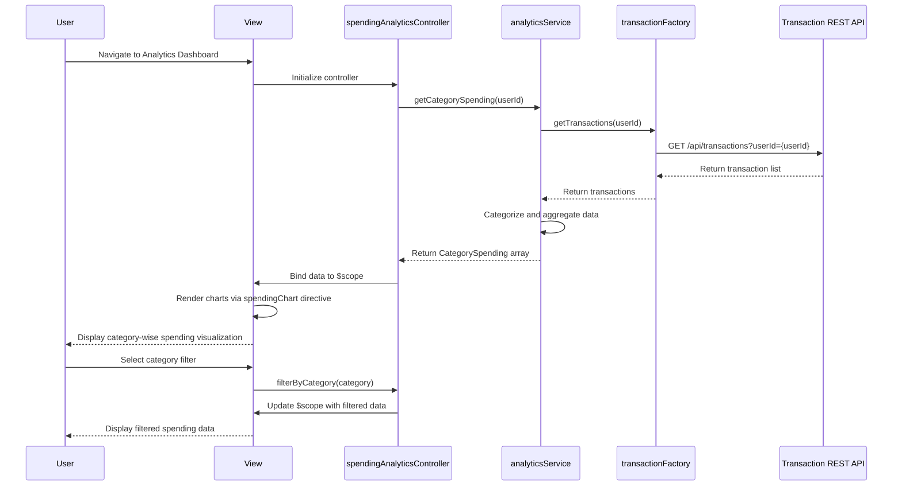

# Low-Level Design: QE-7744 - Analytics and Spending Insights

## a. Architecture Mapping

**Component to AngularJS Artifact Mapping:**
- Analytics Service → AngularJS Service (`analyticsService.js`) for business logic and data aggregation
- Transaction Service Integration → AngularJS Factory (`transactionFactory.js`) for REST API calls
- Categorization Engine Integration → AngularJS Service (`categorizationService.js`) for category assignment logic
- Spending Visualization UI → AngularJS Controller (`spendingAnalyticsController.js`) + Directive (`spendingChart.directive.js`)
- Category Filter Component → AngularJS Controller (`categoryFilterController.js`)
- Trend Analysis Component → AngularJS Controller (`trendAnalysisController.js`)

**Recommended Folder Structure:**
```
app/
├── modules/
│   └── analytics/
│       ├── controllers/
│       │   ├── spendingAnalyticsController.js
│       │   ├── categoryFilterController.js
│       │   └── trendAnalysisController.js
│       ├── services/
│       │   ├── analyticsService.js
│       │   └── categorizationService.js
│       ├── factories/
│       │   └── transactionFactory.js
│       ├── directives/
│       │   └── spendingChart.directive.js
│       └── views/
│           ├── analytics-dashboard.html
│           └── category-breakdown.html
```

## b. Component Specifications

| Component Name | Artifact Type | Responsibility | Key Dependencies |
|----------------|---------------|----------------|------------------|
| analyticsModule | Module | Root module for analytics feature | angular, ngRoute, chart.js |
| spendingAnalyticsController | Controller | Manages spending analytics view state and user interactions | analyticsService, $scope |
| categoryFilterController | Controller | Handles category selection and filtering logic | analyticsService, $scope |
| trendAnalysisController | Controller | Manages monthly trend display and comparison | analyticsService, $scope |
| analyticsService | Service | Aggregates transaction data, calculates category totals, generates trend data | transactionFactory, categorizationService |
| categorizationService | Service | Assigns transactions to predefined categories based on merchant data | transactionFactory |
| transactionFactory | Factory | REST API calls to transaction service endpoint | $http, $q |
| spendingChart | Directive | Renders interactive charts using Chart.js library | chart.js |

## c. Data Model

**Transaction Model:**
```javascript
{
  transactionId: String,
  cardId: String,
  amount: Number,
  merchantName: String,
  merchantCode: String,
  category: String, // One of: Food & Dining, Fuel, Shopping, Travel, Entertainment, Utilities, Healthcare, Education, Miscellaneous
  transactionDate: Date,
  description: String
}
```

**CategorySpending Model:**
```javascript
{
  category: String,
  totalAmount: Number,
  transactionCount: Number,
  percentage: Number
}
```

**MonthlyTrend Model:**
```javascript
{
  month: String, // YYYY-MM format
  totalSpend: Number,
  categoryBreakdown: Array<CategorySpending>
}
```

## d. Data Flow

User navigates to the Analytics Dashboard view, triggering `spendingAnalyticsController` initialization. The controller calls `analyticsService.getCategorySpending()`, which invokes `transactionFactory.getTransactions()` to fetch raw transaction data via REST API. The `categorizationService` processes transactions and assigns categories based on merchant codes. `analyticsService` aggregates data by category and month, returning structured `CategorySpending` and `MonthlyTrend` objects to the controller. The controller binds this data to `$scope`, and the `spendingChart` directive renders interactive visualizations. User interactions (category filter, month selection) trigger controller methods that update the scope, causing automatic view refresh.

## e. Primary Sequence Diagram



## f. Implementation Notes

- Use AngularJS Dependency Injection to inject `analyticsService`, `transactionFactory`, and `categorizationService` into controllers
- Implement ES6 classes for services and factories with arrow functions for cleaner syntax
- Use `$http` service with Promises (`$q`) for asynchronous REST API calls to transaction service
- Integrate Chart.js via custom AngularJS directive for rendering interactive, responsive charts
- Cache aggregated category data in `analyticsService` for 5 minutes to optimize performance and meet <1s rendering NFR

## g. Error Handling

HTTP interceptor captures API errors; user-friendly notifications displayed via toastr; fallback to cached data when available.

## h. Security Notes

Standard input validation and secure API calls assumed; token-based authentication inherited from existing SSO integration.