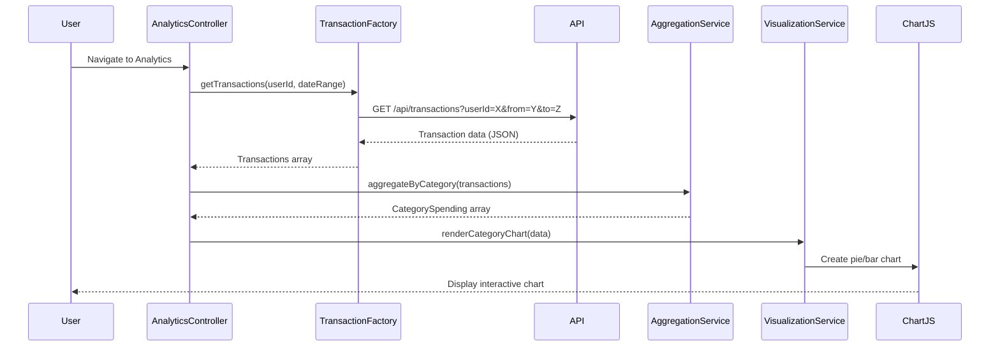

# Low-Level Design: QE-7744 - Analytics and Spending Insights

## a. Architecture Mapping

**Component to Artifact Mapping:**
- Analytics UI → AngularJS Module (`analyticsModule`) + Controller (`AnalyticsController`)
- Visualization Service → AngularJS Service (`VisualizationService`) for chart configuration and rendering
- Transaction Service → AngularJS Factory (`TransactionFactory`) for API calls to fetch transaction data
- Categorization Engine → Backend API (consumed via `CategoryService` Factory)
- Aggregation Service → AngularJS Service (`AggregationService`) for client-side data processing

**Recommended Folder Structure:**
```
app/
├── modules/
│   └── analytics/
│       ├── analytics.module.js
│       ├── controllers/
│       │   └── analytics.controller.js
│       ├── services/
│       │   ├── visualization.service.js
│       │   ├── aggregation.service.js
│       │   └── category.service.js
│       ├── factories/
│       │   └── transaction.factory.js
│       └── views/
│           └── analytics.html
```

## b. Component Specifications

| Component Name | Artifact Type | Responsibility | Key Dependencies |
|----------------|---------------|----------------|------------------|
| analyticsModule | Module | Root module for analytics feature | ngRoute, chart.js |
| AnalyticsController | Controller | Manages analytics UI state, triggers data fetch and chart rendering | VisualizationService, AggregationService, TransactionFactory |
| VisualizationService | Service | Configures and renders charts using Chart.js library | Chart.js, $timeout |
| AggregationService | Service | Aggregates transaction data by category and month | None |
| TransactionFactory | Factory | Fetches transaction data from REST API | $http, $q |
| CategoryService | Service | Retrieves category metadata and validates categorization | $http |

## c. Data Model

**Transaction Model:**
```javascript
{
  id: String,
  cardId: String,
  merchantName: String,
  amount: Number,
  date: Date,
  category: String // One of: Food & Dining, Fuel, Shopping, Travel, Entertainment, Utilities, Healthcare, Education, Miscellaneous
}
```

**CategorySpending Model:**
```javascript
{
  category: String,
  totalAmount: Number,
  transactionCount: Number,
  percentage: Number
}
```

**MonthlyTrend Model:**
```javascript
{
  month: String, // YYYY-MM format
  totalSpend: Number,
  categoryBreakdown: Array<CategorySpending>
}
```

## d. Data Flow

User navigates to Analytics view → AnalyticsController initializes and calls TransactionFactory.getTransactions() → Factory makes REST API call to /api/transactions → Response data is passed to AggregationService for grouping by category and month → Aggregated data is formatted by VisualizationService → Chart.js renders interactive category-wise and monthly trend charts in the view → User interactions (hover, click) trigger chart updates via VisualizationService.

## e. Primary Sequence Diagram



## f. Implementation Notes

- Use AngularJS Dependency Injection to inject TransactionFactory, AggregationService, and VisualizationService into AnalyticsController.
- Leverage Chart.js (v2.9+) for rendering responsive, interactive charts; wrap Chart.js API calls in VisualizationService for reusability.
- Implement client-side caching in TransactionFactory using $cacheFactory to reduce redundant API calls for the same date range.
- Use ES6 arrow functions and const/let for cleaner, modern JavaScript code within services and factories.
- Apply lodash or native Array methods (map, reduce, filter) in AggregationService for efficient data transformation.

## g. Error Handling

HTTP interceptor captures API errors; user-friendly notifications displayed via toastr or AngularJS $mdToast; fallback to empty state UI on data load failure.

## h. Security Notes

Requires token-based auth via existing SSO; all API calls include Authorization header with JWT token.