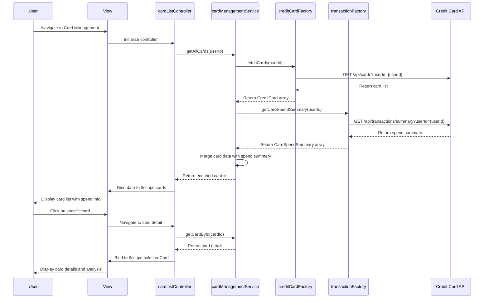

# Low-Level Design: QE-7745 - Credit Card Management and Tracking

## a. Architecture Mapping

**Component to AngularJS Artifact Mapping:**
- Card Management Service → AngularJS Service (`cardManagementService.js`) for card portfolio management logic
- Credit Card Data Service Integration → AngularJS Factory (`creditCardFactory.js`) for REST API calls
- Transaction Service Integration → AngularJS Factory (`transactionFactory.js`) for card-wise spending data
- Card List UI → AngularJS Controller (`cardListController.js`) + View (`card-list.html`)
- Card Detail UI → AngularJS Controller (`cardDetailController.js`) + View (`card-detail.html`)
- Card Filter Component → AngularJS Filter (`cardFilter.js`)

**Recommended Folder Structure:**
```
app/
├── modules/
│   └── cards/
│       ├── controllers/
│       │   ├── cardListController.js
│       │   └── cardDetailController.js
│       ├── services/
│       │   └── cardManagementService.js
│       ├── factories/
│       │   ├── creditCardFactory.js
│       │   └── transactionFactory.js
│       ├── filters/
│       │   └── cardFilter.js
│       └── views/
│           ├── card-list.html
│           └── card-detail.html
```

## b. Component Specifications

| Component Name | Artifact Type | Responsibility | Key Dependencies |
|----------------|---------------|----------------|------------------|
| cardsModule | Module | Root module for credit card management feature | angular, ngRoute |
| cardListController | Controller | Manages card list view, handles card selection and filtering | cardManagementService, $scope, $location |
| cardDetailController | Controller | Displays individual card details and card-wise spending analysis | cardManagementService, $scope, $routeParams |
| cardManagementService | Service | Orchestrates card data retrieval, caching, and card-wise spend calculations | creditCardFactory, transactionFactory |
| creditCardFactory | Factory | REST API calls to credit card data service for card information | $http, $q |
| transactionFactory | Factory | REST API calls to transaction service for card-specific transactions | $http, $q |
| cardFilter | Filter | Filters card list by card type, status, or search term | None |

## c. Data Model

**CreditCard Model:**
```javascript
{
  cardId: String,
  cardNumber: String, // Masked format: **** **** **** 1234
  cardHolderName: String,
  cardType: String, // e.g., Visa, Mastercard, Amex
  creditLimit: Number,
  availableCredit: Number,
  outstandingAmount: Number,
  billingCycle: String, // e.g., "1st to 30th"
  status: String // Active, Inactive, Blocked
}
```

**CardSpendSummary Model:**
```javascript
{
  cardId: String,
  monthlySpend: Number,
  transactionCount: Number,
  lastTransactionDate: Date
}
```

## d. Data Flow

User navigates to the Card Management view, triggering `cardListController` initialization. The controller invokes `cardManagementService.getAllCards()`, which calls `creditCardFactory.fetchCards()` to retrieve card data via REST API. The service also calls `transactionFactory.getCardSpendSummary()` to fetch card-wise spending data. Both API responses are aggregated in `cardManagementService`, which returns a combined array of `CreditCard` objects enriched with `CardSpendSummary` data. The controller binds this to `$scope.cards`, rendering the card list view. When a user selects a card, `$location` navigates to the card detail route, passing `cardId` as a route parameter. `cardDetailController` retrieves the specific card via `cardManagementService.getCardById(cardId)` and displays detailed information.

## e. Primary Sequence Diagram



## f. Implementation Notes

- Use AngularJS Dependency Injection for service and factory injection into controllers
- Implement pagination in `creditCardFactory` to handle users with up to 20 cards efficiently
- Cache card data in `cardManagementService` for 10 minutes to meet <2s retrieval NFR
- Use `$routeParams` to pass `cardId` between card list and card detail views
- Implement responsive grid layout using Bootstrap for card display across devices

## g. Error Handling

HTTP interceptor-based error handling with try/catch blocks in service layer; user notifications via toastr for API failures.

## h. Security Notes

Card numbers masked on client-side; requires token-based auth via existing SSO; API calls secured with JWT tokens.