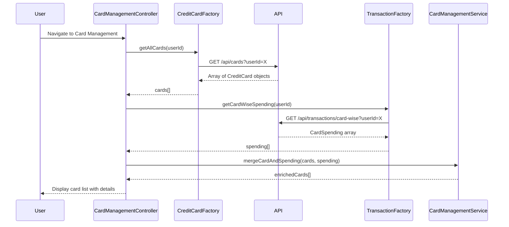

# Low-Level Design: QE-7745 - Credit Card Management and Tracking

## a. Architecture Mapping

**Component to Artifact Mapping:**
- User Interface → AngularJS Module (`cardManagementModule`) + Controller (`CardManagementController`)
- Card Management Service → AngularJS Service (`CardManagementService`) for business logic and state management
- Credit Card Data Service → AngularJS Factory (`CreditCardFactory`) for API calls to fetch card data
- Transaction Service → AngularJS Factory (`TransactionFactory`) for fetching card-wise spending data

**Recommended Folder Structure:**
```
app/
├── modules/
│   └── card-management/
│       ├── card-management.module.js
│       ├── controllers/
│       │   └── card-management.controller.js
│       ├── services/
│       │   └── card-management.service.js
│       ├── factories/
│       │   ├── credit-card.factory.js
│       │   └── transaction.factory.js
│       └── views/
│           └── card-management.html
```

## b. Component Specifications

| Component Name | Artifact Type | Responsibility | Key Dependencies |
|----------------|---------------|----------------|------------------|
| cardManagementModule | Module | Root module for card management feature | ngRoute, ngAnimate |
| CardManagementController | Controller | Manages card list UI, handles card selection and filtering | CardManagementService, CreditCardFactory, TransactionFactory |
| CardManagementService | Service | Maintains card state, applies filters, calculates card-wise spend | None |
| CreditCardFactory | Factory | Fetches all credit cards for a user from REST API | $http, $q |
| TransactionFactory | Factory | Fetches card-wise transaction data for spend analysis | $http, $q |

## c. Data Model

**CreditCard Model:**
```javascript
{
  cardId: String,
  cardNumber: String, // Masked (e.g., "**** **** **** 1234")
  cardType: String, // e.g., "Visa", "MasterCard"
  cardHolderName: String,
  creditLimit: Number,
  availableCredit: Number,
  outstandingBalance: Number,
  billingCycle: String // e.g., "01-30"
}
```

**CardSpending Model:**
```javascript
{
  cardId: String,
  currentMonthSpend: Number,
  lastMonthSpend: Number,
  totalTransactions: Number
}
```

## d. Data Flow

User navigates to Card Management view → CardManagementController calls CreditCardFactory.getAllCards() → Factory makes GET request to /api/cards → Card data returned and stored in controller scope → Controller calls TransactionFactory.getCardWiseSpending() → Spending data merged with card data → CardManagementService applies any active filters → Filtered card list displayed in view with card details (limits, balances, spending) → User selects a card to view detailed spending breakdown.

## e. Primary Sequence Diagram



## f. Implementation Notes

- Use AngularJS Dependency Injection to inject CreditCardFactory, TransactionFactory, and CardManagementService into CardManagementController.
- Optimize API calls by fetching all cards in a single request; use Promise.all to parallelize card and spending data retrieval.
- Implement ng-repeat with track by cardId for efficient DOM rendering of up to 20 cards.
- Use AngularJS filters for client-side card filtering (by card type, balance range, etc.).
- Apply Bootstrap grid system for responsive card layout (card tiles or list view).

## g. Error Handling

HTTP interceptor-based error handling; display user-friendly error messages using toastr; retry logic for transient failures in CreditCardFactory.

## h. Security Notes

Requires token-based auth via existing SSO; card numbers are masked on the server side before transmission; all API calls secured with JWT tokens.