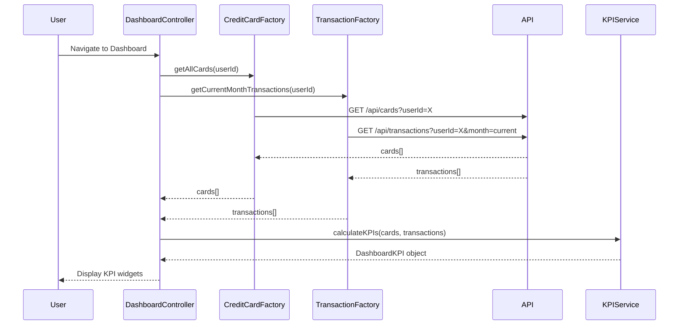

# Low-Level Design: QE-7746 - Dashboard and KPI Management

## a. Architecture Mapping

**Component to Artifact Mapping:**
- Dashboard Interface → AngularJS Module (`dashboardModule`) + Controller (`DashboardController`)
- KPI Calculation Engine → AngularJS Service (`KPIService`) for aggregating and calculating KPIs
- Credit Card Data Service → AngularJS Factory (`CreditCardFactory`) for fetching card data
- Transaction Data Service → AngularJS Factory (`TransactionFactory`) for fetching transaction data

**Recommended Folder Structure:**
```
app/
├── modules/
│   └── dashboard/
│       ├── dashboard.module.js
│       ├── controllers/
│       │   └── dashboard.controller.js
│       ├── services/
│       │   └── kpi.service.js
│       ├── factories/
│       │   ├── credit-card.factory.js
│       │   └── transaction.factory.js
│       └── views/
│           └── dashboard.html
```

## b. Component Specifications

| Component Name | Artifact Type | Responsibility | Key Dependencies |
|----------------|---------------|----------------|------------------|
| dashboardModule | Module | Root module for dashboard feature | ngRoute, ngAnimate |
| DashboardController | Controller | Manages dashboard UI, triggers KPI calculation and refresh | KPIService, CreditCardFactory, TransactionFactory |
| KPIService | Service | Calculates monthly spend, total credit limit, available credit, outstanding amount | None |
| CreditCardFactory | Factory | Fetches all credit cards with balances and limits | $http, $q |
| TransactionFactory | Factory | Fetches current month's transactions for spend calculation | $http, $q, $filter |

## c. Data Model

**DashboardKPI Model:**
```javascript
{
  monthlySpend: Number,
  totalCreditLimit: Number,
  availableCredit: Number,
  outstandingAmount: Number,
  lastUpdated: Date
}
```

**CreditCard Model:**
```javascript
{
  cardId: String,
  creditLimit: Number,
  availableCredit: Number,
  outstandingBalance: Number
}
```

**Transaction Model:**
```javascript
{
  id: String,
  cardId: String,
  amount: Number,
  date: Date,
  type: String // "debit" or "credit"
}
```

## d. Data Flow

User navigates to Dashboard → DashboardController initializes and calls CreditCardFactory.getAllCards() and TransactionFactory.getCurrentMonthTransactions() in parallel → Both API responses received → KPIService.calculateKPIs(cards, transactions) aggregates data to compute monthly spend, total credit limit, available credit, and outstanding amount → Calculated KPIs bound to controller scope → Dashboard view displays KPI widgets with real-time values → Background $interval triggers periodic refresh every 30 seconds.

## e. Primary Sequence Diagram



## f. Implementation Notes

- Use AngularJS Dependency Injection to inject KPIService, CreditCardFactory, and TransactionFactory into DashboardController.
- Leverage $q.all() to parallelize API calls for cards and transactions to meet the 2-second load time requirement.
- Implement $interval for periodic KPI refresh (every 30 seconds) with cancellation on scope destroy to prevent memory leaks.
- Use AngularJS $filter('currency') for formatting monetary values in the view.
- Apply Bootstrap cards or panels for responsive KPI widget layout.

## g. Error Handling

HTTP interceptor captures API errors; fallback to cached KPI data if available; user notification via toastr on failure; retry mechanism for transient errors.

## h. Security Notes

Requires token-based auth via existing SSO; all API calls include Authorization header with JWT token; KPI data is user-specific and access-controlled.