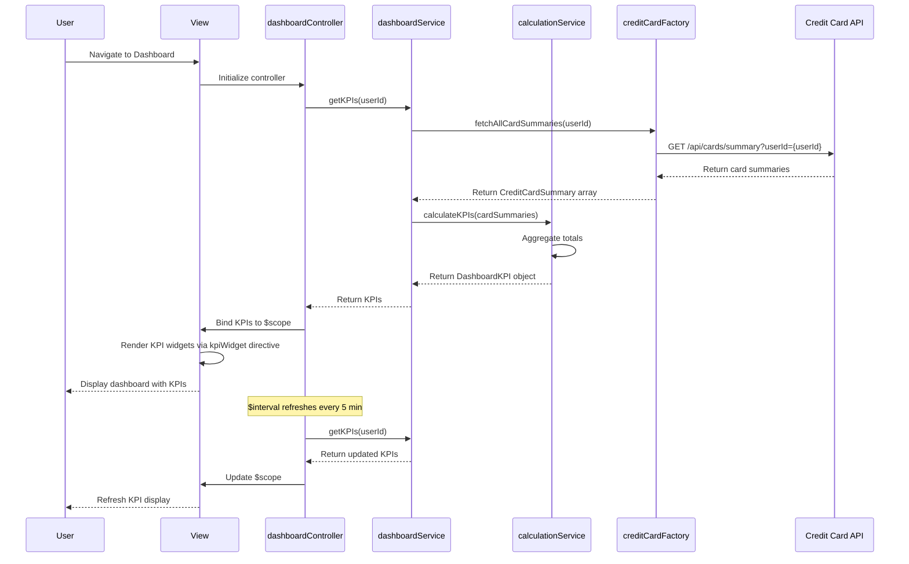

# Low-Level Design: QE-7746 - Dashboard and KPI Management

## a. Architecture Mapping

**Component to AngularJS Artifact Mapping:**
- Dashboard Service → AngularJS Service (`dashboardService.js`) for KPI calculation and aggregation logic
- Credit Card Data Service Integration → AngularJS Factory (`creditCardFactory.js`) for card data REST API calls
- Calculation Engine Integration → AngularJS Service (`calculationService.js`) for KPI computation
- Dashboard UI → AngularJS Controller (`dashboardController.js`) + View (`dashboard.html`)
- KPI Widget Component → AngularJS Directive (`kpiWidget.directive.js`) for reusable KPI display

**Recommended Folder Structure:**
```
app/
├── modules/
│   └── dashboard/
│       ├── controllers/
│       │   └── dashboardController.js
│       ├── services/
│       │   ├── dashboardService.js
│       │   └── calculationService.js
│       ├── factories/
│       │   └── creditCardFactory.js
│       ├── directives/
│       │   └── kpiWidget.directive.js
│       └── views/
│           └── dashboard.html
```

## b. Component Specifications

| Component Name | Artifact Type | Responsibility | Key Dependencies |
|----------------|---------------|----------------|------------------|
| dashboardModule | Module | Root module for dashboard feature | angular, ngRoute |
| dashboardController | Controller | Manages dashboard view state and KPI data binding | dashboardService, $scope, $interval |
| dashboardService | Service | Orchestrates KPI data retrieval and aggregation across multiple cards | creditCardFactory, calculationService |
| calculationService | Service | Performs KPI calculations (total limit, available credit, outstanding, monthly spend) | None |
| creditCardFactory | Factory | REST API calls to credit card data service for card balances and transactions | $http, $q |
| kpiWidget | Directive | Reusable component for displaying individual KPI with icon, label, and value | None |

## c. Data Model

**DashboardKPI Model:**
```javascript
{
  monthlySpend: Number,
  totalCreditLimit: Number,
  availableCredit: Number,
  outstandingAmount: Number,
  lastUpdated: Date
}
```

**CreditCardSummary Model:**
```javascript
{
  cardId: String,
  creditLimit: Number,
  currentBalance: Number,
  availableCredit: Number,
  monthlySpend: Number
}
```

## d. Data Flow

User navigates to the Dashboard view, triggering `dashboardController` initialization. The controller calls `dashboardService.getKPIs(userId)`, which invokes `creditCardFactory.fetchAllCardSummaries(userId)` to retrieve card data via REST API. The factory returns an array of `CreditCardSummary` objects. `dashboardService` passes this data to `calculationService`, which aggregates values to compute total credit limit (sum of all card limits), available credit (sum of available credit across cards), outstanding amount (sum of current balances), and monthly spend (sum of monthly spend across cards). The aggregated `DashboardKPI` object is returned to the controller and bound to `$scope.kpis`. The `kpiWidget` directive renders each KPI. `$interval` service refreshes KPI data every 5 minutes to maintain real-time visibility.

## e. Primary Sequence Diagram



## f. Implementation Notes

- Use AngularJS Dependency Injection to inject `dashboardService`, `calculationService`, and `creditCardFactory` into `dashboardController`
- Implement `$interval` service to auto-refresh KPI data every 5 minutes for real-time updates
- Use ES6 classes for services with arrow functions for cleaner, more maintainable code
- Cache KPI data in `dashboardService` to reduce API calls and improve performance
- Implement responsive Bootstrap grid layout for KPI widgets to support desktop, tablet, and mobile devices

## g. Error Handling

HTTP interceptor captures API errors; fallback to last cached KPI values; user notifications displayed via toastr.

## h. Security Notes

Requires token-based auth via existing SSO; all API calls secured with JWT tokens; standard input validation applied.