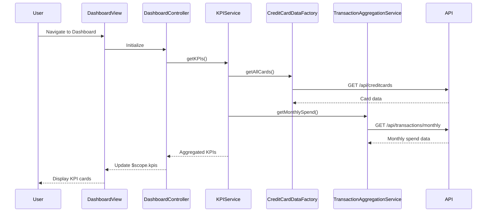

# Low-Level Design: Credit Card Dashboard and KPI Management
**Epic ID:** QE-7795  
**Epic Title:** PERFTEST20261109161809-Credit Card Dashboard and KPI Management

---

## a. Architecture Mapping

- **Dashboard UI** → AngularJS Module (`creditCardDashboardModule`) with Controller (`DashboardController`) and View template
- **KPI Management Service** → AngularJS Service (`KPIService`) for aggregating and computing KPIs
- **Credit Card Data Source** → AngularJS Factory (`CreditCardDataFactory`) for REST API integration
- **Transaction Data Aggregation Service** → AngularJS Service (`TransactionAggregationService`) for monthly spend calculations

**Recommended Folder Structure:**
```
app/
├── modules/dashboard/
│   ├── dashboard.module.js
│   ├── dashboard.controller.js
│   ├── dashboard.view.html
├── services/
│   ├── kpi.service.js
│   ├── transaction-aggregation.service.js
├── factories/
│   ├── credit-card-data.factory.js
├── models/
│   ├── kpi.model.js
```

---

## b. Component Specifications

| Component Name | Artifact Type | Responsibility | Key Dependencies |
|---|---|---|---|
| DashboardController | Controller | Manages dashboard view state, fetches KPIs, handles user interactions | KPIService, $scope |
| KPIService | Service | Aggregates KPI data from multiple sources, computes derived metrics | CreditCardDataFactory, TransactionAggregationService, $http |
| CreditCardDataFactory | Factory | Fetches credit card details, limits, and balances from REST API | $http, $q |
| TransactionAggregationService | Service | Retrieves and aggregates monthly spend and outstanding amounts | $http, $q |
| DashboardView | View/Template | Displays KPI cards (monthly spend, credit limit, available credit, outstanding) with responsive layout | Bootstrap CSS, AngularJS directives |

---

## c. Data Model

**KPI Model (`kpi.model.js`):**
```javascript
{
  monthlySpend: Number,           // Total spend for current month
  totalCreditLimit: Number,       // Sum of all card limits
  availableCredit: Number,        // Total available credit across cards
  outstandingAmount: Number,      // Total outstanding balance
  lastUpdated: Date               // Timestamp of last data refresh
}
```

**Credit Card Model:**
```javascript
{
  cardId: String,
  cardNumber: String,
  cardType: String,
  creditLimit: Number,
  availableBalance: Number,
  outstandingBalance: Number
}
```

---

## d. Data Flow

User loads the dashboard → DashboardController initializes and calls KPIService.getKPIs() → KPIService concurrently invokes CreditCardDataFactory.getAllCards() and TransactionAggregationService.getMonthlySpend() → Both services make REST API calls to backend endpoints → Responses are aggregated and computed (total credit limit = sum of all card limits, available credit = sum of available balances) → KPIService returns consolidated KPI object → DashboardController updates $scope.kpis → View renders KPI cards with data-binding, displaying metrics in responsive Bootstrap grid.

---

## e. Primary Sequence Diagram



---

## f. Implementation Notes

- Use AngularJS Dependency Injection to inject KPIService and data factories into DashboardController for testability and modularity.
- Implement caching in KPIService using $cacheFactory to store KPI data for 60 seconds to reduce API calls and meet 2-second load requirement.
- Use $q.all() to parallelize API calls to CreditCardDataFactory and TransactionAggregationService for faster data retrieval.
- Apply Bootstrap responsive grid (col-xs, col-sm, col-md) in dashboard.view.html to ensure mobile and desktop compatibility.
- Use ES6 arrow functions and const/let in service implementations for cleaner, modern JavaScript code.

---

## g. Error Handling

HTTP interceptor captures API errors; user-friendly notifications displayed via toastr or AngularJS $mdToast; retry logic in services for transient failures.

---

## h. Security Notes

Standard input validation and secure API calls assumed; token-based authentication via existing SSO integrated in $http interceptor.

---