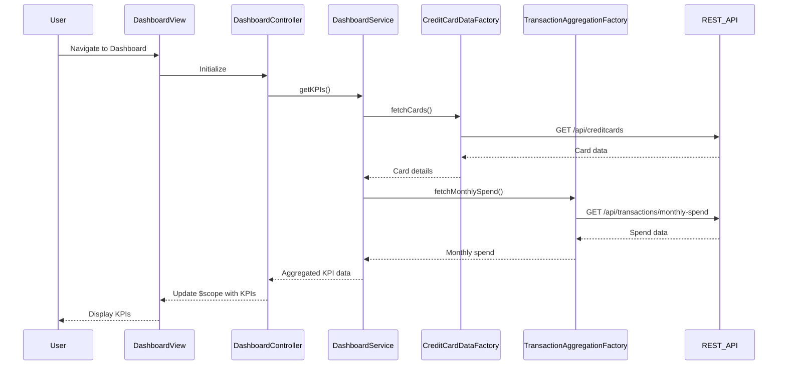

# Low-Level Design: Credit Card Dashboard and KPI Management
**Epic ID:** QE-7795  
**Technology Stack:** AngularJS 1.x, JavaScript ES6, HTML5, CSS3, Bootstrap, REST APIs, MVC Architecture

---

## a. Architecture Mapping

- **User Interface - Dashboard** → AngularJS Module (`dashboardModule`) + Controller (`DashboardController`) + View Template (`dashboard.html`)
- **Dashboard Service** → AngularJS Service (`DashboardService`) for orchestrating KPI data retrieval
- **Credit Card Data Source** → REST API integration via AngularJS Factory (`CreditCardDataFactory`)
- **Transaction Aggregation Service** → REST API integration via AngularJS Factory (`TransactionAggregationFactory`)
- **KPI Calculation Engine** → Server-side logic; client consumes calculated KPIs via REST endpoints

**Recommended Folder Structure:**
```
/app
  /modules
    /dashboard
      dashboard.module.js
      dashboard.controller.js
      dashboard.html
  /services
    dashboard.service.js
  /factories
    creditCardData.factory.js
    transactionAggregation.factory.js
  /models
    kpi.model.js
```

---

## b. Component Specifications

| **Component Name** | **Artifact Type** | **Responsibility** | **Key Dependencies** |
|--------------------|-------------------|--------------------|----------------------|
| `dashboardModule` | Module | Defines the dashboard feature module | `ngRoute`, `ui.bootstrap` |
| `DashboardController` | Controller | Manages dashboard view state, fetches KPI data, handles user interactions | `DashboardService`, `$scope` |
| `DashboardService` | Service | Orchestrates data retrieval from multiple factories, aggregates KPI data | `CreditCardDataFactory`, `TransactionAggregationFactory` |
| `CreditCardDataFactory` | Factory | Fetches credit card details, limits, balances from REST API | `$http`, `API_ENDPOINTS` |
| `TransactionAggregationFactory` | Factory | Fetches aggregated transaction and spend data from REST API | `$http`, `API_ENDPOINTS` |
| `kpiModel` | Model | Defines KPI data structure (monthlySpend, totalCreditLimit, availableCredit, outstandingAmount) | None |

---

## c. Data Model

**KPI Model (`kpiModel`):**
```javascript
{
  monthlySpend: Number,          // Total spend for current month
  totalCreditLimit: Number,      // Sum of credit limits across all cards
  availableCredit: Number,       // Total available credit
  outstandingAmount: Number,     // Total outstanding balance
  cardCount: Number,             // Number of active credit cards
  lastUpdated: Date              // Timestamp of last data refresh
}
```

**Credit Card Model (`creditCardModel`):**
```javascript
{
  cardId: String,
  cardNumber: String,
  cardType: String,
  creditLimit: Number,
  availableCredit: Number,
  outstandingBalance: Number
}
```

---

## d. Data Flow

User accesses the dashboard view, triggering `DashboardController` initialization. The controller invokes `DashboardService.getKPIs()`, which in turn calls `CreditCardDataFactory.fetchCards()` and `TransactionAggregationFactory.fetchMonthlySpend()` to retrieve data from REST APIs. The service aggregates responses into a unified KPI model and returns it to the controller. The controller binds the KPI data to `$scope`, and AngularJS's two-way data binding updates the dashboard view with monthly spend, total credit limit, available credit, and outstanding amount displayed using Bootstrap-styled KPI cards.

---

## e. Primary Sequence Diagram



---

## f. Implementation Notes

- Use AngularJS Dependency Injection to inject `DashboardService` into `DashboardController` and factories into the service for loose coupling.
- Implement ES6 classes for factories and services where appropriate; use arrow functions for callbacks to maintain lexical `this` context.
- Leverage `$http` service with promise-based API calls; handle responses using `.then()` and `.catch()` for error handling.
- Use Bootstrap grid system and responsive utility classes to ensure dashboard adapts to mobile, tablet, and desktop viewports.
- Implement `$q.all()` to parallelize API calls for credit card data and transaction aggregation, improving load performance.

---

## g. Error Handling

HTTP interceptor captures API errors; user-friendly notifications displayed via Bootstrap alerts; fallback to cached data if available.

---

## h. Security Notes

Requires token-based authentication via existing SSO; all API calls include authorization headers with JWT tokens.

---